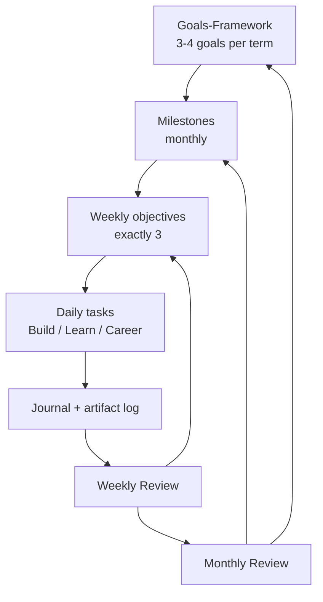

# Command Center

The Command Center is the control loop for everything else in Engineering OS. It turns long-term goals into today's tasks, then feeds what actually happened back into the plan.

## Live State vs Markdown

| Where | What it holds | Persistence |
|---|---|---|
| Web app `/today` | Today's targets, focus blocks, checklist ticks | Your browser (localStorage). Clearing site data or switching browser loses it. |
| Web app `/command-center` | Week and month view, goals, metrics | Your browser (localStorage) |
| Markdown files in this folder | Templates and the reasoning behind them | Git. Copy a template into your own notes folder to keep a permanent record. |

If you need a durable history (for a retrospective, a résumé or a portfolio), export or copy entries from the browser into Markdown at the weekly review.

## The Loop

| Cadence | Time | Template | Question it answers |
|---|---|---|---|
| Daily, morning | 5 min | [[Daily-Dashboard]] | What single artifact will exist tonight? |
| Daily, evening | 5-10 min | [[Daily-Dashboard]] shutdown + [[Engineering-Journal-Template]] | What happened and what is tomorrow's first block? |
| Weekly, Sunday | 60 min | [[Weekly-Review]] | Is the system compounding? What are next week's 3 outcomes? |
| Monthly | 90 min | [[Monthly-Review]] | Are milestones on track? What to cut, what to double down on? |
| Per term | 2-3 h | [[Goals-Framework]], [[Engineering-Roadmap-Template]] | Which goals matter for the next 3-6 months? |
| When needed | 10 min | [[Decision-Log-Template]] | Why did I choose this, and when do I revisit it? |
| When it happens | 2 min | [[Achievement-Log-Template]] | What evidence will I use in résumés and interviews? |
| Rarely | 72 h | [[72-Hour-Execution-Plan]] | Standing up a new system fast |

## Rules

1. Every daily task traces upward to a weekly objective, milestone and goal. Tasks that trace to nothing are either admin or distraction.
2. Metrics measure outputs you control, not hours logged or streaks for their own sake. See [[Metrics-Definitions]].
3. Reviews are where plans change. Don't re-plan mid-week unless a deadline moved.
4. Record decisions and achievements when they happen. Reconstructing them later is slow and inaccurate.

## Other Hubs

- Academic work: [[Academic-Index]]
- Research work: [[Research-OS-Index]]
- Historical inventory (needs refresh): [[Asset-Manifest]]
