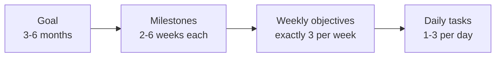

# Goals Framework

A four-level cascade. Each level is written differently, reviewed at a different cadence, and must link to the level above it.

| Level | Horizon | How many | Written as | Reviewed in |
|---|---|---|---|---|
| Goal | term / 3-6 months | 3-4 max | Outcome + why it matters | [[Monthly-Review]] |
| Milestone | 2-6 weeks | 3-5 per goal | Verifiable state: "X exists / passes / is submitted" | [[Monthly-Review]] |
| Weekly objective | 1 week | 3 total | Shippable noun | [[Weekly-Review]] |
| Daily task | 1 day | 1 per mission slot | Action that finishes in one focus block | [[Daily-Dashboard]] |

## Writing Rules

- **Goal**: an outcome you'd be glad to have in six months. "Get a backend internship for summer" beats "get better at backend".
- **Milestone**: something a friend could verify without asking you. "Rate limiter service deployed with load test report in README" beats "learn system design".
- **Weekly objective**: a noun you can link to. "3 DSA pattern notes with solved problems" beats "practice DSA".
- **Daily task**: fits in a 60-90 min block. If it doesn't, split it.
- A level with nothing linking down to it this month is **dormant**. Either schedule it or remove it at the monthly review.
- Keep goals across areas limited: typically one each for academic, career/skills, and one project or research goal.

## Worked Example

| Level | Example |
|---|---|
| Goal | Secure a backend or security internship for next summer |
| Milestone 1 | Résumé with 2 shipped projects reviewed by two seniors (due week 4) |
| Milestone 2 | 60 DSA problems across 12 patterns, each with a pattern note (due week 8) |
| Milestone 3 | 25 targeted applications sent with referrals asked for 10 (due week 10) |
| Weekly objective (week 3) | Project README with architecture diagram and load-test numbers |
| Daily task (Tue) | Write the load-test script and record p50/p95 latency |

## Template

### Goal 1:

- Why it matters:
- Success looks like (observable):
- Deadline:

| # | Milestone | Due | Status |
|---|---|---|---|
| 1 | | | |
| 2 | | | |
| 3 | | | |

- [ ] Milestone 1 done
- [ ] Milestone 2 done
- [ ] Milestone 3 done

### Goal 2:

- Why it matters:
- Success looks like:
- Deadline:

| # | Milestone | Due | Status |
|---|---|---|---|
| 1 | | | |

### Goal 3:

- Why it matters:
- Success looks like:
- Deadline:

| # | Milestone | Due | Status |
|---|---|---|---|
| 1 | | | |

For multi-term skill paths use [[Engineering-Roadmap-Template]]; record why a goal was added or dropped in [[Decision-Log-Template]].
