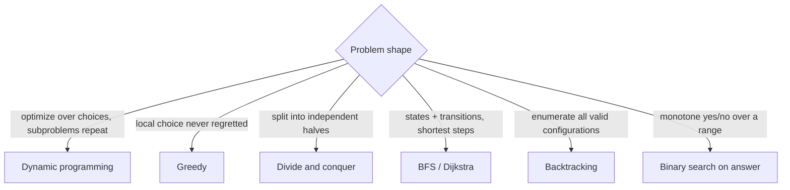

# Algorithms Overview

Hub: [[CS-Core-Index]] · [[CS-Core-Curriculum]]

## Core Idea

An algorithm is a finite procedure with a correctness argument and a cost. Most problems you'll meet fall into a handful of **design paradigms** — brute force, divide and conquer, greedy, dynamic programming, graph search — and the skill is recognizing which paradigm the problem's structure permits, then proving (at least informally) that it works.

## Roadmap

1. [[Big-O-Notation]] — worst/average/amortized; recurrences and the Master theorem
2. [[Recursion-and-Stack-Frames]] — base case, recursion depth, converting to iteration
3. [[Sorting-Algorithms]] — merge sort, quicksort, heap sort, counting/radix; stability; the Ω(n log n) comparison bound
4. [[Binary-Search]] — on arrays and on monotone answer spaces
5. Divide and conquer — merge sort, quickselect, closest pair
6. Greedy — exchange arguments; interval scheduling, Huffman coding ([[Greedy-Pattern]])
7. [[Dynamic-Programming]] — state, transition, order of evaluation ([[DP-Pattern]])
8. [[Graph-Traversal-BFS-DFS]] — then Dijkstra, Bellman-Ford, topological sort, MST (Kruskal/Prim)
9. Beyond: string algorithms (KMP, rolling hash), randomized algorithms, NP-hardness ([[Theory-of-Computation]])
10. Capstone: for 10 mixed problems, name the paradigm before coding and justify it in one sentence

## Key Concepts

| Paradigm | Signal in the problem | Classic example |
|---|---|---|
| Divide and conquer | Independent subproblems that combine | Merge sort, O(n log n) |
| Greedy | Local choice provably safe (exchange argument) | Interval scheduling by earliest finish |
| Dynamic programming | Overlapping subproblems + optimal substructure | Edit distance, knapsack |
| BFS | Shortest path in unweighted graph | Word ladder |
| Dijkstra | Shortest path, non-negative weights | Routing ([[IP-Routing]]) |
| Topological sort | Dependencies in a DAG | Build systems, course schedule |
| Binary search on answer | Monotone feasibility predicate | Minimum capacity to ship in D days |

Master theorem (common case): T(n) = a·T(n/b) + O(n^d) gives O(n^d) if d > log_b a, O(n^d log n) if d = log_b a, and O(n^(log_b a)) if d < log_b a.

## Notes

- [[Big-O-Notation]] · [[Sorting-Algorithms]] · [[Binary-Search]] · [[Recursion-and-Stack-Frames]] · [[Dynamic-Programming]] · [[Graph-Traversal-BFS-DFS]]
- Interview pattern drills: [[Two-Pointer-Pattern]], [[Sliding-Window-Pattern]], [[Backtracking-Pattern]], [[Intervals-Pattern]], [[Bit-Manipulation-Pattern]]

## Interview Questions (with answers)

- **Why is comparison sorting Ω(n log n)?** — A comparison sort is a binary decision tree with at least n! leaves; its height is at least log2(n!) = Θ(n log n).
- **Quicksort worst case and how to avoid it?** — O(n²) when pivots are consistently extreme (e.g. sorted input with first-element pivot); use random or median-of-three pivots, or introsort, which falls back to heap sort.
- **Why doesn't Dijkstra work with negative edges?** — It finalizes a node when popped, assuming no later path can be shorter; a negative edge can violate that. Use Bellman-Ford.
- **Greedy vs DP?** — Greedy commits to one choice per step and needs a proof that the choice is safe; DP considers all choices for each subproblem and reuses results.
- **How do you detect a cycle in a directed graph?** — DFS with three colors: reaching a gray (on-stack) node means a back edge, i.e. a cycle. Or Kahn's algorithm: if topological sort can't output all nodes, there is a cycle.
- **What is a stable sort and when does it matter?** — Equal keys keep their original relative order; it matters when sorting by multiple keys in passes (sort by secondary key, then stable-sort by primary).

## Coding Exercises

- [ ] Merge sort and randomized quicksort; count comparisons on sorted vs random input
- [ ] Quickselect for k-th smallest in expected O(n)
- [ ] Dijkstra with a binary heap; Bellman-Ford with negative-cycle detection
- [ ] Topological sort (Kahn's algorithm) on a course-prerequisite graph
- [ ] Edit distance bottom-up, then reduce memory to O(min(m, n))
- [ ] Kruskal's MST using union-find

## Connections

- **System design** — consistent hashing, rate-limiting algorithms (token bucket), scheduling, and route computation are algorithms under operational constraints; external merge sort underlies database sorts larger than memory.
- **Cybersecurity** — algorithmic-complexity attacks (hash flooding, ReDoS, quadratic parsers) turn worst cases into denial of service; cryptography rests on problems believed hard (factoring, discrete log). See [[Applied-Cryptography]].
- **AI** — gradient descent is an iterative optimization algorithm; beam search and dynamic programming (e.g. Viterbi) appear in decoding; nearest-neighbor search powers retrieval ([[RAG-Retrieval-Augmented-Generation]]).

## Related

- [[Data-Structures-Overview]]
- [[Theory-of-Computation]]
