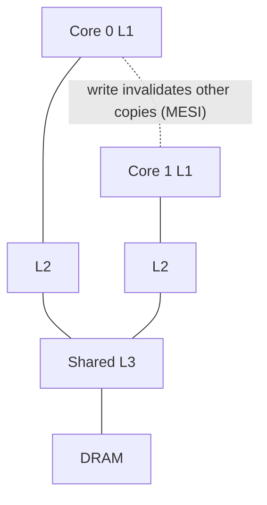

# CPU Caches and Memory Hierarchy

Hub: [[Computer-Architecture]] · [[CS-Core-Curriculum]]

## Core Idea

Processors are much faster than DRAM, so hardware stacks memories from small/fast/expensive to large/slow/cheap:

**registers → L1 → L2 → L3 (often shared) → DRAM → SSD/HDD**

Caches work because programs exhibit **locality**:

- **Temporal** — recently used data is likely to be used again.
- **Spatial** — data near recently used data is likely to be used soon.

Data moves in fixed-size **cache lines** (64 bytes on most modern x86 and many ARM cores). Latencies differ by orders of magnitude between levels; exact cycle counts depend on the microarchitecture.

> TODO: add measured latencies for a specific CPU if you need concrete numbers; avoid quoting generic figures as facts.

## Mechanism

### Cache organization

An address is split into **tag | index | offset**:

- **Offset** — byte within the line (6 bits for 64 B lines).
- **Index** — which set.
- **Tag** — identifies which memory line occupies a slot.

| Organization | Placement | Trade-off |
|---|---|---|
| Direct-mapped | Each line maps to exactly one slot | Fast, but conflict misses |
| N-way set-associative | Line can go in any of N slots in its set | Balance of speed and hit rate |
| Fully associative | Any slot | Fewest conflicts, expensive lookup (used for TLBs) |

**Replacement**: LRU or pseudo-LRU approximations within a set.

### The 3 C's of misses

- **Compulsory** — first access to a line.
- **Capacity** — working set larger than the cache.
- **Conflict** — too many lines map to the same set.

(A 4th C in multicore: **coherence** misses.)

### Write policies

- **Write-through** — update cache and next level every write (simpler, more traffic).
- **Write-back** — mark line dirty; write when evicted (common for L1/L2/L3).
- **Write-allocate** vs **no-write-allocate** on write misses.

### Coherence

Each core has private caches, so writes must be kept consistent. Protocols like **MESI** (Modified, Exclusive, Shared, Invalid) track line state; a write by one core invalidates copies in others.



**Average memory access time:** `AMAT = hit_time + miss_rate × miss_penalty` (apply recursively per level).

## Worked Example

### Row-major vs column-major traversal

```c
#define N 4096
static int a[N][N];

long sum_rows(void) {          // cache-friendly: sequential in memory
    long s = 0;
    for (int i = 0; i < N; i++)
        for (int j = 0; j < N; j++) s += a[i][j];
    return s;
}

long sum_cols(void) {          // strided by N*4 bytes: new line almost every access
    long s = 0;
    for (int j = 0; j < N; j++)
        for (int i = 0; i < N; i++) s += a[i][j];
    return s;
}
```

Both are O(N²), yet `sum_cols` is typically several times slower. The row version uses all 16 ints of each 64-byte line; the column version uses one before the line is likely evicted. This is also why arrays usually beat linked lists in practice ([[Arrays-vs-Linked-Lists]]).

### AMAT calculation

L1 hit = 1 cycle, L1 miss rate = 5%, L2 hit = 10 cycles, L2 miss rate (local) = 20%, DRAM = 200 cycles.

`AMAT = 1 + 0.05 × (10 + 0.2 × 200) = 1 + 0.05 × 50 = 3.5 cycles`

### Address breakdown

32 KiB, 8-way, 64 B lines → 32768 / 64 = 512 lines / 8 = 64 sets → 6 index bits, 6 offset bits, remaining bits are tag.

### False sharing

```cpp
struct Counters { std::atomic<long> a; std::atomic<long> b; };   // same line
struct Padded   { alignas(64) std::atomic<long> a; alignas(64) std::atomic<long> b; };
```

Two threads incrementing `a` and `b` in `Counters` bounce one cache line between cores; `Padded` avoids it.

```bash
perf stat -e cache-references,cache-misses,L1-dcache-load-misses ./app
lscpu | grep -i cache
```

## Pitfalls

- Treating Big-O as the whole story: constant factors from cache misses often dominate ([[Big-O-Notation]]).
- False sharing between per-thread counters.
- Power-of-two strides causing conflict misses in set-associative caches.
- Confusing cache coherence (single location consistency) with memory consistency/ordering (across locations; needs fences/atomics).
- Benchmarking with a cold cache or with data that fits in cache when production data won't.

## Interview Questions

**Q: Why do caches work?**
A: Temporal and spatial locality: programs reuse recent data and access nearby addresses, so keeping recent lines close to the CPU gives high hit rates.

**Q: Direct-mapped vs set-associative?**
A: Direct-mapped allows one location per line (fast, conflict-prone); N-way lets a line sit in any of N slots in its set, reducing conflict misses at some lookup cost.

**Q: Write-back vs write-through?**
A: Write-back delays writes to lower levels until eviction (less bandwidth, needs dirty bits); write-through propagates every write (simpler, more traffic).

**Q: What is false sharing?**
A: Independent variables on the same cache line written by different cores, causing coherence invalidations as if they were shared. Fix with padding/alignment or per-thread data.

**Q: Why is iterating a linked list slower than an array of the same length?**
A: Nodes are scattered, so each step may be a cache miss and the hardware prefetcher can't predict addresses; arrays are contiguous.

**Q: What is MESI?**
A: A cache coherence protocol where each line is Modified, Exclusive, Shared, or Invalid, coordinating reads and writes across cores.

## Connections

- **System Design:** The same hierarchy logic drives application caches (in-process → Redis → DB → disk), cache hit ratios, and data layout choices (columnar stores). See [[System-Design-Basics]], [[Database-Indexing]].
- **Cybersecurity:** Cache timing side channels (Flush+Reload, Prime+Probe) leak secrets and underpin Spectre/Meltdown; constant-time crypto avoids secret-dependent memory access. See [[Applied-Cryptography]].
- **AI:** GPU kernel performance (e.g., FlashAttention) comes from tiling computation to fit fast on-chip memory (SRAM) instead of repeatedly hitting HBM. See [[Transformer-Architecture]].

## Related

[[Pipelining-and-Branch-Prediction]] · [[Virtual-Memory-and-Paging]] · [[Arrays-vs-Linked-Lists]] · [[Synchronization-Primitives]] · [[Big-O-Notation]] · [[Computer-Architecture]]
