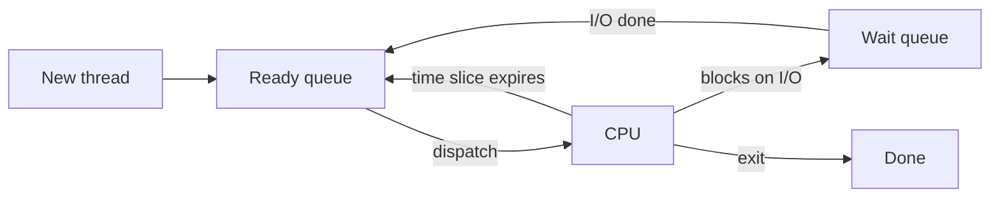

# CPU Scheduling

Hub: [[Operating-Systems]] · [[CS-Core-Curriculum]]

## Core Idea

When more threads are **ready** than there are cores, the scheduler decides who runs and for how long. Every policy trades off between:

- **Throughput** — jobs completed per unit time.
- **Turnaround time** — completion time minus arrival time.
- **Waiting time** — time spent in the ready queue.
- **Response time** — arrival to first run (matters for interactive work).
- **Fairness** — no thread starves.

**Preemptive** schedulers can take the CPU away (timer interrupt); **non-preemptive** ones wait until the thread blocks or exits.

## Mechanism



### Classic algorithms

| Algorithm | Rule | Strength | Weakness |
|---|---|---|---|
| FCFS | Run in arrival order, non-preemptive | Simple | Convoy effect: short jobs wait behind long ones |
| SJF | Shortest next CPU burst first | Optimal average waiting time (non-preemptive, all jobs known) | Needs burst prediction; long jobs can starve |
| SRTF | Preemptive SJF (shortest remaining time) | Optimal average waiting among preemptive | Same prediction/starvation issues |
| Round Robin | Each thread gets a quantum `q`, then goes to back of queue | Good response time | Large `q` → FCFS; tiny `q` → context-switch overhead |
| Priority | Highest priority first | Expresses importance | Starvation → fix with **aging** |
| MLFQ | Multiple queues; new jobs start high, drop if they use full quanta | Favors interactive/I/O-bound without knowing bursts | Tuning; gaming by yielding just before quantum ends (fixed with accounting + periodic boost) |

Burst prediction for SJF typically uses exponential averaging: `τ(n+1) = α·t(n) + (1−α)·τ(n)`.

### Linux

- **CFS** (Completely Fair Scheduler, default from 2.6.23): tracks each task's `vruntime` (runtime weighted by nice value) in a red-black tree and runs the task with the smallest `vruntime`.
- **EEVDF** (Earliest Eligible Virtual Deadline First) replaced CFS's core policy in Linux 6.6, adding latency-aware deadlines.
- Real-time classes `SCHED_FIFO` and `SCHED_RR` always beat normal tasks; `SCHED_DEADLINE` implements EDF.

### Multiprocessor concerns

Per-core run queues with **load balancing**; **processor affinity** keeps a thread on a core to reuse warm caches ([[CPU-Caches-and-Memory-Hierarchy]]).

### Priority inversion

A low-priority thread holds a lock that a high-priority thread needs, while a medium-priority thread preempts the low one. Fix: **priority inheritance** (the lock holder temporarily inherits the waiter's priority). The Mars Pathfinder resets in 1997 are the famous example.

## Worked Example

Processes (all arrive at t=0): P1=24, P2=3, P3=3 (burst times).

**FCFS (P1, P2, P3):**

```
| P1 0-24 | P2 24-27 | P3 27-30 |
waiting: P1=0, P2=24, P3=27 → avg = 17
```

**SJF (P2, P3, P1):**

```
| P2 0-3 | P3 3-6 | P1 6-30 |
waiting: P2=0, P3=3, P1=6 → avg = 3
```

**Round Robin, q=4:**

```
| P1 0-4 | P2 4-7 | P3 7-10 | P1 10-14 | P1 14-18 | ... P1 ends at 30
waiting: P1 = 30-24 = 6, P2 = 4, P3 = 7 → avg ≈ 5.67
```

RR has worse average waiting than SJF here but much better response time for P2/P3 than FCFS.

Inspecting/controlling on Linux:

```bash
nice -n 10 ./batch_job          # lower priority (higher nice)
renice -n -5 -p <pid>           # raise priority (needs privilege)
chrt -f 50 ./rt_task            # SCHED_FIFO priority 50
taskset -c 0,1 ./app            # CPU affinity
```

## Pitfalls

- Computing turnaround vs waiting incorrectly: `turnaround = completion − arrival`; `waiting = turnaround − burst`.
- Forgetting arrival times in Gantt-chart problems.
- Assuming "higher nice = higher priority" — it is the opposite on Unix.
- Running CPU-bound work in `SCHED_FIFO` can starve the whole system.
- Thinking SJF is practical as-is: exact bursts are unknown.

## Interview Questions

**Q: Preemptive vs non-preemptive scheduling?**
A: Preemptive can interrupt a running thread (timer/higher-priority arrival); non-preemptive lets it run until it blocks or finishes.

**Q: What is the convoy effect?**
A: In FCFS, many short jobs queue behind one long CPU-bound job, inflating average waiting time and underutilizing I/O devices.

**Q: How does Round Robin quantum size matter?**
A: Too large degenerates to FCFS; too small spends much time in context switches. It should be large relative to switch cost but small enough for responsiveness.

**Q: How does MLFQ approximate SJF?**
A: Jobs that use their full quantum are demoted, so short/interactive jobs stay in high-priority queues; periodic priority boosts prevent starvation.

**Q: What is priority inversion and its fix?**
A: High-priority task blocked by a lower one holding a lock while a medium task runs; fixed with priority inheritance or priority ceiling.

**Q: How does Linux CFS choose the next task?**
A: It picks the runnable task with the smallest weighted `vruntime` from a red-black tree (EEVDF has replaced this core policy since 6.6).

## Connections

- **System Design:** Request queues, thread pools, and Kubernetes CPU requests/limits (CFS bandwidth throttling) are scheduling in disguise; tail latency often comes from throttling. See [[System-Design-Basics]].
- **Cybersecurity:** Fork bombs and CPU exhaustion are DoS vectors mitigated by cgroups limits.
- **AI:** GPU job schedulers and LLM inference batchers make similar throughput vs latency trade-offs.

## Related

[[Processes-and-Threads]] · [[Synchronization-Primitives]] · [[Deadlocks]] · [[Concurrency-Basics]] · [[CPU-Caches-and-Memory-Hierarchy]] · [[Operating-Systems]]
