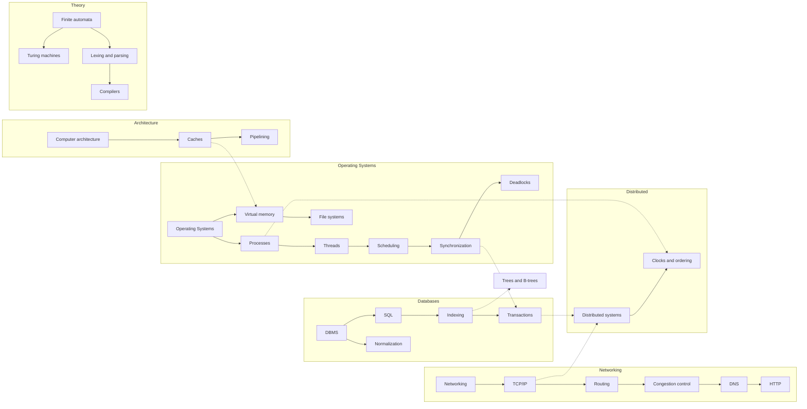

# CS Core Curriculum

Hub: [[CS-Core-Index]]

## How to Use This

Work subject by subject, but not strictly in sequence: DS + Algorithms run continuously alongside everything else. For each concept note, finish its interview questions out loud and do at least one coding exercise from the subject hub before ticking it off. Every subject hub ends with **System design**, **Cybersecurity**, and **AI** connections — read them; they are what turn trivia into engineering judgment.

## Concept Map

Dotted edges are cross-subject dependencies worth noticing: MMU/TLB hardware underpins virtual memory; database isolation is synchronization at a larger scale; distributed systems combine networking and transactions.

## Suggested Order

| Phase | Subjects | Why this order |
|---|---|---|
| 1. Foundations | Data Structures, Algorithms, OOP | Vocabulary for everything else; heaviest interview weight |
| 2. Machine | Computer Architecture, Operating Systems | How programs actually run |
| 3. Communication and data | Computer Networks, DBMS | How programs talk and remember |
| 4. Scale | Distributed Systems | Combines phases 2–3 under failure |
| 5. Languages and limits | Compiler basics, Theory of Computation | How code becomes execution; what is computable |
| 6. Practice | Software Engineering | Shipping and maintaining all of the above with a team |

## Per-Subject Roadmap

### Data Structures — [[Data-Structures-Overview]]
- [ ] [[Big-O-Notation]] and amortized analysis
- [ ] [[Arrays-vs-Linked-Lists]]
- [ ] [[Hash-Tables]]
- [ ] [[Trees-and-BSTs]]
- [ ] Heaps, tries, union-find (see hub exercises)

### Algorithms — [[Algorithms-Overview]]
- [ ] [[Recursion-and-Stack-Frames]]
- [ ] [[Sorting-Algorithms]]
- [ ] [[Binary-Search]]
- [ ] [[Dynamic-Programming]]
- [ ] [[Graph-Traversal-BFS-DFS]]

### Operating Systems — [[Operating-Systems]]
- [ ] [[Processes-and-Threads]]
- [ ] [[CPU-Scheduling]]
- [ ] [[Synchronization-Primitives]] (with [[Concurrency-Basics]])
- [ ] [[Deadlocks]]
- [ ] [[Virtual-Memory-and-Paging]]
- [ ] [[File-Systems]]

### Computer Networks — [[Computer-Networks]]
- [ ] [[TCP-vs-UDP]]
- [ ] [[IP-Routing]]
- [ ] [[TCP-Congestion-Control]]
- [ ] [[DNS]]
- [ ] [[HTTP-Evolution]]

### DBMS — [[DBMS]]
- [ ] [[SQL-Joins-and-Query-Plans]]
- [ ] [[Database-Indexing]]
- [ ] [[Transactions-and-Isolation-Levels]]
- [ ] [[Normalization]]

### OOP — [[OOP-Concepts]]
- [ ] Four pillars, abstract class vs interface, SOLID ([[OOP-Concepts]])
- [ ] Language specifics: [[Java-Interview-Essentials]], [[Cpp-Interview-Essentials]]

### Computer Architecture — [[Computer-Architecture]]
- [ ] [[CPU-Caches-and-Memory-Hierarchy]]
- [ ] [[Pipelining-and-Branch-Prediction]]

### Distributed Systems — [[Distributed-Systems]]
- [ ] [[Clocks-and-Ordering]]
- [ ] Replication, quorums, consensus (in the hub)

### Compiler Basics — [[Compilers-and-Interpreters]]
- [ ] [[Lexing-and-Parsing]]
- [ ] IR, optimization, code generation (in the hub)

### Theory of Computation — [[Theory-of-Computation]]
- [ ] [[Finite-Automata-and-Regular-Languages]]
- [ ] [[Turing-Machines-and-Decidability]]

### Software Engineering — [[Software-Engineering]]
- [ ] [[Testing-Strategies]]
- [ ] [[Version-Control-Internals]]

## Completion Bar per Subject

- [ ] Can explain every concept note's Core Idea in under 30 seconds
- [ ] Answered every interview question in the hub aloud without notes
- [ ] Completed at least two coding exercises from the hub
- [ ] Can name one system-design, one security, and one AI connection from memory

Back to [[Home]]
