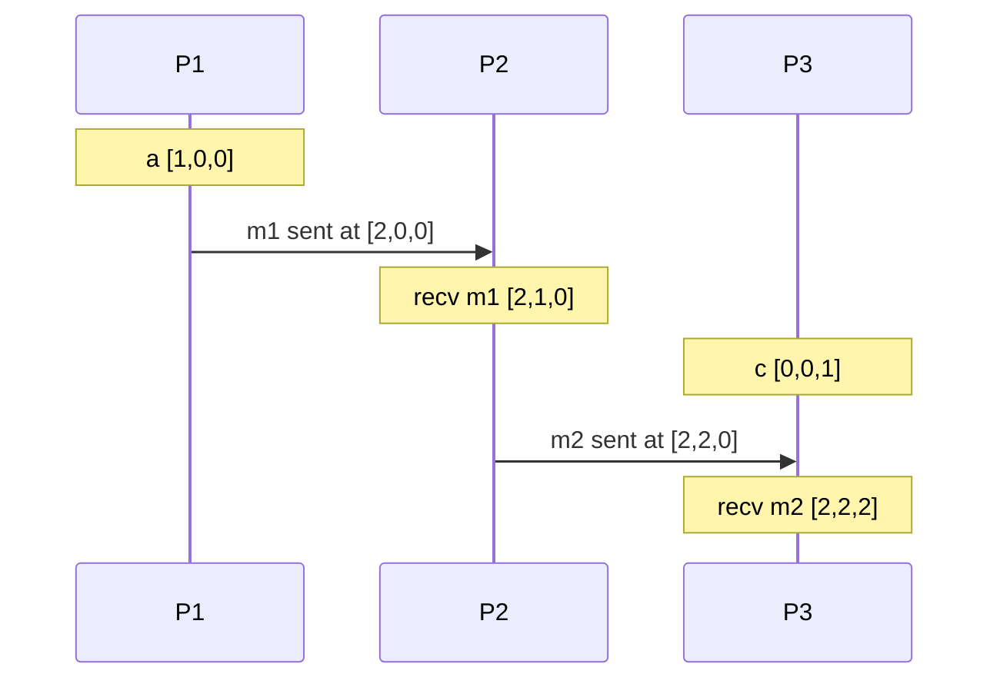

# Clocks and Ordering

Hub: [[Distributed-Systems]] · [[CS-Core-Curriculum]]

## Core Idea

In one process, "what happened first" is obvious. Across machines it is not: there is no shared clock, messages have variable delay, and each machine's clock drifts. Many correctness properties (last-writer-wins, snapshot reads, lease expiry, log ordering) depend on ordering, so distributed systems use either:

- **Physical clocks**, synchronised as well as possible, with explicit error bounds, or
- **Logical clocks**, which ignore wall time and capture **causality** directly.

## Mechanism

### Physical clocks

- **Drift:** quartz oscillators run slightly fast or slow and vary with temperature.
- **Skew:** the difference between two clocks at the same instant.
- **NTP** estimates offset from a request/response exchange: with client send t1, server receive t2, server send t3, client receive t4, offset ≈ ((t2 − t1) + (t3 − t4)) / 2, assuming symmetric network delay. Asymmetric paths create error NTP cannot see.
- **Time-of-day clocks can jump** (NTP step, manual change, leap second handling). **Monotonic clocks** only move forward but are meaningless across machines. Measure durations with monotonic clocks.

### Happens-before (Lamport, 1978)

`a → b` if:
1. a and b are in the same process and a comes first, or
2. a is sending a message and b is receiving that message, or
3. transitively, a → c and c → b.

If neither a → b nor b → a, the events are **concurrent** (`a ∥ b`). This is a partial order.

### Lamport clocks

Each process keeps a counter `L`.
- Before each local event or send: `L = L + 1`; attach L to messages.
- On receive with timestamp `t`: `L = max(L, t) + 1`.

Guarantee: `a → b ⇒ L(a) < L(b)`. The converse does **not** hold. Break ties with process ID to get a **total order** consistent with causality (used for total-order broadcast and mutual exclusion).

### Vector clocks

Each process i keeps a vector `V[1..n]`.
- Local event/send: `V[i] += 1`; attach V.
- Receive W: `V[k] = max(V[k], W[k])` for all k, then `V[i] += 1`.

Compare: `V ≤ W` iff every entry ≤. Then `a → b ⇔ V(a) < V(b)` (≤ and not equal), and incomparable vectors mean concurrent. Cost: O(n) per timestamp. Used for conflict detection in Dynamo-style stores (often as version vectors per replica).

### Hybrid logical clocks (HLC)

An HLC timestamp is `(l, c)`: `l` tracks the maximum physical time seen, `c` is a logical counter breaking ties when physical time hasn't advanced. It stays close to wall time (useful for queries like "as of 10:00"), preserves `a → b ⇒ hlc(a) < hlc(b)`, and fits in 64 bits. CockroachDB uses HLCs.

### TrueTime (Google Spanner)

`TT.now()` returns an interval `[earliest, latest]` guaranteed to contain true time, using GPS and atomic clocks to keep the uncertainty small. A committing transaction picks timestamp s and **commit-waits** until `TT.now().earliest > s` before making the commit visible. This makes timestamp order match real-time order (external consistency) at the cost of waiting out the uncertainty.

## Worked Example

Three processes, vector clocks `[P1, P2, P3]`:

- `a [1,0,0]` vs `recv m2 [2,2,2]`: every entry ≤ and not equal, so a → recv m2 (causal chain through P2).
- `c [0,0,1]` vs `recv m1 [2,1,0]`: neither dominates, so they are **concurrent**.

With Lamport clocks, c might get L = 1 and recv m1 L = 3. The comparison 1 < 3 wrongly suggests an order; Lamport clocks cannot detect concurrency.

## Pitfalls

- **Last-writer-wins by wall clock silently loses writes** when a node with a fast clock overwrites a causally later update from a node with a slow clock.
- **Using `time.time()` for timeouts or leases.** A clock jump can expire a lease early or late. Use monotonic clocks for durations, and fencing tokens for leases.
- **Assuming Lamport order = causality.** `L(a) < L(b)` does not imply a → b.
- **Vector clock growth** with many clients; systems bound it with per-server version vectors or pruning (which can cause false conflicts).
- **Ignoring clock error bounds.** Without a bound (as TrueTime provides), you cannot safely derive real-time ordering from timestamps.

## Interview Questions

**Q: Why not just use NTP-synchronised timestamps to order events?**
A: NTP leaves skew (depends on network asymmetry and load), clocks can jump, and two events within the skew window can be misordered. Correctness should not depend on unbounded clock accuracy.

**Q: Difference between Lamport and vector clocks?**
A: Lamport gives a single integer with `a → b ⇒ L(a) < L(b)` only. Vector clocks give an n-entry vector where `a → b ⇔ V(a) < V(b)`, so they detect concurrency, at O(n) size.

**Q: What does "concurrent" mean in a distributed system?**
A: Neither event could have influenced the other: no happens-before path either way, regardless of their wall-clock times.

**Q: How does Spanner get external consistency?**
A: TrueTime bounds clock uncertainty; a transaction commit-waits until its timestamp is guaranteed past on every clock, so later-starting transactions always get larger timestamps.

**Q: Why do databases use HLCs?**
A: They give causally consistent timestamps that stay close to physical time, so they support snapshot reads by time without per-node vectors.

## Connections

- **System Design:** conflict resolution in replicated stores, event ordering in logs and message queues, idempotency windows, and lease design all depend on these ideas. See [[System-Design-Basics]] and [[Transactions-and-Isolation-Levels]] (MVCC snapshot timestamps).
- **Cybersecurity:** TLS certificate validity, Kerberos tickets, and TOTP codes depend on roughly correct clocks; clock manipulation can make expired credentials look valid. Log correlation in incident response needs synchronised time. See [[Applied-Cryptography]].

## Related

- [[Distributed-Systems]]
- [[Transactions-and-Isolation-Levels]]
- [[DBMS]]
- [[Computer-Networks]]
- [[System-Design-Basics]]
