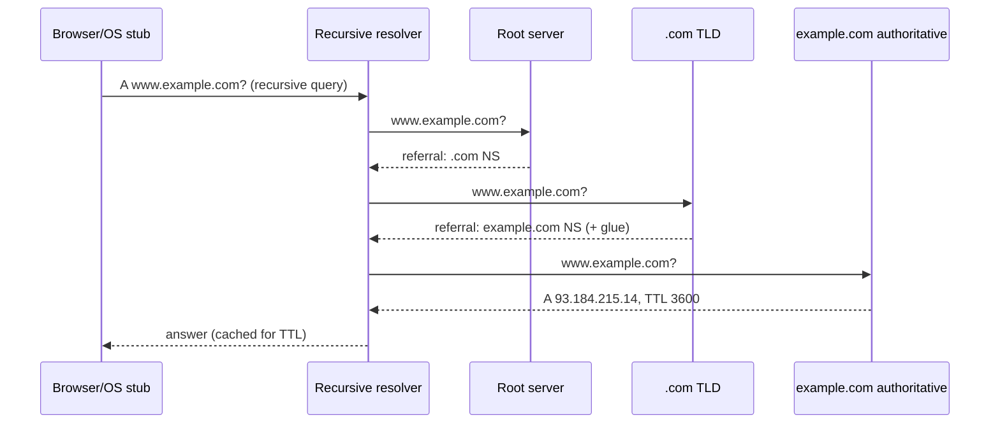

# DNS

Hub: [[Computer-Networks]] · [[CS-Core-Curriculum]]

## Core Idea

DNS maps human-friendly names (`www.example.com`) to data, most often IP addresses. It is a **distributed, hierarchical, heavily cached** database:

- **Root** servers know the TLD servers.
- **TLD** servers (`.com`, `.in`, `.org`) know which name servers are authoritative for each domain.
- **Authoritative** servers hold the actual records for a zone.

No single server knows everything. Delegation (NS records) splits responsibility, and caching with **TTLs** keeps load manageable.

## Mechanism

### Resolution



- The **stub resolver** (in the OS) sends a **recursive** query: "give me the final answer".
- The **recursive resolver** (ISP, 1.1.1.1, 8.8.8.8, or corporate) does **iterative** queries, following referrals down the tree, and caches every step.
- **Glue records** supply the IPs of name servers that sit inside the zone they serve, which avoids a circular lookup.
- Caches exist at many layers: browser, OS, resolver. Negative answers (NXDOMAIN) are cached too, with the TTL taken from the SOA record.
- Transport is UDP/53 by default. TCP is used for large responses (truncated flag), zone transfers (AXFR/IXFR), and often DNS over TLS (853). DNS over HTTPS runs on 443.

### Common record types

| Type | Purpose |
|---|---|
| A / AAAA | IPv4 / IPv6 address |
| CNAME | Alias to another name (cannot sit at the zone apex alongside other records) |
| NS | Delegates a zone to name servers |
| SOA | Zone metadata, serial, negative-cache TTL |
| MX | Mail servers with priority |
| TXT | Arbitrary text (SPF, DKIM, domain verification) |
| SRV | Service location (host + port) |
| PTR | Reverse lookup (IP → name) |
| CAA | Which CAs may issue certificates |

## Worked Example

```bash
dig www.example.com A +short          # final answer
dig +trace www.example.com            # walk root -> TLD -> authoritative
dig example.com NS                    # delegated name servers
dig example.com MX
dig -x 8.8.8.8                        # reverse (PTR)
dig @1.1.1.1 example.com +dnssec      # query a specific resolver, request DNSSEC
nslookup example.com                  # available on Windows too
```

**TTL trade-off during a migration**: if the A record has TTL 86400 (1 day), clients may keep using the old IP for up to a day after a change. Common practice is to lower the TTL (e.g., to 300 s) at least one old-TTL period before the cutover, switch, then raise it again afterwards.

**DNS-based load balancing**: return multiple A records, or answer by the client's location (GeoDNS). Failover is only as fast as the TTL and client caching allow.

## Pitfalls

- Expecting DNS changes to be instant. Caches honor TTLs, and some clients ignore them.
- Putting a CNAME at the apex (`example.com`). It is invalid alongside SOA/NS records. Providers offer ALIAS/ANAME flattening instead.
- Forgetting that negative caching makes an "NXDOMAIN" linger after you add a record.
- Blaming the app for latency that is really slow DNS. Measure resolution time separately.
- Firewalls that block TCP/53 break large responses, including DNSSEC.

## Interview Questions

**Q: What happens when you type a URL? (DNS part)**
A: The browser and OS caches are checked first. On a miss, the stub asks a recursive resolver, which iteratively queries root, TLD, and authoritative servers, caches the answers by TTL, and returns the IP.

**Q: Recursive vs iterative query?**
A: With a recursive query, the client asks the server to do the full lookup and return the final answer. With an iterative query, the server returns the best referral it has, and the asker follows it.

**Q: Why does DNS use UDP?**
A: Small, single request/response exchanges. UDP avoids handshake latency and connection state on busy servers. TCP is used when needed.

**Q: A vs CNAME?**
A: An A record maps a name to an IPv4 address. A CNAME maps a name to another name, which must then be resolved.

**Q: What is DNS cache poisoning and how is it mitigated?**
A: Injecting forged responses into a resolver's cache, for example the Kaminsky attack. Mitigations are randomized source ports and query IDs, 0x20 case randomization, and DNSSEC signatures that let resolvers validate authenticity.

## Connections

- **System Design:** Service discovery, GeoDNS, CDN request routing, and blue/green cutovers use DNS. TTLs bound how fast failover can be. See [[System-Design-Basics]], [[IP-Routing]].
- **Cybersecurity:** Cache poisoning, DNS hijacking, subdomain takeover (dangling CNAMEs), DNS tunneling for exfiltration, and amplification DDoS. DNS logs are a high-value detection source. DoH/DoT add privacy, and CAA plus DNS-based ACME challenges tie DNS to certificate issuance. See [[Network-Security]], [[Security-Logging-and-Detection]], [[TLS-Handshake]].

## Related

[[TCP-vs-UDP]] · [[IP-Routing]] · [[HTTP-Evolution]] · [[TLS-Handshake]] · [[Computer-Networks]]
