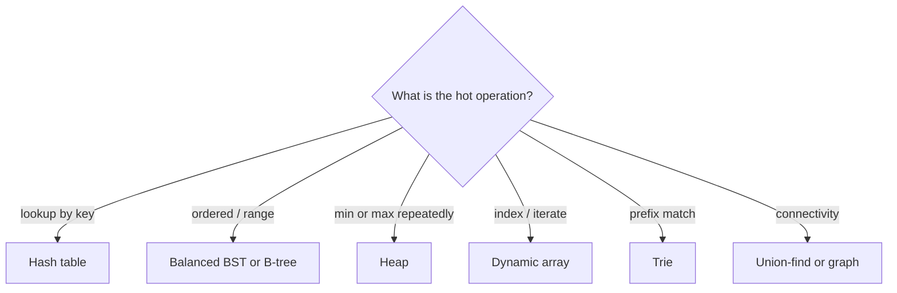

# Data Structures Overview

Hub: [[CS-Core-Index]] · [[CS-Core-Curriculum]]

## Core Idea

A data structure is a memory layout plus a set of operations with known costs. Choosing one means asking: **which operations are hot** (lookup, insert, ordered iteration, min/max, prefix search), and **what memory layout makes them cheap** on real hardware. Asymptotic cost decides at scale; cache behavior decides at every scale ([[CPU-Caches-and-Memory-Hierarchy]]).

## Roadmap

1. [[Big-O-Notation]] — including amortized analysis (dynamic array growth)
2. [[Arrays-vs-Linked-Lists]] — contiguous vs linked; dynamic arrays
3. Stacks, queues, deques — and their array/linked implementations
4. [[Hash-Tables]] — hashing, collisions, load factor, resizing
5. [[Trees-and-BSTs]] — traversals, balanced trees (AVL, red-black), B-trees ([[Database-Indexing]])
6. Heaps and priority queues — binary heap in an array
7. Graphs — adjacency list vs matrix ([[Graph-Traversal-BFS-DFS]])
8. Tries, union-find, segment/Fenwick trees — specialized tools
9. Capstone: implement an LRU cache (hash map + doubly linked list) with O(1) get/put

## Key Concepts — Operation Cost Table

| Structure | Access / search | Insert | Delete | Notes |
|---|---|---|---|---|
| Dynamic array | O(1) index / O(n) search | O(1) amortized at end, O(n) middle | O(n) middle | Best cache locality |
| Linked list | O(n) | O(1) given node | O(1) given node | Pointer chasing is cache-unfriendly |
| Hash table | O(1) average, O(n) worst | O(1) average | O(1) average | No ordering |
| Balanced BST | O(log n) | O(log n) | O(log n) | Ordered iteration, range queries |
| Binary heap | O(1) min/max | O(log n) | O(log n) pop | Array-backed, no search |
| Trie | O(L) for key length L | O(L) | O(L) | Prefix queries |
| Union-find | ~O(α(n)) find/union | — | — | With path compression + union by rank |

## Notes

- [[Arrays-vs-Linked-Lists]] · [[Hash-Tables]] · [[Trees-and-BSTs]] · [[Recursion-and-Stack-Frames]]
- Patterns that use them: [[Heap-Pattern]], [[Union-Find-Pattern]], [[BFS-DFS-Pattern]]

## Interview Questions (with answers)

- **Why is appending to a dynamic array O(1) amortized?** — Capacity grows geometrically (e.g. doubling), so the total copying over n appends is O(n), i.e. O(1) per append on average.
- **How would you implement an LRU cache?** — Hash map from key to node in a doubly linked list ordered by recency; get moves the node to the front, put inserts at the front and evicts from the tail — both O(1).
- **Why is a heap stored in an array?** — A complete binary tree maps perfectly to indices (children of i at 2i+1 and 2i+2), which needs no pointers and is cache-friendly.
- **When does a hash table degrade to O(n)?** — When many keys collide (poor hash or adversarial input) or the load factor isn't controlled.
- **BST vs hash table?** — BST gives ordering, range queries, and predictable O(log n) worst case when balanced; hash tables give faster average point lookups but no order.
- **Stack using queues / queue using stacks?** — Queue with two stacks: push onto `in`; on pop, if `out` is empty move everything from `in` to `out`; each element moves at most once, so operations are O(1) amortized.

## Coding Exercises

- [ ] Dynamic array with doubling; measure resize count
- [ ] Hash map with separate chaining and resizing
- [ ] Binary heap: push, pop, heapify in O(n)
- [ ] LRU cache in O(1)
- [ ] Trie with insert, search, and startsWith
- [ ] Union-find with path compression and union by rank

## Connections

- **System design** — caches (LRU), rate limiters (queues, sliding windows), database indexes (B+ trees, LSM trees), consistent hashing rings, and bloom filters are data structures at system scale.
- **Cybersecurity** — hash-flooding DoS exploits predictable hash functions (mitigated by keyed hashes such as SipHash); unchecked buffer indices are the root of many [[Memory-Safety]] bugs.
- **AI** — tensors are strided arrays; vector databases use graph-based approximate-nearest-neighbor indexes (e.g. HNSW); tokenizer vocabularies use tries/hash maps. See [[Embeddings]].

## Related

- [[Algorithms-Overview]]
- [[Computer-Architecture]]
- [[Database-Indexing]]
