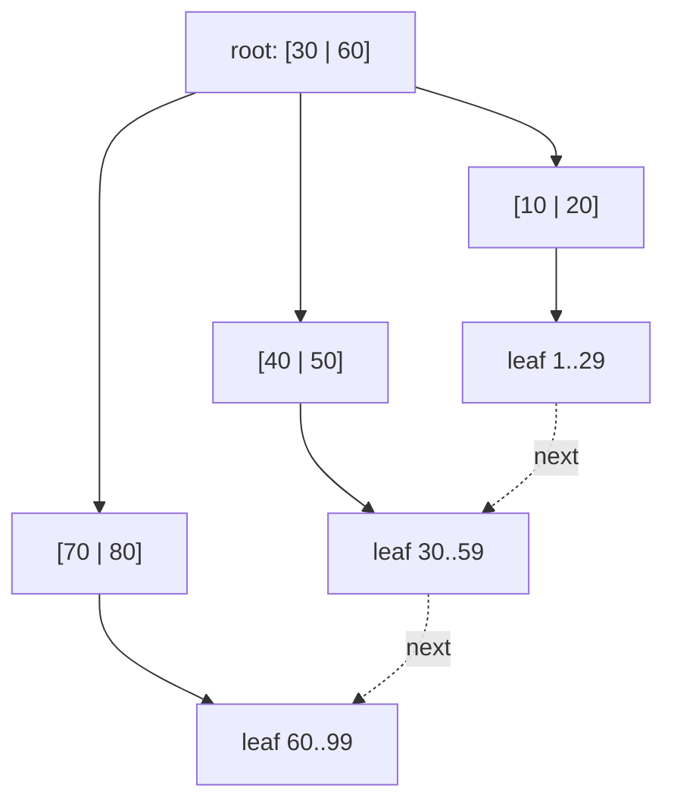

# Database Indexing

Hub: [[DBMS]] · [[CS-Core-Curriculum]]

## Core Idea

An index is an auxiliary data structure that maps key values to row locations, so the engine can find rows without scanning the whole table. It trades **extra storage and slower writes** for **faster reads**.

The two dominant families:

- **B+tree**: a balanced, high-fanout tree updated in place. It is the default in PostgreSQL, MySQL InnoDB, SQL Server, Oracle, and SQLite.
- **LSM-tree** (log-structured merge): buffers writes in memory, flushes them as sorted immutable files, and merges those files in the background. Used by RocksDB, LevelDB, Cassandra, and ScyllaDB, and as the storage engine under several distributed databases.

## Mechanism

### B+tree

- Internal nodes hold only keys and child pointers. **Leaves hold keys plus row pointers (or the rows themselves) and are linked**, so range scans walk the leaf level.
- Nodes are the size of a disk page (e.g., 8 KiB in PostgreSQL, 16 KiB in InnoDB), so fanout is in the hundreds and height stays small (3–4 levels covers a very large table).
- Lookup costs O(log_f N) page reads. Inserts can split nodes, and deletes can merge them.



### LSM-tree

1. A write is appended to the **WAL** (for durability) and inserted into the **memtable** (a sorted in-memory structure).
2. When the memtable is full, it is flushed as an immutable sorted file (an **SSTable**) at level 0.
3. **Compaction** merges SSTables into larger sorted runs, discarding overwritten values and tombstones.
4. A read checks the memtable, then SSTables from newest to oldest. **Bloom filters** skip files that can't contain the key.

### B+tree vs LSM

| | B+tree | LSM-tree |
|---|---|---|
| Writes | Random in-place page updates | Sequential appends; high write throughput |
| Reads | Predictable: one tree path | May check several files (mitigated by Bloom filters, compaction) |
| Range scans | Excellent (linked leaves) | Good, but must merge across runs |
| Amplification | Write amp from page rewrites; some space left free in pages | Write amp from compaction; read amp; space amp before compaction |
| Typical fit | OLTP with mixed reads and writes | Write-heavy, time-series, key-value |

### Index kinds

- **Clustered / primary**: table rows are stored in index order. InnoDB clusters on the primary key, and its secondary indexes store the PK value. PostgreSQL tables are **heaps**, and all indexes point to tuple IDs.
- **Secondary**: a separate structure pointing to rows.
- **Composite (multi-column)**: ordered by `(a, b, c)` lexicographically. It follows the **leftmost-prefix rule**: it helps predicates on `a`, on `a, b`, or on `a, b, c`, but not on `b` alone. Put equality columns first, then range or sort columns.
- **Covering**: the index contains every column a query needs, so it can answer the query without visiting the table (an **index-only scan**). PostgreSQL has `INCLUDE (...)`, and in InnoDB secondary indexes implicitly carry the PK.
- **Other types**: hash (equality only), GIN (inverted index for arrays, JSONB, full-text), GiST/R-tree (spatial), BRIN (block ranges for naturally ordered big tables), partial indexes (`WHERE active`), and expression indexes (`lower(email)`).

## Worked Example

```sql
CREATE TABLE orders (
  id BIGSERIAL PRIMARY KEY,
  customer_id BIGINT,
  status TEXT,
  created_at TIMESTAMPTZ,
  total NUMERIC
);

-- Query: recent orders for a customer
SELECT id, total FROM orders
WHERE customer_id = 42 AND created_at >= now() - interval '30 days'
ORDER BY created_at DESC;

-- Equality column first, then range/sort column; INCLUDE makes it covering
CREATE INDEX idx_orders_cust_created
  ON orders (customer_id, created_at DESC) INCLUDE (total);
```

- `WHERE customer_id = 42`: uses the index (leftmost prefix).
- `WHERE created_at > ...` alone: cannot seek with this index, because `created_at` is not the leading column.
- `WHERE customer_id = 42 ORDER BY created_at DESC`: the index order satisfies the sort, so no separate sort step is needed.
- Selecting `id, total`: an index-only scan is possible (in PostgreSQL, when the visibility map shows the pages all-visible).

```sql
EXPLAIN ANALYZE SELECT ...;     -- expect "Index Only Scan using idx_orders_cust_created"
CREATE INDEX CONCURRENTLY ...;  -- PostgreSQL: build without blocking writes
```

**Low selectivity:** an index on `status` with 3 distinct values is rarely useful for common values. The planner will often prefer a sequential scan, because random I/O to fetch a large fraction of rows costs more than scanning. A partial index such as `WHERE status = 'pending'` can help when the value you query is rare.

## Pitfalls

- Indexing every column: each index slows `INSERT`/`UPDATE`/`DELETE` and uses memory and disk.
- Wrong column order in composite indexes.
- Functions on indexed columns (`WHERE lower(email) = ...`) need a matching expression index.
- Implicit type casts (comparing a string column to a number) can disable index use.
- Leading-wildcard `LIKE '%abc'` can't use a B+tree. Use trigram (GIN/GiST) or full-text indexes.
- Random UUIDv4 primary keys in clustered indexes cause page splits and poor locality. Time-ordered IDs (UUIDv7, ULID) behave better.
- Assuming an index is used. Always check the plan.

## Interview Questions

**Q: Why B+tree rather than a binary search tree for disk-based indexes?**
A: High fanout means very few levels, so few page reads, and pages match disk/IO units. Linked leaves make range scans efficient. A BST would need about log2 N random reads.

**Q: What is a covering index?**
A: An index that contains all columns a query references, so the engine answers it from the index alone without fetching table rows.

**Q: Explain the leftmost-prefix rule.**
A: A composite index on (a, b, c) is sorted by a, then b, then c. It can seek on a prefix (a), (a, b), or (a, b, c), but not on b or c without a.

**Q: When would you choose an LSM-based store?**
A: For write-heavy workloads (logs, metrics, time series, large key-value datasets) where sequential writes and compression matter more than the lowest point-read latency.

**Q: Clustered vs non-clustered index?**
A: Clustered determines the physical row order, and there is only one per table. Non-clustered indexes are separate structures pointing to rows (by row ID or primary key).

## Connections

- **System Design:** Choosing a database often comes down to B+tree vs LSM trade-offs. Secondary indexes in sharded systems are either local (scatter-gather reads) or global (distributed writes). See [[System-Design-Basics]], [[Distributed-Systems]].
- **AI:** Vector databases use approximate nearest-neighbor indexes (HNSW graphs, IVF) instead of B+trees to search [[Embeddings]] for [[RAG-Retrieval-Augmented-Generation]].
- **Cybersecurity:** Timing differences from index lookups can leak information, and unindexed queries on user-controlled filters can be abused for DoS.

## Related

[[SQL-Joins-and-Query-Plans]] · [[Transactions-and-Isolation-Levels]] · [[Normalization]] · [[Trees-and-BSTs]] · [[Binary-Search]] · [[File-Systems]] · [[DBMS]]
