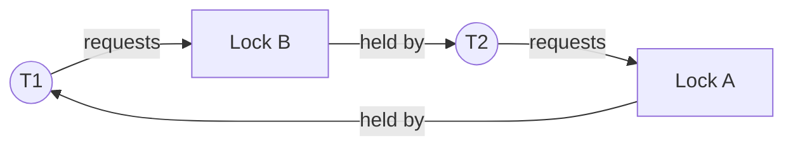

# Deadlocks

Hub: [[Operating-Systems]] · [[CS-Core-Curriculum]]

## Core Idea

A **deadlock** is a set of threads/processes each waiting for a resource held by another in the set, so none can proceed. It differs from:

- **Livelock** — threads keep changing state (e.g., backing off and retrying in lockstep) but make no progress.
- **Starvation** — a thread waits indefinitely while others progress.

Deadlock requires all four **Coffman conditions** simultaneously:

1. **Mutual exclusion** — a resource can be held by only one at a time.
2. **Hold and wait** — a holder may request more resources.
3. **No preemption** — resources can't be forcibly taken.
4. **Circular wait** — a cycle T1 → T2 → … → T1 of waits.

Break any one and deadlock is impossible.

## Mechanism

### Resource allocation graph

Edges: thread → resource (request), resource → thread (assignment).

- With **single-instance** resources, a cycle ⇔ deadlock.
- With **multi-instance** resources, a cycle is necessary but not sufficient.



### Four strategies

| Strategy | Approach | Cost |
|---|---|---|
| Prevention | Structurally break a condition: global lock ordering (circular wait), acquire all at once (hold and wait), `trylock` + release (no preemption) | Lower concurrency or retries |
| Avoidance | Grant a request only if the system stays in a **safe state** (Banker's algorithm) | Needs max demand in advance; O(m·n²) per check |
| Detection & recovery | Let it happen, periodically find cycles (wait-for graph), then kill/rollback a victim | Lost work; detection overhead |
| Ignore (ostrich) | Assume rare; rely on reboot/timeouts | Most general-purpose OSes do this for user locks |

### Banker's algorithm (safety check)

Given `Available`, `Max`, `Allocation`, compute `Need = Max − Allocation`. Repeatedly find a process whose `Need ≤ Work`; pretend it finishes (`Work += Allocation[i]`). If all can finish, the state is safe.

## Worked Example

### Deadlock in code

```python
import threading, time
a, b = threading.Lock(), threading.Lock()

def t1():
    with a:
        time.sleep(0.1)
        with b: pass      # waits for b

def t2():
    with b:
        time.sleep(0.1)
        with a: pass      # waits for a -> cycle

threading.Thread(target=t1).start()
threading.Thread(target=t2).start()   # hangs
```

Fix by **lock ordering**: always acquire `a` before `b` (e.g., order by object id or account number). For a bank transfer, lock `min(from, to)` then `max(from, to)`.

### Banker's example

5 processes, 3 resource types, `Available = (3,3,2)`.

| P | Allocation | Max | Need |
|---|---|---|---|
| P0 | 0 1 0 | 7 5 3 | 7 4 3 |
| P1 | 2 0 0 | 3 2 2 | 1 2 2 |
| P2 | 3 0 2 | 9 0 2 | 6 0 0 |
| P3 | 2 1 1 | 2 2 2 | 0 1 1 |
| P4 | 0 0 2 | 4 3 3 | 4 3 1 |

- Work=(3,3,2): P1 fits → Work=(5,3,2)
- P3 fits → (7,4,3)
- P4 fits → (7,4,5)
- P0 fits → (7,5,5)
- P2 fits → (10,5,7)

Safe sequence: **P1, P3, P4, P0, P2**.

### Detecting in practice

```bash
jstack <pid>         # Java prints "Found one Java-level deadlock"
gdb -p <pid> -ex "thread apply all bt"   # inspect native thread stacks
```

Databases (PostgreSQL, MySQL InnoDB) detect deadlocks via wait-for graphs and abort one transaction with a deadlock error; the application should retry.

## Pitfalls

- Treating a cycle as sufficient with multi-instance resources.
- Hidden lock acquisition: calling a callback or library that takes its own locks while you hold one.
- Nested locks acquired in different orders on different code paths.
- Using timeouts as a "fix" without handling the failure path.
- Confusing unsafe state with deadlock: unsafe means deadlock is *possible*, not certain.
- Self-deadlock: re-locking a non-recursive mutex in the same thread.

## Interview Questions

**Q: What are the four necessary conditions for deadlock?**
A: Mutual exclusion, hold and wait, no preemption, circular wait.

**Q: Easiest practical prevention technique?**
A: Impose a global total order on locks and always acquire in that order, eliminating circular wait.

**Q: Deadlock avoidance vs prevention?**
A: Prevention designs out a Coffman condition statically; avoidance examines each request at runtime and grants it only if the resulting state is safe (Banker's).

**Q: How is deadlock detected?**
A: Build a wait-for graph and search for a cycle (DFS; see [[Graph-Traversal-BFS-DFS]]); for multi-instance resources use a Banker's-like detection algorithm.

**Q: Deadlock vs livelock?**
A: In deadlock threads are blocked; in livelock they are active but repeatedly react to each other without progress.

**Q: How do databases handle deadlock?**
A: They detect cycles among waiting transactions (or use timeouts / wait-die and wound-wait schemes) and abort a victim, which the client retries.

## Connections

- **System Design:** Distributed deadlocks across services/locks; mitigations include lock ordering, leases with expiry, and avoiding synchronous call cycles between services. See [[Distributed-Systems]], [[Transactions-and-Isolation-Levels]].
- **Cybersecurity:** Attackers can deliberately trigger deadlocks or lock contention as a denial-of-service.

## Related

[[Synchronization-Primitives]] · [[Processes-and-Threads]] · [[Transactions-and-Isolation-Levels]] · [[Graph-Traversal-BFS-DFS]] · [[Concurrency-Basics]] · [[Operating-Systems]]
