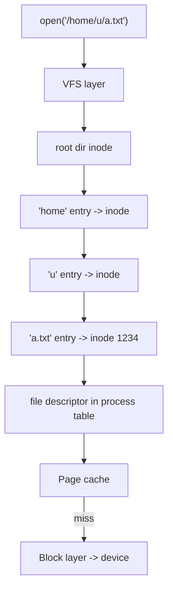

# File Systems

Hub: [[Operating-Systems]] · [[CS-Core-Curriculum]]

## Core Idea

A disk (HDD/SSD) exposes numbered **blocks**. A **file system** layers on top:

- **Files** — named byte sequences with metadata.
- **Directories** — maps from names to files.
- **Allocation** — which blocks belong to which file, and which are free.
- **Consistency** — surviving crashes without corruption.

On Unix, a file's metadata lives in an **inode** (size, owner, mode, timestamps, link count, block pointers). The **name** lives in a directory entry that points to the inode number. That separation is why hard links exist and why `rename` within a filesystem is cheap.

## Mechanism

### Path lookup and the VFS



The **VFS** gives one API (`open/read/write/stat`) over ext4, XFS, Btrfs, NFS, etc. Directory lookups are cached (dentry cache), file data in the **page cache**.

### Allocation methods

| Method | Idea | Pros | Cons |
|---|---|---|---|
| Contiguous | File occupies consecutive blocks | Fast sequential/random access | External fragmentation; hard to grow |
| Linked (FAT) | Each block points to the next (FAT keeps pointers in a table) | No external fragmentation | Slow random access |
| Indexed (Unix inode) | Inode holds direct pointers + single/double/triple indirect blocks | Fast random access, supports large files | Metadata overhead |
| Extents (ext4, XFS) | (start, length) runs | Compact metadata for large contiguous files | More complex |

### Crash consistency

A single `append` updates the data block, the inode, and the free-space bitmap. A crash in between leaves inconsistency.

- **fsck**: scan and repair after crash — slow on large disks.
- **Journaling** (write-ahead logging): write intended changes to a journal, commit, then apply ("checkpoint"). ext4 default mode `data=ordered` journals metadata and writes data before committing metadata.
- **Copy-on-write** (Btrfs, ZFS): never overwrite in place; write new blocks and atomically switch the root pointer. Enables cheap snapshots.

### Durability

`write()` returns once data is in the page cache, **not** on disk. `fsync(fd)` forces the file's data and metadata to stable storage. Creating or renaming a file also requires `fsync` on the **parent directory** for the entry to be durable.

## Worked Example

### Inodes and links

```bash
echo hi > a.txt
ln a.txt hard.txt        # same inode, link count 2
ln -s a.txt soft.txt     # new inode storing the path "a.txt"
ls -li a.txt hard.txt soft.txt
rm a.txt                 # hard.txt still works; soft.txt now dangles
stat hard.txt            # Links: 1
df -i                    # inode usage; you can run out of inodes before space
```

### Max file size with indexed allocation

4 KiB blocks, 4-byte pointers → 1024 pointers per indirect block. Classic ext2/3 inode: 12 direct + 1 single + 1 double + 1 triple indirect.

`(12 + 1024 + 1024² + 1024³) × 4 KiB ≈ 4 TiB` of addressable blocks (ext3 has other limits in practice).

### Atomic file replace (safe config write)

```python
import os
def atomic_write(path, data: bytes):
    tmp = path + ".tmp"
    with open(tmp, "wb") as f:
        f.write(data)
        f.flush()
        os.fsync(f.fileno())          # data durable
    os.replace(tmp, path)             # atomic rename on POSIX
    dfd = os.open(os.path.dirname(path) or ".", os.O_RDONLY)
    os.fsync(dfd); os.close(dfd)      # directory entry durable
```

Readers see either the old or the new file, never a half-written one.

## Pitfalls

- Assuming `write()` or `close()` means durable.
- Forgetting to `fsync` the directory after create/rename.
- Deleting a file that a process still has open: space isn't freed until the last descriptor closes (a common "disk full but du shows nothing" puzzle; check `lsof +L1`).
- Hard links can't cross file systems or (normally) point to directories.
- Running out of inodes with many tiny files.
- Treating network file systems (NFS) as having local semantics for locking and consistency.

## Interview Questions

**Q: What is an inode and what doesn't it contain?**
A: A metadata structure (permissions, owner, size, timestamps, block pointers, link count). It does not contain the file name; names live in directory entries.

**Q: Hard link vs symbolic link?**
A: A hard link is another directory entry for the same inode; a symlink is a separate file containing a path, which can dangle and cross file systems.

**Q: What does journaling guarantee?**
A: After a crash, replaying/discarding the journal returns metadata (and data, depending on mode) to a consistent state without a full scan. It doesn't guarantee un-fsynced data survives.

**Q: What does fsync do and why is it slow?**
A: It flushes the file's dirty pages and metadata to stable storage, waiting for the device (including cache flush), which costs real device latency.

**Q: How does the OS make repeated reads fast?**
A: The page cache keeps file pages in RAM; readahead prefetches sequential blocks.

**Q: Journaling vs copy-on-write file systems?**
A: Journaling logs changes before updating in place; CoW writes new blocks and swaps pointers atomically, enabling snapshots and checksums but can fragment.

## Connections

- **System Design:** Databases implement their own WAL plus `fsync` discipline on top of files; log-structured storage (LSM trees, Kafka segments) relies on sequential appends. See [[Database-Indexing]], [[Transactions-and-Isolation-Levels]].
- **Cybersecurity:** Permission bits, setuid, ACLs, and symlink races (TOCTOU) are file-system attack surface; deleted files are often recoverable forensically until blocks are reused. See [[Least-Privilege]], [[Security-Logging-and-Detection]].
- **Version control:** Git's object store is a content-addressed file layout. See [[Version-Control-Internals]].

## Related

[[Virtual-Memory-and-Paging]] · [[Processes-and-Threads]] · [[Database-Indexing]] · [[Transactions-and-Isolation-Levels]] · [[Version-Control-Internals]] · [[Operating-Systems]]
