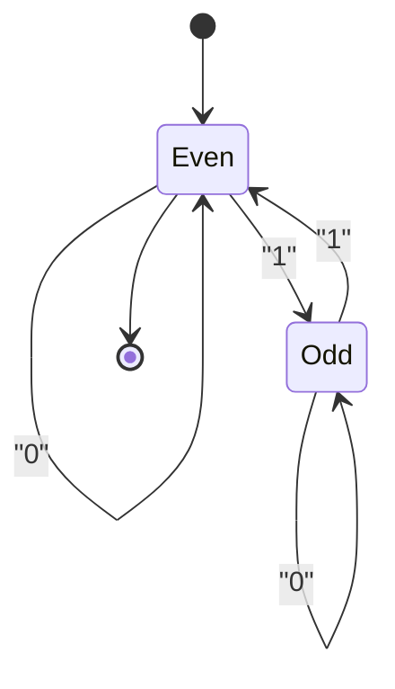

# Finite Automata and Regular Languages

Hub: [[Theory-of-Computation]] · [[CS-Core-Curriculum]]

## Core Idea

A **finite automaton** is a machine with a fixed, finite number of states and no auxiliary memory. It reads input one symbol at a time and accepts or rejects. The set of strings it accepts is its **language**. The languages recognised by finite automata are exactly the **regular languages**, which are also exactly the languages described by **regular expressions** (Kleene's theorem).

- **DFA** (deterministic): formally `(Q, Σ, δ, q0, F)` with `δ: Q × Σ → Q`. Exactly one next state per (state, symbol).
- **NFA** (nondeterministic): `δ: Q × (Σ ∪ {ε}) → P(Q)`. Zero, one, or many next states; ε-moves consume no input. Accepts if *any* path ends in an accept state.

DFAs and NFAs recognise the same class of languages; NFAs can be exponentially more compact.

Because there is no memory beyond the current state, finite automata cannot count without bound. `{aⁿbⁿ | n ≥ 0}` and balanced parentheses are **not** regular.

## Mechanism

### Example DFA: binary strings with an even number of 1s

`Even` is both start and accepting. Runtime is O(n) with O(1) memory.

### Regex to NFA (Thompson's construction)

Each regex operator maps to a small NFA fragment glued with ε-edges:

- literal `a`: two states, one `a` edge
- concatenation `RS`: accept of R ε→ start of S
- union `R|S`: new start ε→ both, both ε→ new accept
- star `R*`: ε-loops allowing zero or more passes

The NFA has O(m) states for a regex of length m.

### NFA to DFA (subset / powerset construction)

Each DFA state is a *set* of NFA states.

1. Start state = ε-closure({q0}).
2. For each DFA state S and symbol a: `move(S, a)` = all NFA states reachable on `a`, then take the ε-closure.
3. A DFA state is accepting if it contains any NFA accept state.
4. Repeat until no new sets appear (a BFS over subsets).

Worst case 2ⁿ DFA states (e.g. "the k-th symbol from the end is 1" needs 2ᵏ states), but typically far fewer are reachable.

### DFA to regex and minimisation

- **State elimination** converts a DFA back to a regex, closing the equivalence loop.
- **Minimisation** (Hopcroft, O(n log n)) merges indistinguishable states; the minimal DFA for a language is unique up to renaming (Myhill–Nerode).

### Closure properties

Regular languages are closed under union, concatenation, star, complement (swap accepting states of a complete DFA), intersection (product construction), and reversal.

## Worked Example

Language: strings over {a, b} ending in `ab`. Regex `(a|b)*ab`.

NFA: `q0` loops on a,b; `q0 -a-> q1`; `q1 -b-> q2` (accept).

Subset construction:

| DFA state | on a | on b |
|---|---|---|
| {q0} (start) | {q0,q1} | {q0} |
| {q0,q1} | {q0,q1} | {q0,q2} |
| {q0,q2} (accept) | {q0,q1} | {q0} |

Three DFA states. Trace `abab`: {q0} → {q0,q1} → {q0,q2} → {q0,q1} → {q0,q2} → accept.

### Pumping lemma proof that `aⁿbⁿ` is not regular

Pumping lemma: if L is regular, there is p such that every w ∈ L with |w| ≥ p splits as w = xyz with |xy| ≤ p, |y| ≥ 1, and xyⁱz ∈ L for all i ≥ 0.

Pick w = aᵖbᵖ. Since |xy| ≤ p, y consists only of `a`s. Pumping i = 2 gives more `a`s than `b`s, not in L. Contradiction, so L is not regular.

Note: the lemma is a *necessary* condition only. Passing it does not prove regularity; use Myhill–Nerode for a full characterisation.

## Pitfalls

- **"Regex" in programming ≠ regular expressions.** Backreferences (`(a+)\1`) in PCRE-style engines recognise non-regular languages and remove DFA-based linear-time guarantees.
- **ReDoS.** Backtracking engines (Java, Python `re`, PCRE, JavaScript) explore NFA paths depth-first. Nested or overlapping quantifiers like `(a+)+$` or `(a|aa)*$` on input `aaaa…aX` try exponentially many splits before failing. Fixes: avoid ambiguous nested quantifiers, use possessive quantifiers/atomic groups where supported, cap input length, set timeouts, or use a linear-time engine (RE2, Rust `regex`, Go `regexp`) that simulates the automaton.
- **Forgetting the dead state.** A complete DFA needs a trap state for missing transitions; complementing an incomplete DFA gives wrong answers.
- **Misusing the pumping lemma** by choosing a specific split: you must show *every* valid split fails.
- **Parsing nested structures (HTML, JSON) with regex** fails in general because nesting is not regular.

## Interview Questions

**Q: Are NFAs more powerful than DFAs?**
A: No. Every NFA converts to an equivalent DFA via subset construction. NFAs can be exponentially smaller, not more expressive.

**Q: Why can't a regular expression match balanced parentheses?**
A: Matching requires unbounded counting of depth. A DFA has finitely many states, so by pumping it cannot track arbitrary depth. It needs a pushdown automaton (context-free grammar).

**Q: What causes catastrophic backtracking?**
A: An ambiguous pattern, typically nested quantifiers, with many ways to split the input. A backtracking engine tries them all when the overall match fails, giving exponential time.

**Q: How do RE2-style engines guarantee linear time?**
A: They simulate the NFA by tracking the set of active states (or lazily build DFA states), giving O(n·m) matching; they drop backreferences to keep that guarantee.

**Q: How do you check whether two regexes are equivalent?**
A: Convert both to minimal DFAs and compare for isomorphism, or build the product DFA for the symmetric difference and check it accepts nothing.

## Connections

- **Compilers:** lexers are DFAs generated from token regexes (lex/flex) — see [[Lexing-and-Parsing]].
- **Cybersecurity:** ReDoS is a denial-of-service vector in input validation and WAF rules; regex-based filters are also frequently bypassed. See [[OWASP-Top-10]].
- **System Design:** protocol handlers are often finite-state machines (e.g. TCP connection states in [[TCP-vs-UDP]]).

## Related

- [[Turing-Machines-and-Decidability]]
- [[Lexing-and-Parsing]]
- [[Compilers-and-Interpreters]]
- [[Graph-Traversal-BFS-DFS]]
- [[Theory-of-Computation]]
