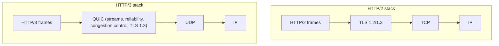

# HTTP Evolution

Hub: [[Computer-Networks]] · [[CS-Core-Curriculum]]

## Core Idea

HTTP semantics have stayed stable across versions: methods, status codes, headers, and caching (collected in RFC 9110). What changed is how messages are **carried on the wire**, and each version targets the latency bottleneck of the one before:

| Version | Transport | Key change | HOL blocking |
|---|---|---|---|
| HTTP/1.0 | TCP | One request per connection (by default) | n/a |
| HTTP/1.1 | TCP | Persistent connections, `Host` header, chunked encoding, (pipelining) | **HTTP-level**: responses on a connection come back in order |
| HTTP/2 | TCP (+TLS in practice) | Binary framing, many streams multiplexed on one connection, HPACK header compression | **TCP-level**: one lost packet stalls all streams |
| HTTP/3 | QUIC over UDP | Streams are independent at the transport level, TLS 1.3 built in, QPACK, connection migration | Removed across streams (still within a stream) |

## Mechanism

### HTTP/1.1

Text protocol. A connection handles one outstanding request at a time. Pipelining exists but was widely disabled in browsers because responses must return in order. As a workaround, browsers open several connections per origin (commonly around 6), and sites used domain sharding, sprite sheets, and concatenated bundles.

### HTTP/2

- A **binary framing layer** splits messages into frames tagged with stream IDs. Frames from different streams interleave on one TCP connection.
- **HPACK** compresses headers with static and dynamic tables.
- Stream prioritization (the original scheme was deprecated in RFC 9113 in favor of RFC 9218 extensible priorities) and flow control per stream.
- **Server push** has since been removed from major browsers.
- Problem: TCP delivers one ordered byte stream. If one packet is lost, the kernel holds back all later bytes, including frames for unrelated streams. On lossy networks HTTP/2 can do worse than several HTTP/1.1 connections.

### HTTP/3 and QUIC



- **QUIC** implements reliability, ordering **per stream**, and congestion control in user space on top of UDP. A loss only stalls the stream it affects.
- A combined transport and crypto handshake makes new connections take **1 RTT**, and **0-RTT** is possible on resumption. TCP + TLS 1.3 needs 2 RTTs (TLS 1.2 needs 3).
- **Connection IDs** let a connection survive IP changes (Wi-Fi to cellular).
- Headers use **QPACK** (HPACK adapted for out-of-order delivery).
- Clients discover HTTP/3 support via the `Alt-Svc` header or DNS HTTPS records, and fall back to TCP if UDP is blocked.

## Worked Example

### Head-of-line blocking scenario

A page requests `a.css`, `b.js`, and `c.png` concurrently, and one packet carrying part of `a.css` is lost.

- **HTTP/1.1, 3 connections**: only the `a.css` connection waits for the retransmit.
- **HTTP/2, 1 connection**: TCP holds back every byte after the hole, so `b.js` and `c.png` frames that already arrived also wait.
- **HTTP/3**: only stream `a.css` waits. The other streams are delivered.

### Inspecting protocol versions

```bash
curl -sI --http1.1 https://example.com | head -1
curl -sI --http2   https://example.com | head -1    # "HTTP/2 200"
curl -sI --http3   https://example.com | head -1    # needs curl built with HTTP/3
curl -sI https://example.com | grep -i alt-svc      # h3 advertisement
```

In browser DevTools, the Network tab has a "Protocol" column that shows `http/1.1`, `h2`, or `h3`.

### Raw HTTP/1.1

```text
GET /index.html HTTP/1.1
Host: example.com
Connection: keep-alive
Accept-Encoding: gzip, br

HTTP/1.1 200 OK
Content-Type: text/html
Content-Length: 1256
Cache-Control: max-age=3600
```

## Pitfalls

- Saying HTTP/2 "eliminates" head-of-line blocking. It removes the HTTP-level blocking but not the TCP-level blocking.
- Keeping HTTP/1.1 workarounds (domain sharding, heavy bundling) under HTTP/2. Sharding defeats multiplexing and header-compression reuse.
- Assuming 0-RTT data is safe for all requests. It can be **replayed**, so only use it for idempotent requests.
- Forgetting that some networks block or throttle UDP, so HTTP/3 must fall back.
- Treating HTTP version and HTTP semantics as the same thing: caching and status codes don't change.

## Interview Questions

**Q: What problem did HTTP/2 solve over HTTP/1.1?**
A: Only one outstanding request per connection, and verbose repeated headers. HTTP/2 multiplexes many streams over one connection and compresses headers.

**Q: Why was HTTP/3 built on UDP instead of fixing TCP?**
A: TCP lives in OS kernels and is ossified by middleboxes, so changing it is slow. QUIC over UDP can be deployed in user space and gives independent streams, faster handshakes, and connection migration.

**Q: Explain head-of-line blocking in each version.**
A: In HTTP/1.1, responses on a connection are serialized. In HTTP/2, a lost TCP segment blocks all streams. In HTTP/3, loss only blocks the affected QUIC stream.

**Q: How many round trips before the first request is sent in HTTP/3 vs HTTP/2?**
A: New connection: QUIC takes 1 RTT (combined handshake), while TCP + TLS 1.3 takes 2. On resumption, QUIC can send 0-RTT data.

**Q: What is Alt-Svc used for?**
A: A server advertises an alternative endpoint or protocol, such as `h3=":443"`, so clients can upgrade to HTTP/3 on later connections.

## Connections

- **System Design:** CDNs and load balancers terminate HTTP/2 and HTTP/3. gRPC runs over HTTP/2 streams. Connection reuse and multiplexing change how you size connection pools. See [[System-Design-Basics]].
- **Cybersecurity:** HTTP/2 Rapid Reset (CVE-2023-44487) abused stream cancellation for DDoS. Request smuggling arises from HTTP/1.1 parsing ambiguities, especially when HTTP/2 is downgraded to HTTP/1.1 at proxies. QUIC encrypts most transport headers, which limits middlebox inspection. See [[TLS-Handshake]], [[Network-Security]], [[OWASP-Top-10]].

## Related

[[TCP-vs-UDP]] · [[TCP-Congestion-Control]] · [[DNS]] · [[TLS-Handshake]] · [[Computer-Networks]]
