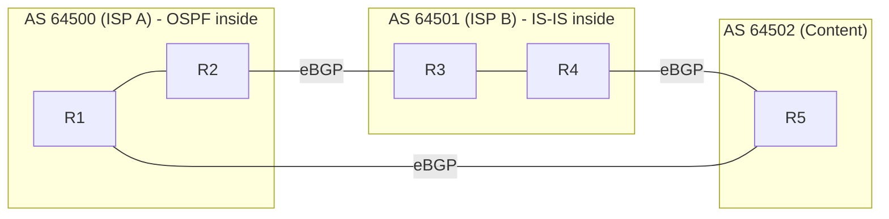

# IP Routing

Hub: [[Computer-Networks]] · [[CS-Core-Curriculum]]

## Core Idea

IP is **hop-by-hop**. Each router looks at a packet's destination address, picks an outgoing interface and next hop from its **forwarding table**, decrements the TTL (IPv6: hop limit), and sends the packet on. No router knows the whole path.

Two planes:

- **Data plane (forwarding)**: per-packet table lookup, done in hardware on fast routers.
- **Control plane (routing)**: protocols that build those tables.

Addresses are aggregated into **prefixes** using CIDR (e.g., `10.1.0.0/16`), so a table holds prefixes rather than every host.

## Mechanism

### Longest prefix match (LPM)

When several prefixes match a destination, the **most specific** one (longest mask) wins. Routers implement this with tries (Patricia/radix trees) or TCAM hardware.

### Routing protocol families

| | Distance-vector | Link-state | Path-vector |
|---|---|---|---|
| Example | RIP | OSPF, IS-IS | BGP |
| Knowledge | Neighbors' distance vectors | Full topology map (LSAs flooded) | Full AS paths to each prefix |
| Algorithm | Bellman-Ford (distributed) | Dijkstra shortest path | Policy-based best-path selection |
| Convergence | Slow; **count-to-infinity** | Fast | Can be slow; policy-driven |
| Mitigations | Split horizon, poison reverse, max 15 hops (RIP) | Areas for scale | Route filtering, RPKI |
| Scope | Small internal networks | Inside an AS (IGP) | Between ASes (EGP) |

An **Autonomous System (AS)** is a network under one administrative routing policy, identified by an ASN. IGPs (OSPF/IS-IS) optimize a metric inside an AS. **BGP** connects ASes, and it chooses routes by **policy** (business relationships, local preference, AS-path length, and more), not just shortest path.



### Other pieces

- **Default route** `0.0.0.0/0` matches everything and has the lowest priority.
- **ARP** (IPv4) / **NDP** (IPv6) map the next-hop IP to a MAC address on the local link.
- **NAT** rewrites private addresses to public ones at the edge.
- **ECMP** spreads flows across equal-cost paths, hashing on the 5-tuple so each flow stays in order.
- **Anycast** announces the same prefix from many sites. BGP delivers each user to a "nearby" site, which is how many DNS resolvers and CDNs work.

## Worked Example

### LPM

Forwarding table:

| Prefix | Next hop |
|---|---|
| 0.0.0.0/0 | ISP |
| 10.0.0.0/8 | Core |
| 10.1.0.0/16 | DC-East |
| 10.1.2.0/24 | Rack-7 |

- `10.1.2.55` matches /0, /8, /16, and /24, so it goes to **Rack-7**.
- `10.1.9.1` matches /0, /8, and /16, so it goes to **DC-East**.
- `8.8.8.8` matches only /0, so it goes to **ISP**.

### Count-to-infinity (distance-vector)

A—B—C in a line, with cost 1 per link. B reaches C at cost 1 and A at cost 2. When the B–C link fails, B may hear A advertise "C at 2" (a route that went through B itself) and set its own cost to 3. A then updates to 4, and so on until the costs reach infinity (16 in RIP). Split horizon stops a router from advertising a route back to the neighbor it learned it from.

### Commands

```bash
ip route show                  # Linux routing table
ip route get 10.1.2.55         # which route LPM picks
traceroute example.com         # hops via TTL-expired ICMP replies
mtr example.com                # continuous traceroute with loss stats
whois -h whois.radb.net AS15169  # routing registry info
```

## Pitfalls

- Thinking routers choose by "first match". They use the longest prefix.
- Assuming BGP picks the shortest or fastest path. It follows policy, and AS-path length is only one tie-breaker.
- Forgetting that routing is asymmetric: the return path can differ.
- Treating traceroute as the exact path. Load balancing and ICMP rate limiting can distort it.
- Confusing routing (IP, L3) with switching (MAC, L2).

## Interview Questions

**Q: What is longest prefix match?**
A: Among all table entries matching a destination, pick the one with the longest subnet mask, i.e. the most specific route.

**Q: Distance-vector vs link-state?**
A: Distance-vector routers share distance tables with neighbors and run distributed Bellman-Ford, which is simple but slow to converge and prone to count-to-infinity. Link-state routers flood link information so each builds the full graph and runs Dijkstra, which converges faster but uses more memory and CPU.

**Q: Why do we need BGP when we have OSPF?**
A: OSPF optimizes a metric within one trusted administrative domain. Between independent organizations, routing must express policy and scale to the full Internet table, which BGP's path-vector design handles. The AS path also prevents loops.

**Q: What happens when TTL reaches 0?**
A: The router drops the packet and sends ICMP Time Exceeded. Traceroute relies on this.

**Q: What is anycast?**
A: The same IP prefix is announced from multiple locations, and routing sends each client to one of them, usually the closest in BGP terms.

## Connections

- **System Design:** Multi-region architectures, anycast load balancing, and VPC route tables all use these ideas. See [[System-Design-Basics]], [[DNS]].
- **Cybersecurity:** BGP hijacks and route leaks can redirect traffic (RPKI route-origin validation mitigates origin hijacks). IP spoofing is limited by ingress filtering. Cloud route tables and security groups are part of network segmentation. See [[Network-Security]], [[Cloud-Security]].
- **Algorithms:** OSPF runs Dijkstra and RIP runs Bellman-Ford, both graph shortest-path algorithms. See [[Graph-Traversal-BFS-DFS]].

## Related

[[TCP-vs-UDP]] · [[DNS]] · [[TCP-Congestion-Control]] · [[Graph-Traversal-BFS-DFS]] · [[Computer-Networks]]
