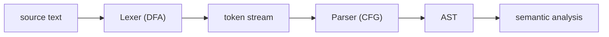

# Lexing and Parsing

Hub: [[Compilers-and-Interpreters]] · [[CS-Core-Curriculum]]

## Core Idea

The compiler front end turns a flat string into structure in two stages:

1. **Lexing (scanning):** characters → **tokens** such as `NUMBER(42)`, `IDENT(x)`, `PLUS`. Token shapes are regular, so the lexer is a DFA. It also discards whitespace and comments.
2. **Parsing:** tokens → a tree according to a **context-free grammar (CFG)**, usually producing an **abstract syntax tree (AST)**.

Splitting them keeps the grammar small (it speaks in tokens, not characters) and lets each stage use the right machine: finite automaton for lexing, pushdown automaton for parsing.

## Mechanism



### Lexing rules

- **Maximal munch:** take the longest match (`>=` is one token, not `>` then `=`).
- **Priority:** on equal length, the earlier rule wins, so keywords are listed before the identifier rule (`if` is `IF`, not `IDENT`).

### Context-free grammars

A CFG has terminals (tokens), nonterminals, productions, and a start symbol. An expression grammar that encodes precedence and left associativity:

```
expr   -> expr ('+'|'-') term | term
term   -> term ('*'|'/') factor | factor
factor -> NUMBER | '(' expr ')'
```

### Ambiguity

A grammar is **ambiguous** if some string has two parse trees. `E -> E '+' E | E '*' E | NUMBER` gives two trees for `1+2*3`. Fixes: stratify into precedence levels (as above) or declare precedence/associativity to a parser generator. The classic **dangling else** (`if a if b s1 else s2`) is usually resolved by binding `else` to the nearest `if`. Deciding whether an arbitrary CFG is ambiguous is undecidable.

### Parse tree vs AST

A parse (concrete syntax) tree has a node for every rule and token, including parentheses. An AST keeps only meaning: `1+(2*3)` becomes `Add(1, Mul(2, 3))`.

### LL vs LR

| | LL(k) | LR(k) family (SLR, LALR, LR) |
|---|---|---|
| Direction | top-down, leftmost derivation | bottom-up, rightmost derivation in reverse |
| Picks a rule | from k tokens at its start | after the whole right-hand side is seen (+k lookahead) |
| Left recursion | not allowed; rewrite it | fine |
| Typical build | hand-written recursive descent, ANTLR | generators: yacc/bison (LALR(1)) |
| Power | LL(1) grammars are a strict subset of LR(1) | handles more grammars |

LR parsers keep a stack and a table of **shift** (push a token) and **reduce** (replace a right-hand side on the stack with its nonterminal) actions. Shift/reduce or reduce/reduce conflicts reveal ambiguity or insufficient lookahead.

**Pratt parsing** (precedence climbing) is a common hand-written technique for expressions using per-operator binding powers.

## Worked Example

Recursive descent for the grammar above. Left recursion `expr -> expr '+' term` would recurse forever, so it becomes a loop: `expr -> term (('+'|'-') term)*`.

```python
import re

TOKEN = re.compile(r"\s*(?:(\d+)|(.))")

def lex(src):
    tokens = []
    for num, op in TOKEN.findall(src):
        if num:
            tokens.append(("NUM", int(num)))
        elif op.strip():
            tokens.append(("OP", op))
    tokens.append(("EOF", None))
    return tokens

class Parser:
    def __init__(self, tokens):
        self.toks, self.i = tokens, 0

    def peek(self):
        return self.toks[self.i]

    def eat(self, kind, val=None):
        tok = self.peek()
        if tok[0] != kind or (val is not None and tok[1] != val):
            raise SyntaxError(f"expected {val or kind}, got {tok}")
        self.i += 1
        return tok

    def expr(self):                     # expr -> term (('+'|'-') term)*
        node = self.term()
        while self.peek() in (("OP", "+"), ("OP", "-")):
            op = self.eat("OP")[1]
            node = (op, node, self.term())   # left-associative
        return node

    def term(self):                     # term -> factor (('*'|'/') factor)*
        node = self.factor()
        while self.peek() in (("OP", "*"), ("OP", "/")):
            op = self.eat("OP")[1]
            node = (op, node, self.factor())
        return node

    def factor(self):                   # factor -> NUM | '(' expr ')'
        if self.peek()[0] == "NUM":
            return self.eat("NUM")[1]
        self.eat("OP", "(")
        node = self.expr()
        self.eat("OP", ")")
        return node

def parse(src):
    p = Parser(lex(src))
    tree = p.expr()
    p.eat("EOF")
    return tree

def evaluate(n):
    if isinstance(n, int):
        return n
    op, a, b = n
    a, b = evaluate(a), evaluate(b)
    return {"+": a + b, "-": a - b, "*": a * b, "/": a / b}[op]

print(parse("1 + 2 * (3 - 1)"))      # ('+', 1, ('*', 2, ('-', 3, 1)))
print(evaluate(parse("8 - 3 - 2")))  # 3  (left-associative)
```

Each nonterminal is one function, and the call stack mirrors the tree (see [[Recursion-and-Stack-Frames]]). Precedence falls out of the call hierarchy: `term` binds tighter because `expr` calls it.

## Pitfalls

- **Left recursion in top-down parsers** causes infinite recursion. Rewrite as iteration.
- **Wrong associativity after rewriting**: `expr -> term '-' expr` parses `8-3-2` as `8-(3-2)=7`. The loop form keeps left associativity.
- **Deep nesting** can overflow the stack in recursive descent; parsers of untrusted input need depth limits.
- **Using regex to parse nested languages** (HTML, JSON) fails; they are context-free, not regular.
- **Poor error recovery**: stopping at the first error or cascading bogus errors. Panic-mode recovery skips to a synchronising token like `;`.

## Interview Questions

**Q: Why separate lexing from parsing?**
A: Tokens are regular and handled efficiently by a DFA; the grammar becomes smaller when written over tokens; whitespace and comments disappear early.

**Q: What makes a grammar ambiguous and how do you fix it?**
A: Some string has more than one parse tree. Fix with precedence levels and associativity in the grammar, or precedence declarations in a generator.

**Q: LL vs LR?**
A: LL is top-down, predicting a production from lookahead; it cannot handle left recursion but is easy to hand-write. LR is bottom-up, shifting tokens and reducing when a full right-hand side is on the stack; it accepts more grammars and is usually table-generated.

**Q: Why is left recursion a problem for recursive descent?**
A: `expr()` would call `expr()` first without consuming input, recursing forever.

**Q: Parse tree vs AST?**
A: The parse tree reflects every production and token; the AST drops syntactic noise and keeps the structure later passes need.

## Connections

- **Cybersecurity:** injection bugs ([[SQL-Injection]], [[XSS]]) happen when untrusted data is concatenated into text another parser interprets as code. Parameterisation and context-aware encoding keep data out of the grammar. Parser differentials (two components parsing the same input differently) enable request smuggling and filter bypasses.
- **AI:** LLM tokenisers are a different kind of lexer (subword units, not grammar tokens); constrained decoding uses grammars to force valid JSON or code.
- **System Design:** config formats, query languages, and DSLs all need parsers; prefer well-tested libraries or generators.

## Related

- [[Compilers-and-Interpreters]]
- [[Finite-Automata-and-Regular-Languages]]
- [[Turing-Machines-and-Decidability]]
- [[Recursion-and-Stack-Frames]]
- [[Trees-and-BSTs]]
