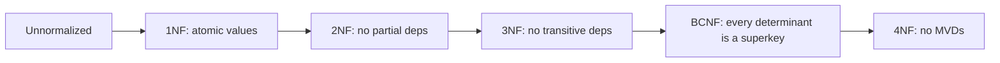

# Normalization

Hub: [[DBMS]] · [[CS-Core-Curriculum]]

## Core Idea

Normalization organizes relations (tables) so that **each fact is stored once**. Redundant storage causes **anomalies**:

- **Update anomaly**: changing a fact means updating many rows, and missing one leaves inconsistent data.
- **Insertion anomaly**: you can't record a fact without an unrelated fact (e.g., a new course with no students yet).
- **Deletion anomaly**: deleting one fact loses another (deleting the last student loses the course's instructor).

The tool for reasoning about this is the **functional dependency (FD)**. `X → Y` means any two rows that agree on X must agree on Y.

## Mechanism

### Keys

- **Superkey**: a set of attributes that determines all attributes.
- **Candidate key**: a minimal superkey. The **primary key** is the chosen candidate key.
- **Prime attribute**: part of some candidate key.
- **Closure X⁺**: all attributes derivable from X using the FDs (Armstrong's axioms: reflexivity, augmentation, transitivity). X is a superkey if X⁺ contains every attribute.

### Normal forms

| Form | Requirement | Removes |
|---|---|---|
| 1NF | Atomic values; no repeating groups or lists in a column | Multi-valued cells |
| 2NF | 1NF + no **partial dependency**: no non-prime attribute depends on part of a composite candidate key | Redundancy from composite keys |
| 3NF | 2NF + no **transitive dependency**. Formally, for every FD X → A: X is a superkey **or** A is prime | Non-key → non-key dependencies |
| BCNF | For every non-trivial FD X → A, X is a superkey | Remaining FD redundancy |
| 4NF | BCNF + no non-trivial multivalued dependencies except on superkeys | Independent multi-valued facts |



**Decomposition properties:**

- **Lossless join**: joining the parts reproduces exactly the original relation. A binary split R → R1, R2 is lossless if `R1 ∩ R2` is a key of R1 or of R2.
- **Dependency preservation**: every FD can be checked within a single table.

A 3NF decomposition that is both lossless and dependency-preserving always exists. BCNF is always achievable losslessly but may **not** preserve dependencies.

## Worked Example

Start with one wide table:

`Enrollment(student_id, student_name, course_id, course_title, instructor, instructor_office, grade)`

FDs:

- `student_id → student_name`
- `course_id → course_title, instructor`
- `instructor → instructor_office`
- `student_id, course_id → grade`

Candidate key: `(student_id, course_id)`.

1. **2NF violations** (partial dependencies): `student_name` depends only on `student_id`, and `course_title, instructor` depend only on `course_id`. Split:
   - `Student(student_id, student_name)`
   - `Course(course_id, course_title, instructor, instructor_office)`
   - `Enrollment(student_id, course_id, grade)`
2. **3NF violation** in `Course`: `course_id → instructor → instructor_office` (transitive). Split:
   - `Course(course_id, course_title, instructor)`
   - `Instructor(instructor, instructor_office)`

Now each fact lives in one place. Changing an office is a single-row update.

**3NF but not BCNF:** `Teaches(student, course, instructor)` where each instructor teaches exactly one course (`instructor → course`) and `(student, course) → instructor`. The candidate keys are `(student, course)` and `(student, instructor)`. The FD `instructor → course` has a non-superkey determinant, but `course` is prime, so the table is in 3NF and not in BCNF. The BCNF decomposition `(instructor, course)` + `(student, instructor)` is lossless but can no longer enforce `(student, course) → instructor` within one table.

### Denormalization

```sql
-- Normalized read needs a join
SELECT o.id, c.name FROM orders o JOIN customers c ON c.id = o.customer_id;

-- Denormalized: copy customer_name into orders for a hot read path
ALTER TABLE orders ADD COLUMN customer_name TEXT;
-- must now be kept in sync: trigger, application logic, or async job
```

| Normalize when | Denormalize when |
|---|---|
| OLTP with frequent writes | Read-heavy paths where joins dominate latency |
| Data integrity is critical | Analytics/OLAP (star schemas, wide tables) |
| Schema is still evolving | Document/NoSQL stores without joins |
| | Precomputed aggregates, materialized views, caches |

Denormalization is a deliberate trade: faster reads and fewer joins, in exchange for extra storage, more expensive writes, and the risk of inconsistency.

## Pitfalls

- Over-normalizing lookup data until simple reads need 8 joins.
- Denormalizing before measuring. Indexes and query fixes often solve the problem ([[Database-Indexing]], [[SQL-Joins-and-Query-Plans]]).
- Storing comma-separated lists in a column (a 1NF violation). This breaks indexing and constraints.
- Forgetting to identify **all** candidate keys before checking 2NF, 3NF, or BCNF.
- Confusing 3NF and BCNF: 3NF allows `X → A` with non-superkey X when A is prime; BCNF does not.
- Decompositions that are not lossless and create spurious tuples when joined.

## Interview Questions

**Q: What is a functional dependency?**
A: A constraint `X → Y` meaning rows equal on X must be equal on Y. X determines Y.

**Q: 2NF vs 3NF?**
A: 2NF removes non-prime attributes that depend on part of a composite key. 3NF additionally removes non-prime attributes that depend on other non-key attributes (transitive dependencies).

**Q: What is BCNF and how does it differ from 3NF?**
A: BCNF requires every non-trivial determinant to be a superkey. 3NF relaxes this when the dependent attribute is prime, which keeps dependency preservation possible.

**Q: How do you know a decomposition is lossless?**
A: For a binary split, the common attributes must form a key of at least one of the resulting tables.

**Q: When would you denormalize?**
A: When measured read performance requires it: hot read paths, analytics, or stores without joins. Accept the write overhead and keep copies consistent with triggers, transactions, or events.

## Connections

- **System Design:** NoSQL data modeling is query-first denormalization. CQRS and read models, materialized views, and caches are controlled denormalization. See [[System-Design-Basics]].
- **LLD:** Normalization is similar to single-responsibility and avoiding duplicated state in object models. See [[OOP-Concepts]].

## Related

[[SQL-Joins-and-Query-Plans]] · [[Database-Indexing]] · [[Transactions-and-Isolation-Levels]] · [[OOP-Concepts]] · [[DBMS]]
