# Pipelining and Branch Prediction

Hub: [[Computer-Architecture]] · [[CS-Core-Curriculum]]

## Core Idea

**Pipelining** splits instruction execution into stages so several instructions are in flight at once, like an assembly line. It doesn't make one instruction faster (latency); it raises **throughput** — ideally one instruction completes per cycle.

The ideal is broken by **hazards**. The most expensive in practice are control hazards from branches, which is why CPUs **predict** branch outcomes and **speculatively execute** ahead, discarding work if the guess was wrong.

## Mechanism

### Classic 5-stage RISC pipeline

IF (fetch) → ID (decode/register read) → EX (execute) → MEM (memory access) → WB (write back)

```mermaid
gantt
    title Ideal 5-stage pipeline
    dateFormat X
    axisFormat %s
    section I1
    IF :0, 1
    ID :1, 2
    EX :2, 3
    MEM :3, 4
    WB :4, 5
    section I2
    IF :1, 2
    ID :2, 3
    EX :3, 4
    MEM :4, 5
    WB :5, 6
    section I3
    IF :2, 3
    ID :3, 4
    EX :4, 5
    MEM :5, 6
    WB :6, 7
```



With k stages and n instructions (no stalls): `cycles = k + (n − 1)`, versus `k × n` unpipelined.

### Hazards

| Hazard | Cause | Mitigation |
|---|---|---|
| Structural | Two instructions need the same hardware in one cycle | Duplicate resources (separate I/D caches) |
| Data (RAW) | Instruction needs a result not yet written | **Forwarding/bypassing**; stall if still unavailable (load-use) |
| Data (WAR/WAW) | Name reuse in out-of-order machines | **Register renaming** |
| Control | Next PC unknown until branch resolves | Prediction + speculation, delay slots (historical MIPS) |

### Branch prediction

- **Static** — e.g., predict backward branches taken (loops), forward not taken.
- **Dynamic 1-bit** — remember last outcome.
- **2-bit saturating counter** — states strongly/weakly taken/not-taken; needs two wrong guesses to flip, so a loop exit mispredicts once, not twice.
- **Correlating/global history** (gshare, two-level) — uses recent outcomes of other branches.
- **TAGE-style and perceptron predictors** — used in modern high-end cores.
- **BTB** (Branch Target Buffer) predicts the target address; the **return stack buffer** predicts `ret` targets.

On a **misprediction**, the pipeline flushes wrong-path instructions; the penalty grows with pipeline depth (commonly on the order of 10–20 cycles in modern deep pipelines; exact values depend on the core).

### Beyond the simple pipeline

- **Superscalar** — issue multiple instructions per cycle.
- **Out-of-order execution** — run independent instructions while earlier ones wait (Tomasulo, reorder buffer); results commit in program order to keep precise exceptions.
- **Speculative execution** — execute past unresolved branches; architectural state is rolled back on mispredict, but microarchitectural state (caches) may not be.

## Worked Example

### Load-use stall with forwarding

```asm
lw   x1, 0(x2)     # x1 available after MEM
add  x3, x1, x4    # needs x1 in EX -> 1 stall cycle even with forwarding
sub  x5, x6, x7
```

A compiler can **schedule** `sub` between the load and the `add` to fill the bubble.

### Speedup

5-stage pipeline, 1000 instructions, no stalls: `5 + 999 = 1004` cycles vs `5000` unpipelined → ≈ 4.98× speedup.

With 20% branches, 10% mispredicted, 3-cycle penalty: `CPI = 1 + 0.2 × 0.1 × 3 = 1.06`.

### Sorted vs unsorted data

```cpp
// Summing elements >= 128 from random bytes
for (int i = 0; i < n; ++i)
    if (data[i] >= 128) sum += data[i];
```

With random `data` the branch is unpredictable (~50% mispredicts). After `std::sort(data, data + n)` the branch is taken/not-taken in long runs and becomes highly predictable, so the loop runs markedly faster despite identical work. A branchless version also avoids the problem:

```cpp
int t = (data[i] - 128) >> 31;   // -1 if < 128, else 0 (assumes arithmetic shift)
sum += ~t & data[i];
```

Compilers often emit `cmov` or vectorized code for this at higher optimization levels, so measure with the actual build.

```bash
perf stat -e branches,branch-misses ./app
```

## Pitfalls

- Believing deeper pipelines are always better: higher clock potential but larger mispredict penalty and more hazards.
- Confusing latency and throughput.
- Assuming branchless code is always faster: if a branch is well predicted, a branch can beat `cmov` (which creates a data dependency).
- Forgetting that speculation leaves cache side effects (Spectre).
- Micro-benchmarking without checking what the compiler actually emitted.

## Interview Questions

**Q: What does pipelining improve?**
A: Throughput (instructions per cycle), not the latency of a single instruction.

**Q: Name the three hazard types.**
A: Structural (resource conflicts), data (dependencies between instructions), control (branches changing the PC).

**Q: How does forwarding help?**
A: It routes a result from a later pipeline stage directly to an earlier stage's input, avoiding waiting for write-back; a load followed immediately by a use still needs one stall.

**Q: Why use a 2-bit predictor instead of 1-bit?**
A: Hysteresis: a single anomalous outcome (like a loop exit) doesn't flip the prediction, so a loop costs one mispredict per execution instead of two.

**Q: Why does processing a sorted array sometimes run faster?**
A: A data-dependent branch becomes predictable, eliminating misprediction flushes.

**Q: How are Spectre attacks related to branch prediction?**
A: An attacker trains the predictor so the victim speculatively executes code that accesses secret-dependent memory; the result is rolled back architecturally but leaves cache traces readable via timing.

## Connections

- **Cybersecurity:** Spectre (branch predictor/BTB poisoning) and Meltdown (speculative access past permission checks) are the canonical transient-execution attacks; mitigations include retpolines, IBRS/IBPB, and KPTI. See [[CPU-Caches-and-Memory-Hierarchy]], [[Virtual-Memory-and-Paging]], [[Reverse-Engineering-Basics]].
- **Compilers:** Instruction scheduling, loop unrolling, and if-conversion (predication) target pipeline behavior. See [[Compilers-and-Interpreters]].
- **System Design:** Hot-path code in latency-sensitive services (parsers, matching engines) is tuned for predictable branches and cache-friendly layouts.

## Related

[[CPU-Caches-and-Memory-Hierarchy]] · [[Virtual-Memory-and-Paging]] · [[Compilers-and-Interpreters]] · [[Sorting-Algorithms]] · [[Computer-Architecture]]
