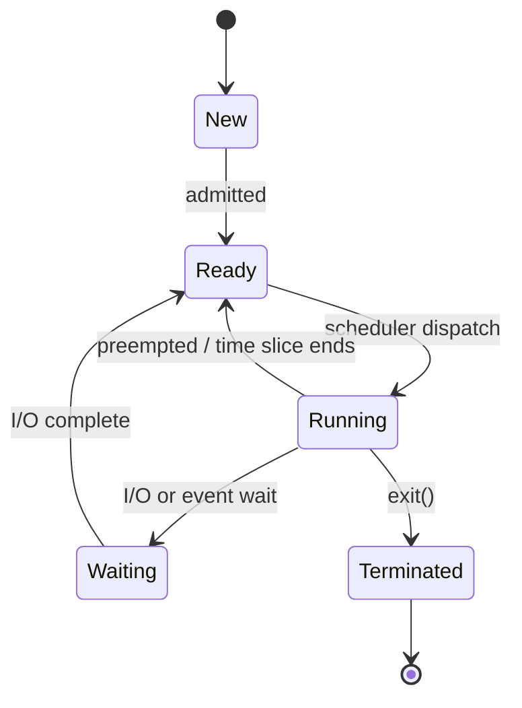

# Processes and Threads

Hub: [[Operating-Systems]] · [[CS-Core-Curriculum]]

## Core Idea

A **process** is a program in execution plus the resources the OS gives it: its own virtual address space, open file descriptors, credentials (UID/GID), signal handlers, and at least one thread. A **thread** is a single flow of execution inside a process: a program counter, a register set, and a stack. All threads of a process share the address space (code, heap, globals) and open files, but each has a private stack and registers.

- Processes give **isolation**: one crashing process normally cannot corrupt another's memory.
- Threads give **cheap sharing**: they communicate through shared memory without copying, at the cost of needing synchronization.

The kernel tracks a process in a **Process Control Block (PCB)** (in Linux, `task_struct`; Linux actually uses `task_struct` for every thread too, and threads are tasks that share an `mm_struct`).

## Mechanism

### Process lifecycle



### Creation on Unix

- `fork()` duplicates the calling process. Modern kernels use **copy-on-write (COW)**: parent and child share physical pages marked read-only; a page is copied only when one side writes it.
- `exec()` replaces the process image with a new program (same PID).
- `wait()`/`waitpid()` lets the parent reap the child's exit status. A child that has exited but not been reaped is a **zombie**; a child whose parent died is an **orphan** and is re-parented (to init/systemd or a subreaper).

Threads are created with `pthread_create` (which on Linux calls `clone()` with flags like `CLONE_VM | CLONE_FILES` to share resources).

### Context switch

Switching the CPU from one thread to another requires saving registers/PC/stack pointer to the kernel and loading the next thread's. Switching between **processes** additionally changes the address space (page table base register, e.g. CR3 on x86), which may flush or invalidate TLB entries (unless tagged with PCIDs/ASIDs). That is why thread switches within the same process are generally cheaper than process switches. Indirect cost — cold caches and TLB — often dominates the direct cost.

### User vs kernel threads

| Model | Description | Trade-off |
|---|---|---|
| 1:1 | Each user thread is a kernel thread (Linux NPTL, Windows) | True parallelism; kernel-managed |
| N:1 | Many user threads on one kernel thread (old green threads) | Cheap switches; one blocking syscall blocks all |
| M:N | Many user threads multiplexed onto many kernel threads (Go goroutines, Java virtual threads) | Cheap and parallel; complex runtime |

## Worked Example

```c
#include <stdio.h>
#include <unistd.h>
#include <sys/wait.h>
#include <pthread.h>

int counter = 0;

void *work(void *arg) { counter++; return NULL; }

int main(void) {
    pid_t pid = fork();
    if (pid == 0) {            // child
        counter = 100;         // COW: modifies child's private copy
        printf("child counter=%d\n", counter);
        _exit(0);
    }
    waitpid(pid, NULL, 0);
    printf("parent counter=%d\n", counter);   // still 0

    pthread_t t;
    pthread_create(&t, NULL, work, NULL);
    pthread_join(t, NULL);
    printf("after thread counter=%d\n", counter); // 1: threads share memory
}
```

Output: child prints 100, parent prints 0 (separate address spaces), and after the thread runs the parent sees 1 (shared address space).

Inspecting on Linux:

```bash
ps -eLf | grep myprog      # -L shows one line per thread (LWP)
ls /proc/<pid>/task        # each thread's TID
cat /proc/<pid>/status     # Threads:, VmRSS:, voluntary_ctxt_switches
```

## Pitfalls

- Assuming `fork()` copies all threads: only the calling thread exists in the child. Locks held by other threads at fork time stay locked forever in the child. Call only async-signal-safe functions before `exec` in a multithreaded parent.
- Forgetting to `wait()` → zombie accumulation (PID table exhaustion).
- Shared globals across threads without synchronization → data races (see [[Synchronization-Primitives]]).
- Thinking threads are "free": each has a stack (commonly several MB of reserved virtual memory by default on Linux) and scheduling overhead. Thousands of blocking threads can be worse than an event loop or thread pool.
- In CPython, the GIL limits CPU-bound parallelism with threads (except in free-threaded builds); use processes for CPU-bound work.

## Interview Questions

**Q: Process vs thread?**
A: A process has its own address space and resources; threads are execution units inside a process that share its address space and files but have their own stack, registers, and PC.

**Q: What does fork() return?**
A: 0 in the child, the child's PID in the parent, -1 on failure.

**Q: What is copy-on-write in fork()?**
A: Parent and child initially share physical pages marked read-only; a write triggers a page fault and the kernel copies just that page. It makes `fork()`+`exec()` cheap.

**Q: What is a zombie process and how do you fix it?**
A: A terminated child whose exit status hasn't been collected. The parent must `wait()`, or handle `SIGCHLD`; if the parent dies, init adopts and reaps it.

**Q: Why is a thread context switch cheaper than a process switch?**
A: No address-space change, so no page-table switch and less TLB/cache disruption.

**Q: When prefer processes over threads?**
A: When you need fault isolation or security boundaries (e.g., browser site isolation), or when a runtime lock (GIL) prevents thread parallelism.

## Connections

- **System Design:** Worker models (pre-fork servers like classic Apache/Gunicorn vs threaded vs event-loop like Nginx/Node) are direct applications. See [[System-Design-Basics]].
- **Cybersecurity:** Process isolation is a core security boundary; privilege separation and sandboxing run untrusted code in separate processes with reduced rights ([[Least-Privilege]]). Process trees and parent-child anomalies are key detection signals ([[Security-Logging-and-Detection]], [[Malware-Analysis-Basics]]).
- **AI:** Data-loading pipelines (e.g., PyTorch DataLoader workers) use multiple processes to bypass the GIL.

## Related

[[CPU-Scheduling]] · [[Synchronization-Primitives]] · [[Deadlocks]] · [[Virtual-Memory-and-Paging]] · [[Concurrency-Basics]] · [[Operating-Systems]]
