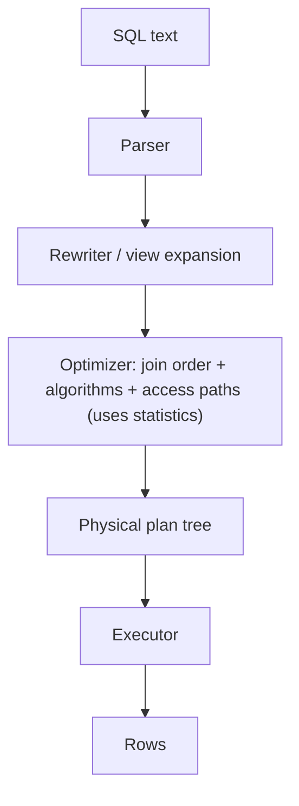

# SQL Joins and Query Plans

Hub: [[DBMS]] · [[CS-Core-Curriculum]]

## Core Idea

SQL is **declarative**: you describe *what* rows you want, and the **query optimizer** decides *how* to get them. There are two separate layers:

1. **Logical joins** say which rows appear in the result: INNER, LEFT/RIGHT/FULL OUTER, CROSS, and semi/anti joins (written with `EXISTS` / `NOT EXISTS`).
2. **Physical join algorithms** decide how the engine computes them: nested loop, hash join, and sort-merge join.

The optimizer estimates cardinalities from **statistics** (row counts, histograms, distinct values) and picks the plan with the lowest estimated cost. `EXPLAIN` shows that plan. `EXPLAIN ANALYZE` (PostgreSQL) also runs the query and shows actual rows and times.

## Mechanism

### Logical joins

| Join | Result |
|---|---|
| INNER | Rows with a match on both sides |
| LEFT OUTER | All left rows; NULLs where there is no right match |
| FULL OUTER | All rows from both sides |
| CROSS | Cartesian product |
| Semi (`EXISTS`/`IN`) | Left rows that have at least one match; no duplication |
| Anti (`NOT EXISTS`) | Left rows with no match |

### Physical join algorithms

| Algorithm | How | Cost (rough) | Best when |
|---|---|---|---|
| Nested loop | For each outer row, scan or probe the inner side | O(N·M) naive; O(N·log M) with an index on the inner side | Small outer side + indexed inner side; supports any join condition |
| Hash join | Build a hash table on the smaller input, probe it with the other | O(N + M) expected; needs memory (spills to disk otherwise) | Large unsorted inputs, equality joins only |
| Sort-merge | Sort both inputs on the key, then merge like mergesort | O(N log N + M log M), or O(N + M) if already sorted | Inputs already sorted (index order), equality or range joins, large data |



**Join ordering** matters most: for n tables the number of possible orders grows factorially. Optimizers use dynamic programming (the System R style) for small n and heuristics or genetic search for large n (PostgreSQL's GEQO kicks in above `geqo_threshold`).

**Access paths** for each table are a sequential scan, an index scan, an index-only scan, or a bitmap scan. See [[Database-Indexing]].

## Worked Example

```sql
CREATE TABLE customers (id INT PRIMARY KEY, country TEXT);
CREATE TABLE orders (id INT PRIMARY KEY, customer_id INT, total NUMERIC, created_at DATE);
CREATE INDEX ON orders (customer_id);

-- Revenue by customer in India
EXPLAIN ANALYZE
SELECT c.id, SUM(o.total)
FROM customers c
JOIN orders o ON o.customer_id = c.id
WHERE c.country = 'IN'
GROUP BY c.id;
```

A plausible PostgreSQL plan (shape only; the numbers depend on your data):

```text
HashAggregate
  Group Key: c.id
  -> Hash Join  (Hash Cond: (o.customer_id = c.id))
       -> Seq Scan on orders o
       -> Hash
            -> Seq Scan on customers c
                 Filter: (country = 'IN')
```

How to read it:

- Plans are trees, and execution flows from the **innermost/lowest** nodes upward.
- The smaller filtered `customers` set is **hashed** (the build side), and `orders` **probes** it.
- If only a handful of customers matched, the optimizer might instead choose a **Nested Loop** with an `Index Scan using orders_customer_id_idx`.
- Compare `rows=` estimated vs actual. A large mismatch means stale or insufficient statistics, so run `ANALYZE` or add extended statistics.

LEFT JOIN trap:

```sql
-- Turns the LEFT JOIN into an INNER JOIN (filter on the right table in WHERE)
SELECT * FROM customers c LEFT JOIN orders o ON o.customer_id = c.id
WHERE o.total > 100;
-- Keep customers without orders: move the predicate into ON
SELECT * FROM customers c LEFT JOIN orders o ON o.customer_id = c.id AND o.total > 100;
```

MySQL equivalents: `EXPLAIN FORMAT=TREE` and `EXPLAIN ANALYZE` (8.0.18+).

## Pitfalls

- A filter on the outer-joined table in `WHERE` silently turns the outer join into an inner join.
- `NOT IN` with a subquery that can return NULL returns no rows. Prefer `NOT EXISTS`.
- Joining on a non-unique key multiplies rows, which inflates `SUM`/`COUNT`. Aggregate before joining, or use a semi join.
- Functions or casts on indexed columns (`WHERE date(created_at) = ...`) prevent index use.
- Trusting `EXPLAIN` estimates without `ANALYZE`. Stale statistics cause bad join choices.
- The **N+1 query** pattern in ORMs: one query per parent row instead of a single join.

## Interview Questions

**Q: When does the optimizer pick a hash join vs a nested loop?**
A: Hash join for large inputs joined on equality with no useful index ordering. Nested loop when the outer side is small and the inner side has an index on the join key, or when the condition isn't an equality.

**Q: Why can a sort-merge join be attractive?**
A: If both inputs are already sorted (for example via an index), merging is linear and handles large data without a big hash table. It also supports range conditions.

**Q: INNER vs LEFT JOIN?**
A: INNER keeps only matched pairs. LEFT keeps every left row, filling unmatched right-side columns with NULL.

**Q: EXPLAIN vs EXPLAIN ANALYZE?**
A: EXPLAIN shows the chosen plan and estimates without running the query. EXPLAIN ANALYZE executes it and reports actual row counts and timing per node, so be careful with write statements.

**Q: A query got slow after data grew. What do you check?**
A: Run `EXPLAIN ANALYZE`, compare estimated vs actual rows, check for missing indexes or stale statistics, look for sequential scans on big tables and spills (hash batches, sort to disk), and check the join order.

## Connections

- **System Design:** Denormalization, read replicas, and pre-joined materialized views exist because joins at scale are expensive. Distributed joins require shuffling data across nodes. See [[Normalization]], [[Distributed-Systems]], [[System-Design-Basics]].
- **Cybersecurity:** Dynamic SQL built by string concatenation enables [[SQL-Injection]]. Use parameterized queries. Expensive joins can also be abused for DoS.
- **Algorithms:** Hash join is [[Hash-Tables]] applied to relations. Merge join is the merge step of mergesort ([[Sorting-Algorithms]]).

## Related

[[Database-Indexing]] · [[Normalization]] · [[Transactions-and-Isolation-Levels]] · [[Hash-Tables]] · [[Sorting-Algorithms]] · [[DBMS]]
