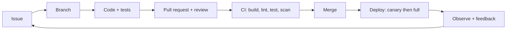

# Software Engineering

Hub: [[CS-Core-Index]] · [[CS-Core-Curriculum]]

## Core Idea

Software engineering is programming integrated over **time** and **people**. The code has to keep working as requirements change, teammates change, and dependencies change. The practices below — version control, testing, code review, modular design, CI/CD, observability — exist to keep the cost of change low and to catch mistakes before users do.

## Roadmap

1. Requirements — functional vs non-functional, user stories, acceptance criteria
2. Process models — waterfall, iterative, Agile/Scrum/Kanban; what each optimizes for
3. Design — modularity, coupling and cohesion, SOLID ([[OOP-Concepts]]), design patterns, architecture decision records
4. [[Version-Control-Internals]] — git object model, branching strategies, code review workflow
5. [[Testing-Strategies]] — test pyramid, unit/integration/end-to-end, TDD, property-based testing, fuzzing
6. CI/CD — automated builds, tests on every change, deployment strategies (blue-green, canary, feature flags)
7. Maintenance — refactoring, technical debt, semantic versioning, dependency management
8. Operations — logging, metrics, tracing, incident response, blameless postmortems
9. Capstone: take a small project through issue → branch → tests → PR review → CI → release with a changelog

## Key Concepts

| Concept | Why it matters |
|---|---|
| Coupling / cohesion | Low coupling + high cohesion lets modules change independently |
| Test pyramid | Many fast unit tests, fewer integration tests, few slow end-to-end tests |
| Continuous integration | Small changes merged often, each verified automatically |
| Semantic versioning | MAJOR.MINOR.PATCH communicates compatibility |
| Technical debt | Shortcuts that raise the future cost of change; track it explicitly |
| Code review | Catches defects, spreads knowledge, enforces conventions |
| Observability | Logs, metrics, traces let you debug production without redeploying |

## Notes

- [[Testing-Strategies]]
- [[Version-Control-Internals]]
- Design: [[OOP-Concepts]], [[System-Design-Basics]]

## Interview Questions (with answers)

- **Agile vs waterfall?** — Waterfall completes each phase (requirements, design, build, test) before the next, which suits fixed, well-understood requirements. Agile delivers in short iterations with continuous feedback, which suits changing requirements.
- **What makes a good unit test?** — Fast, deterministic, isolated from I/O, tests one behavior through the public interface, and has a name that says what broke when it fails.
- **Merge vs rebase?** — Merge preserves history and adds a merge commit; rebase replays commits onto a new base for a linear history but rewrites commit IDs, so never rebase shared branches.
- **How do you ship a risky change safely?** — Hide it behind a feature flag, roll out gradually (canary), watch error and latency metrics, and keep a fast rollback path.
- **What is technical debt and how do you manage it?** — The extra future cost created by expedient choices. Record it (issues/ADRs), estimate its interest (how often it slows work), and pay down the items with the highest interest first.
- **Cohesion vs coupling?** — Cohesion is how related a module's responsibilities are (want high); coupling is how much modules depend on each other's internals (want low).

## Coding Exercises

- [ ] Write unit tests for an existing function, then refactor it without changing behavior
- [ ] Add a property-based test (Hypothesis / jqwik / RapidCheck) for a sort or parser
- [ ] Set up a CI workflow that runs lint + tests on every pull request
- [ ] Recover a "lost" commit using `git reflog`; resolve a merge conflict by hand
- [ ] Write an ADR for one real decision in a project you own

## Connections

- **System design** — deployment strategies, backward-compatible API/schema changes, and observability are how designs survive contact with production.
- **Cybersecurity** — secure SDLC: threat modeling at design time, dependency and secret scanning in CI, signed commits and artifacts, least-privilege CI tokens; supply-chain attacks target exactly this pipeline. See [[OWASP-Top-10]].
- **AI** — ML systems add data and model versioning, evaluation suites as tests, and monitoring for drift; LLM coding assistants make review and tests more important, not less.

## Related

- [[Computer-Networks]]
- [[Distributed-Systems]]
