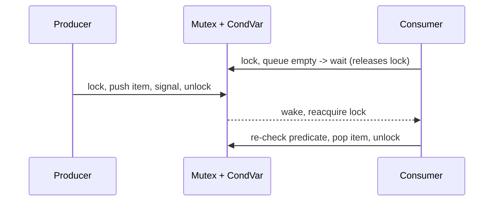

# Synchronization Primitives

Hub: [[Operating-Systems]] · [[CS-Core-Curriculum]]

## Core Idea

When threads share mutable state, the result can depend on interleaving — a **race condition**. The code that touches shared state is the **critical section**. A correct solution must provide:

1. **Mutual exclusion** — at most one thread in the critical section.
2. **Progress** — if nobody is inside, someone who wants in eventually gets in.
3. **Bounded waiting** — no thread waits forever while others repeatedly enter.

Primitives are built on hardware atomic instructions (test-and-set, compare-and-swap, load-linked/store-conditional) plus memory ordering guarantees.

## Mechanism

| Primitive | What it is | Blocks by | Typical use |
|---|---|---|---|
| Spinlock | Busy-waits on an atomic flag | Spinning | Very short sections, kernel code where sleeping is not allowed |
| Mutex | Lock with an owner; waiters sleep | Sleeping (often spin briefly first; Linux futex) | General critical sections |
| Semaphore | Integer counter with `wait` (P, decrement, block if 0) and `signal` (V, increment) | Sleeping | Limit concurrency to N; signaling between threads |
| Condition variable | Wait queue used *with* a mutex to wait for a predicate | Sleeping | Producer–consumer, "wait until state X" |
| Read-write lock | Many readers or one writer | Sleeping | Read-heavy data |
| Atomics / CAS | Single-word lock-free updates | Retrying | Counters, lock-free structures |
| Barrier | All N threads wait until all arrive | Sleeping | Phased parallel computation |

A **monitor** (Java `synchronized` + `wait/notify`) bundles a mutex and condition variable into a language construct.



Key rule: `wait()` atomically releases the mutex and sleeps; on wake it reacquires the mutex before returning. Always re-check the condition in a `while` loop because of **spurious wakeups** and because another thread may have consumed the state first.

## Worked Example

Race on a counter and three fixes (C++):

```cpp
#include <thread>
#include <mutex>
#include <atomic>
#include <condition_variable>
#include <queue>

int unsafe_count = 0;                 // count++ is read-modify-write: racy
std::mutex m;
int safe_count = 0;
std::atomic<int> atomic_count{0};

void inc() {
    for (int i = 0; i < 100000; ++i) {
        unsafe_count++;                          // lost updates
        { std::lock_guard<std::mutex> g(m); safe_count++; }
        atomic_count.fetch_add(1, std::memory_order_relaxed);
    }
}

// Bounded producer-consumer with a condition variable
std::queue<int> q; const size_t CAP = 8;
std::mutex qm; std::condition_variable not_full, not_empty;

void produce(int x) {
    std::unique_lock<std::mutex> lk(qm);
    not_full.wait(lk, []{ return q.size() < CAP; });  // loops internally
    q.push(x);
    not_empty.notify_one();
}

int consume() {
    std::unique_lock<std::mutex> lk(qm);
    not_empty.wait(lk, []{ return !q.empty(); });
    int x = q.front(); q.pop();
    not_full.notify_one();
    return x;
}
```

Running two `inc` threads, `unsafe_count` typically ends below 200000; the other two are exactly 200000.

Classic semaphore version of bounded buffer: `empty = N`, `full = 0`, `mutex = 1`; producer does `wait(empty); wait(mutex); put; signal(mutex); signal(full)`. Swapping the order of `wait(empty)` and `wait(mutex)` can deadlock.

## Pitfalls

- Using `if` instead of `while` around condition waits.
- Holding a lock while doing I/O or calling unknown callbacks — increases contention and deadlock risk.
- Inconsistent lock ordering → [[Deadlocks]].
- Spinlocks on a uniprocessor or with long sections waste CPU; sleeping while holding a spinlock in kernel code is a bug.
- `volatile` is not a synchronization primitive in C/C++ (it is in Java for visibility, but not atomic compound ops).
- Double-checked locking without proper memory ordering is broken.
- Semaphore with count 1 ≠ mutex: a semaphore has no owner, so any thread can signal it, and there's no priority inheritance.
- ABA problem in lock-free CAS loops; fix with tagged pointers or hazard pointers/epoch reclamation.

## Interview Questions

**Q: Mutex vs semaphore?**
A: A mutex provides ownership-based mutual exclusion (only the locker unlocks). A counting semaphore is a counter allowing up to N concurrent holders and can be signaled by any thread, useful for resource pools and signaling.

**Q: Spinlock vs mutex — when to use which?**
A: Spinlock when the critical section is shorter than the cost of sleeping/waking and you're on multiple cores (or can't sleep, e.g. interrupt context); mutex otherwise.

**Q: Why must condition variable waits be in a loop?**
A: Spurious wakeups are permitted, and the predicate may be false again by the time the woken thread reacquires the mutex.

**Q: What is compare-and-swap?**
A: An atomic instruction that writes a new value only if the current value equals an expected value, returning success/failure; it underpins lock-free algorithms.

**Q: How does a read-write lock cause writer starvation?**
A: If readers keep arriving, a reader-preferring lock never reaches zero readers so the writer never gets in; writer-preferring or fair locks fix this.

**Q: What is a futex?**
A: A Linux "fast userspace mutex": the uncontended path is a userspace atomic op; the kernel is entered only to sleep/wake on contention.

## Connections

- **System Design:** Distributed locks (leases, fencing tokens), optimistic concurrency with version numbers (a distributed CAS), and DB row locks are the same ideas at larger scale. See [[Transactions-and-Isolation-Levels]], [[Distributed-Systems]].
- **Cybersecurity:** TOCTOU (time-of-check to time-of-use) races are a vulnerability class, e.g., checking a file's permissions then opening a swapped symlink. Races also enable use-after-free bugs ([[Memory-Safety]]).
- **AI:** Parameter servers and data-parallel training rely on barriers/all-reduce synchronization.

## Related

[[Deadlocks]] · [[Processes-and-Threads]] · [[CPU-Scheduling]] · [[Concurrency-Basics]] · [[Transactions-and-Isolation-Levels]] · [[Operating-Systems]]
