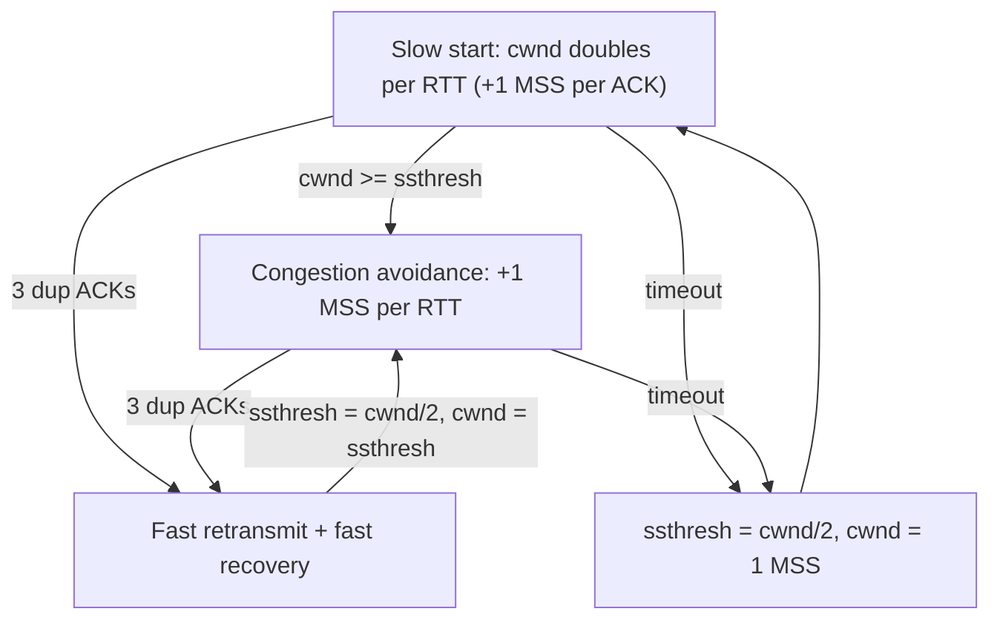

# TCP Congestion Control

Hub: [[Computer-Networks]] · [[CS-Core-Curriculum]]

## Core Idea

If every sender transmits as fast as it can, router queues overflow. Packets are dropped, retransmissions add more load, and throughput can collapse. This is the **congestion collapse** seen on the Internet in the 1980s, which led to Van Jacobson's algorithms.

TCP limits unacknowledged data in flight to `min(cwnd, rwnd)`. The **congestion window** `cwnd` is the sender's estimate of what the network can absorb. The sender cannot observe the network directly, so it infers congestion from signals:

- **Loss** (timeouts, duplicate ACKs) in Reno and CUBIC.
- **Delay / delivery rate** in BBR, and in delay-based schemes like Vegas.
- **Explicit marks** (ECN), where routers set bits instead of dropping.

Goals: use available bandwidth efficiently, share it fairly between flows, and avoid collapse.

## Mechanism

### Phases (Reno-style)



- **Slow start**: begin with a small initial window (RFC 6928 allows 10 segments) and add 1 MSS per ACK. The window doubles each RTT, so growth is exponential. Despite the name, it is fast.
- **Congestion avoidance (AIMD)**: once past `ssthresh`, increase additively (about 1 MSS per RTT) and decrease multiplicatively on loss (halve). AIMD converges toward fair sharing among competing flows.
- **Fast retransmit**: 3 duplicate ACKs suggest a single lost segment while later segments are still arriving. Resend it without waiting for the RTO.
- **Fast recovery** (Reno): after fast retransmit, set `cwnd = ssthresh = cwnd/2` and continue in congestion avoidance instead of dropping to 1. **NewReno** handles multiple losses in one window better. **SACK** tells the sender exactly which blocks are missing.
- **Timeout**: treated as severe congestion. `cwnd` goes back to 1 MSS and slow start restarts. **Tahoe** did this on every loss, including triple duplicate ACKs.

### Algorithms at a high level

| Algorithm | Signal | Growth | Notes |
|---|---|---|---|
| Tahoe | Loss | Slow start + AIMD | Any loss → cwnd = 1 |
| Reno / NewReno | Loss | AIMD, fast recovery | Classic textbook model |
| CUBIC | Loss | cwnd is a cubic function of time since last loss | Default in Linux since 2.6.19; better on high bandwidth-delay paths |
| BBR (Google) | Estimated bottleneck bandwidth + min RTT | Paces at the estimated bandwidth, keeps inflight ≈ BDP | Not loss-driven; fairness with loss-based flows has been an issue (v2/v3 revisions) |
| Vegas | Delay | Backs off as RTT rises | Loses to loss-based flows when they compete |

**Bandwidth-delay product (BDP)** = bottleneck bandwidth × RTT. It is the amount of data in flight needed to fill the pipe.

**Bufferbloat**: oversized buffers let loss-based algorithms fill queues, which inflates latency. AQM such as CoDel/fq_codel, and delay-aware algorithms, reduce it.

## Worked Example

MSS = 1 segment unit, initial `cwnd = 1`, `ssthresh = 16`.

| RTT | cwnd | Phase |
|---|---|---|
| 0 | 1 | slow start |
| 1 | 2 | slow start |
| 2 | 4 | slow start |
| 3 | 8 | slow start |
| 4 | 16 | reaches ssthresh → CA |
| 5 | 17 | CA |
| 6 | 18 | CA |
| 7 | 3 dup ACKs at 18 → ssthresh = 9, cwnd = 9 | fast recovery (Reno) |
| 8 | 10 | CA |

If a **timeout** happened instead at RTT 7: `ssthresh = 9`, `cwnd = 1`, then slow start runs up to 9.

BDP example: a 100 Mbit/s link with 50 ms RTT gives BDP = 100e6 × 0.05 / 8 = 625,000 bytes. You need about 625 KB in flight (and windows big enough, which requires window scaling) to saturate it.

```bash
sysctl net.ipv4.tcp_congestion_control          # e.g. cubic
sysctl net.ipv4.tcp_available_congestion_control
sudo sysctl -w net.ipv4.tcp_congestion_control=bbr   # if module available
ss -ti dst example.com                            # shows cwnd, rtt, ssthresh per socket
```

## Pitfalls

- Confusing `rwnd` (receiver limit) with `cwnd` (network limit).
- Thinking slow start is slow. It is exponential.
- Assuming loss always means congestion. On wireless links, loss can come from corruption, and loss-based algorithms then under-utilize the link.
- Short flows (most web requests) often finish during slow start, so RTT and initial window matter more than steady-state throughput. Connection reuse helps.
- Comparing algorithms without accounting for competing traffic and queue sizes.

## Interview Questions

**Q: What is AIMD and why multiplicative decrease?**
A: Additive increase, multiplicative decrease. Halving on congestion quickly relieves queues, and competing AIMD flows converge toward a fair share.

**Q: Slow start vs congestion avoidance?**
A: Slow start grows `cwnd` exponentially until it reaches `ssthresh` or sees loss. Congestion avoidance grows linearly, about 1 MSS per RTT.

**Q: Why do 3 duplicate ACKs trigger retransmission instead of waiting for a timeout?**
A: Duplicate ACKs show that later segments are arriving, so only one segment is probably lost and the network is still delivering. Retransmitting immediately avoids the long RTO and allows the milder fast-recovery response.

**Q: How does BBR differ from CUBIC?**
A: CUBIC reacts to packet loss. BBR builds a model of bottleneck bandwidth and minimum RTT and paces sending to match it, which aims to keep queues short.

**Q: What is the bandwidth-delay product?**
A: Bandwidth × RTT: how many bytes must be in flight to keep the link fully used.

## Connections

- **System Design:** Cross-region transfers, CDN tuning, and long fat networks depend on BDP and window sizes. Latency-sensitive services benefit from connection reuse and TCP settings. See [[System-Design-Basics]], [[HTTP-Evolution]] (QUIC implements its own congestion control in user space).
- **Cybersecurity:** Low-rate "shrew" attacks exploit RTO behavior, and misbehaving receivers (optimistic ACKing) can trick senders into sending too fast. See [[Network-Security]].

## Related

[[TCP-vs-UDP]] · [[HTTP-Evolution]] · [[IP-Routing]] · [[Computer-Networks]]
