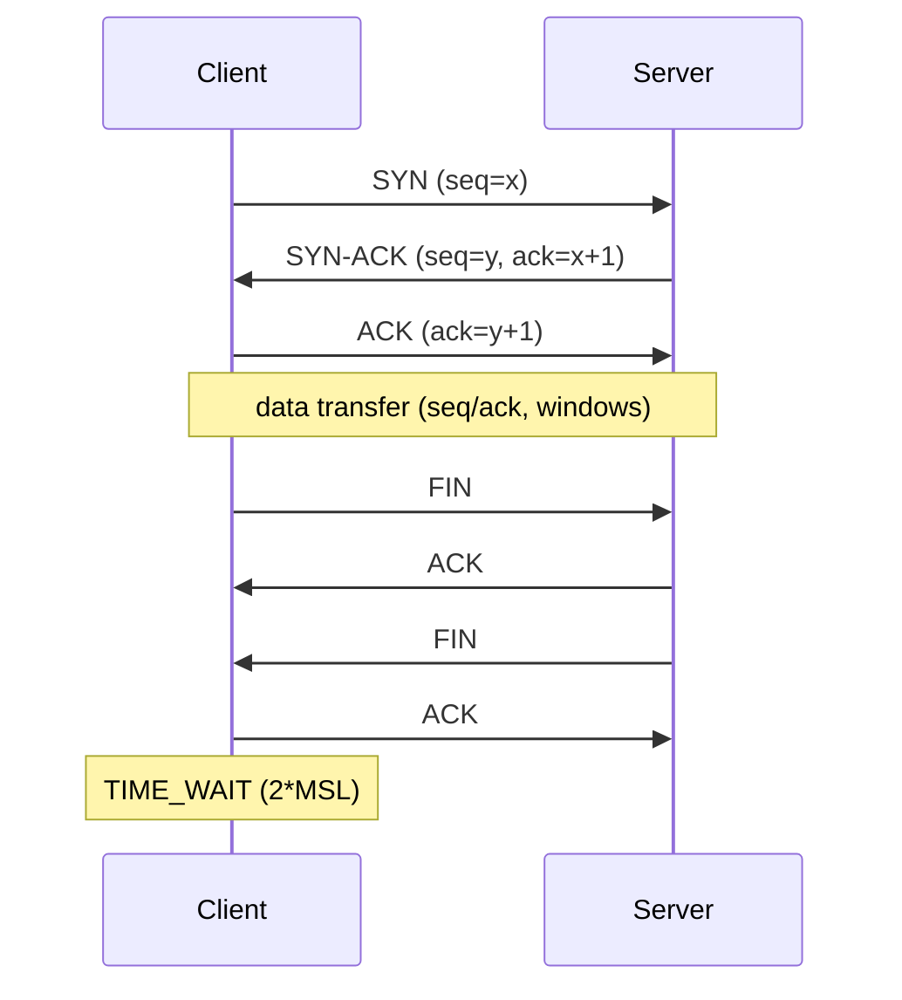

# TCP vs UDP

Hub: [[Computer-Networks]] · [[CS-Core-Curriculum]]

## Core Idea

Both are transport-layer protocols on top of IP, which delivers packets **best-effort**: they may be lost, duplicated, reordered, or corrupted. Both use **ports** so traffic reaches the right process.

- **TCP** gives a **reliable, ordered, byte-stream** connection. It adds handshakes, sequence numbers, acknowledgements, retransmission, flow control, and congestion control.
- **UDP** gives **unreliable, unordered datagrams** with message boundaries, plus a checksum. The header is 8 bytes and there is no connection setup.

TCP spends latency and complexity to buy correctness. UDP hands those decisions to the application.

| Property | TCP | UDP |
|---|---|---|
| Connection | 3-way handshake | None |
| Reliability | ACKs + retransmission | None |
| Ordering | In-order delivery | None |
| Boundaries | Byte stream (no message boundaries) | Preserves datagrams |
| Flow control | Receive window | None |
| Congestion control | Yes | None (application's job) |
| Header | 20–60 bytes | 8 bytes |
| Multicast/broadcast | No | Yes |
| Typical uses | HTTP/1.1–2, SSH, SMTP, databases | DNS, VoIP, games, QUIC/HTTP/3, DHCP |

## Mechanism

### TCP connection lifecycle



- **Sequence numbers** count bytes, not segments. ACKs are cumulative: they carry the next byte expected. SACK lets a receiver report gaps.
- **Retransmission** happens on timeout (the RTO is derived from smoothed RTT) or after 3 duplicate ACKs (fast retransmit).
- **Flow control** stops a sender from overrunning the receiver: the receiver advertises a window `rwnd`.
- **Congestion control** stops senders from overrunning the network (`cwnd`). See [[TCP-Congestion-Control]]. The amount in flight is at most `min(rwnd, cwnd)`.
- **TIME_WAIT** is held by the side that closes first. It lets late segments die out and lets a lost final ACK be retransmitted.

### UDP

Each `sendto()` produces one datagram. The receiver gets it whole or not at all. If the application needs reliability, ordering, or pacing, it builds them itself. QUIC does exactly that on top of UDP.

## Worked Example

```python
# UDP echo: no connection, message boundaries kept
import socket
s = socket.socket(socket.AF_INET, socket.SOCK_DGRAM)
s.bind(("127.0.0.1", 9999))
data, addr = s.recvfrom(2048)      # one whole datagram
s.sendto(data, addr)

# TCP: stream, must frame messages yourself
t = socket.socket(socket.AF_INET, socket.SOCK_STREAM)
t.connect(("example.com", 80))
t.sendall(b"GET / HTTP/1.1\r\nHost: example.com\r\nConnection: close\r\n\r\n")
chunks = []
while (b := t.recv(4096)):        # recv may return partial data
    chunks.append(b)
```

```bash
ss -tan state time-wait | wc -l     # count TIME_WAIT sockets
tcpdump -n 'tcp[tcpflags] & (tcp-syn) != 0'   # watch handshakes
dig example.com                      # DNS query, normally over UDP/53
```

With `sendall(b"ab")` then `sendall(b"cd")`, a TCP reader may get `b"abcd"` in one `recv`, or `b"a"` then `b"bcd"`. That is why protocols over TCP use length prefixes or delimiters.

## Pitfalls

- Treating TCP `recv()` as message-oriented. It is a stream, so you must frame messages.
- Assuming UDP is always faster. Without congestion control it can cause loss that hurts everyone, and implementing reliability yourself costs time and effort.
- Large UDP datagrams get IP-fragmented, and losing one fragment loses the whole datagram. Keep payloads under the path MTU.
- Head-of-line blocking in TCP: one lost segment stalls delivery of all later bytes, even when they belong to independent streams. See [[HTTP-Evolution]].
- Nagle's algorithm combined with delayed ACKs can add latency to small writes. Use `TCP_NODELAY` for interactive protocols.
- UDP has no handshake, so source IPs are easy to spoof.

## Interview Questions

**Q: Why does TCP need a 3-way handshake and not 2?**
A: Both sides must learn and acknowledge each other's initial sequence number. The third message confirms the server's ISN, which also guards against old duplicate SYNs opening bogus connections.

**Q: Flow control vs congestion control?**
A: Flow control protects the receiver (`rwnd`). Congestion control protects the network (`cwnd`).

**Q: Why is DNS usually over UDP?**
A: Queries are small request/response exchanges, so a handshake would double the latency. It falls back to TCP for large responses (truncation), zone transfers, and DNS over TLS.

**Q: What is TIME_WAIT and why does it exist?**
A: The active closer waits 2×MSL so that delayed segments from the old connection don't corrupt a new one with the same 4-tuple, and so it can resend the final ACK if that was lost.

**Q: Why does HTTP/3 use UDP?**
A: QUIC implements reliable multiplexed streams in user space over UDP. That avoids TCP's cross-stream head-of-line blocking, allows combined transport and TLS handshakes, and makes the protocol deployable without kernel or middlebox changes.

## Connections

- **System Design:** Load balancers work at L4 (TCP/UDP) or L7. Connection pooling and keep-alive exist to amortize handshakes. See [[System-Design-Basics]].
- **Cybersecurity:** SYN floods exhaust half-open connection state (mitigated with SYN cookies). UDP amplification DDoS abuses spoofable, reflective protocols (DNS, NTP, memcached). Port scanning relies on handshake behavior. See [[Network-Security]], [[TLS-Handshake]].

## Related

[[TCP-Congestion-Control]] · [[HTTP-Evolution]] · [[DNS]] · [[IP-Routing]] · [[TLS-Handshake]] · [[Computer-Networks]]
