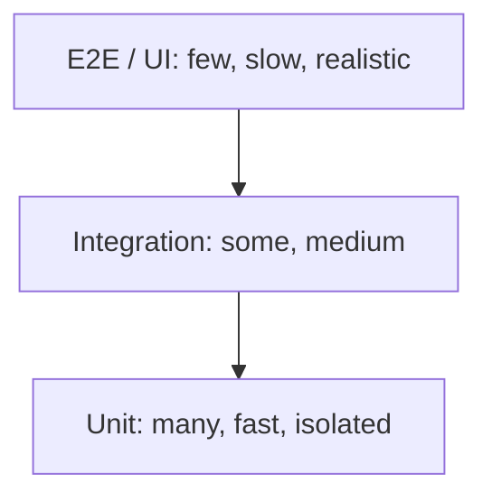

# Testing Strategies

Hub: [[Software-Engineering]] · [[CS-Core-Curriculum]]

## Core Idea

Tests exist to give **fast, trustworthy feedback** that the code does what it should and keeps doing so after changes. No single kind of test does this well alone: small tests are fast and precise but miss wiring bugs; large tests catch integration issues but are slow and flaky. A strategy mixes them deliberately.

Testing can show the presence of bugs, not their absence. Coverage measures what code ran, not whether its behaviour was checked.

## Mechanism

### The test pyramid



| Level | Scope | Speed | Catches |
|---|---|---|---|
| Unit | one function/class, dependencies replaced | milliseconds | logic errors, edge cases |
| Integration | real DB, queue, HTTP between components | seconds | schema, serialisation, config, query bugs |
| End-to-end | whole system via UI/API | seconds–minutes | broken user flows, deployment wiring |

Variants: **contract tests** (consumer and provider agree on an API schema without full e2e), **smoke tests** (quick post-deploy check), **regression tests** (pin a fixed bug). The "testing trophy" argues for weighting integration tests more heavily in UI-heavy apps; the point of any shape is cost versus confidence.

### Test doubles

| Double | Behaviour | Use |
|---|---|---|
| Dummy | passed but never used | fill a parameter |
| Stub | returns canned answers | control inputs |
| Fake | working lightweight implementation (in-memory DB) | realistic but fast |
| Spy | records calls for later assertions | verify interactions |
| Mock | preprogrammed with expectations; fails if not met | verify protocol |

Prefer asserting on **state/outputs** over **interactions**; interaction-heavy mocks couple tests to implementation and break on refactors.

### Beyond example-based tests

- **Property-based testing** (Hypothesis, QuickCheck, jqwik): state an invariant, let the framework generate many inputs, and **shrink** failures to a minimal counterexample. Good properties: round-trips (`decode(encode(x)) == x`), idempotence, invariants (sorted output is a permutation and ordered), comparison with a simple reference implementation.
- **Fuzzing** (AFL++, libFuzzer, OSS-Fuzz): feed generated/mutated inputs to find crashes, hangs, and sanitizer reports. **Coverage-guided** fuzzers keep inputs that reach new code paths. Pair with AddressSanitizer/UBSan to turn silent memory corruption into crashes.
- **Mutation testing** (PIT, mutmut, Stryker): make small changes to the code (`<` to `<=`, delete a line). If tests still pass, the mutant "survived" and the tests are weak there. A better measure of test quality than line coverage, but expensive.

### Test design habits

- **Arrange–Act–Assert**, one behaviour per test, descriptive names.
- **Boundary values and equivalence classes**: empty, one, many, max, negative, off-by-one.
- **Deterministic**: inject clock, randomness seed, and IDs.
- **TDD** (red–green–refactor) is a design technique as much as a testing one.

## Worked Example

A property-based test catching a bug a hand-written example missed:

```python
from hypothesis import given, strategies as st

def dedupe_keep_order(xs):
    seen, out = set(), []
    for x in xs:
        if x not in seen:
            seen.add(x)
            out.append(x)
    return out

@given(st.lists(st.integers()))
def test_dedupe(xs):
    out = dedupe_keep_order(xs)
    assert len(out) == len(set(out))          # no duplicates
    assert set(out) == set(xs)                # nothing lost
    assert out == sorted(out, key=xs.index)   # first-occurrence order kept
```

If someone "optimises" the function to `list(set(xs))`, the order property fails, and Hypothesis shrinks the counterexample to something tiny like `[1, 0]` (exact output depends on set iteration order).

Mocking at a boundary, not inside the logic:

```python
def test_sends_welcome_email():
    mailer = FakeMailer()                     # fake, not a mock of internals
    signup("a@x.com", mailer=mailer)
    assert mailer.sent == [("a@x.com", "Welcome")]
```

## Pitfalls

- **Flaky tests** (pass/fail without code change). Common causes: sleeps and timing assumptions, shared state/test order dependence, real network, unseeded randomness, time zones and wall clock, concurrency races, resource leaks. Fix the cause; quarantine with an owner if needed. Blind retries hide real race conditions.
- **Coverage as a target.** High coverage with weak assertions gives false confidence.
- **Over-mocking**: tests pass while the real integration is broken; mocks drift from real behaviour.
- **Ice-cream cone** (mostly e2e, few unit tests): slow, flaky, hard to diagnose.
- **Testing implementation details** (private methods, call order) makes refactoring painful.
- **Mocking what you don't own** (a third-party SDK) — wrap it in an adapter and fake the adapter; test the adapter with integration tests.

## Interview Questions

**Q: Unit vs integration test?**
A: A unit test checks one unit with dependencies replaced and runs in milliseconds; an integration test exercises real collaborators (DB, network, other services) to catch wiring and contract issues.

**Q: Mock vs stub?**
A: A stub supplies canned answers so the code under test can run; a mock also carries expectations about how it is called and fails the test if they aren't met.

**Q: How do you deal with a flaky test?**
A: Reproduce (loop it, randomise order, stress), find the non-determinism (time, order, concurrency, network), remove it by injecting clocks/seeds, isolating state, or awaiting conditions instead of sleeping. Quarantine meanwhile, tracked.

**Q: What does mutation testing tell you that coverage doesn't?**
A: Whether the tests actually detect behaviour changes. Coverage only says code executed.

**Q: When is property-based testing useful?**
A: When you can state general invariants: parsers/serialisers (round-trip), data structures, algorithms vs a reference implementation, and stateful systems via model-based tests.

**Q: What is fuzzing good at?**
A: Finding crashes, hangs, and memory errors from unexpected inputs in parsers and input-handling code, especially in memory-unsafe languages with sanitizers.

## Connections

- **Cybersecurity:** fuzzing is a primary way memory-corruption vulnerabilities are found (see [[Memory-Safety]]); security regression tests pin fixed vulnerabilities such as [[SQL-Injection]] payloads.
- **System Design:** contract tests, canary releases, and chaos experiments extend testing to distributed systems. See [[System-Design-Basics]].
- **AI:** ML systems need data validation and evaluation sets in addition to code tests; outputs are statistical, so assertions become thresholds.

## Related

- [[Software-Engineering]]
- [[Version-Control-Internals]]
- [[Memory-Safety]]
- [[OOP-Concepts]]
- [[System-Design-Basics]]
