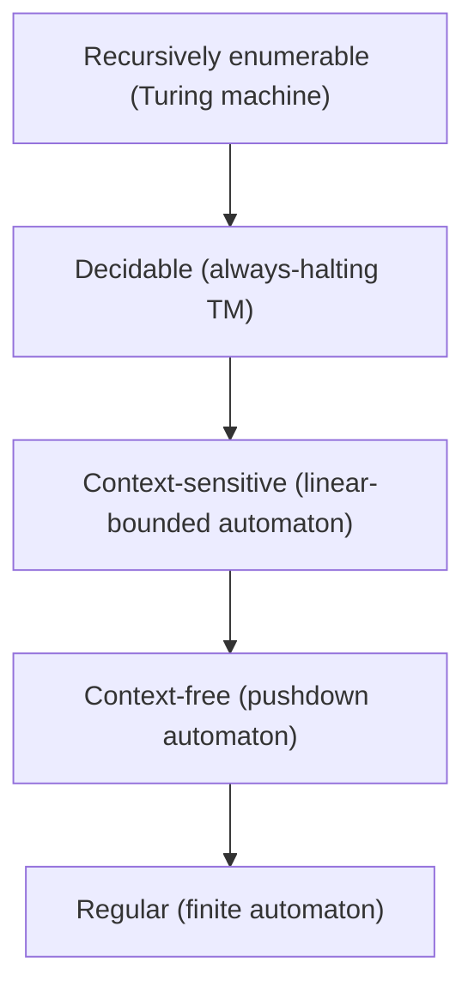

# Theory of Computation

Hub: [[CS-Core-Index]] · [[CS-Core-Curriculum]]

## Core Idea

Theory of computation classifies problems by the **weakest machine that can solve them** and by **how many resources** that takes. Finite automata recognize regular languages; pushdown automata add a stack and recognize context-free languages; Turing machines capture everything algorithmically computable. Some problems (like halting) are undecidable by any algorithm, and among decidable ones, complexity theory asks which are efficiently solvable (P) versus efficiently checkable (NP).

## Roadmap

1. Sets, strings, languages, proof techniques (induction, contradiction, diagonalization)
2. [[Finite-Automata-and-Regular-Languages]] — DFA, NFA, regex, closure properties, pumping lemma
3. Context-free grammars and pushdown automata — the theory behind parsers ([[Lexing-and-Parsing]])
4. [[Turing-Machines-and-Decidability]] — Church–Turing thesis, halting problem, Rice's theorem, reductions
5. Complexity — P, NP, NP-complete, NP-hard, polynomial-time reductions
6. Capstone: prove a language non-regular with the pumping lemma, and reduce 3-SAT to a graph problem (e.g. independent set)

## Key Concepts

Each class strictly contains the one below it (the Chomsky hierarchy, with decidable languages inserted between context-sensitive and recursively enumerable).

| Machine | Memory | Language class | Practical echo |
|---|---|---|---|
| DFA / NFA | Finite states | Regular | Lexers, regex engines, protocol state machines |
| Pushdown automaton | States + stack | Context-free | Parsers for programming languages, JSON |
| Turing machine | Unbounded tape | Recursively enumerable | Any general-purpose program |

## Notes

- [[Finite-Automata-and-Regular-Languages]]
- [[Turing-Machines-and-Decidability]]
- Applied side: [[Lexing-and-Parsing]], [[Compilers-and-Interpreters]]

## Interview Questions (with answers)

- **Can a regular expression match balanced parentheses?** — Not a true (formal) regular expression: balanced parentheses are context-free but not regular, which the pumping lemma proves. Some engines (PCRE recursion, .NET balancing groups) add non-regular extensions.
- **DFA vs NFA — which is more powerful?** — Equal power: every NFA converts to a DFA by subset construction, though the DFA may need up to 2^n states.
- **What does undecidable mean?** — No algorithm halts with the correct yes/no answer on every input. The halting problem is the canonical example.
- **P vs NP in one sentence?** — P is problems solvable in polynomial time; NP is problems whose solutions can be verified in polynomial time; whether they are equal is open.
- **NP-hard vs NP-complete?** — NP-complete problems are in NP and NP-hard; NP-hard problems need not be in NP (they may not even be decidable, like halting).
- **How do you show a new problem is NP-complete?** — Show it is in NP (poly-time verifier), then reduce a known NP-complete problem to it in polynomial time.

## Coding Exercises

- [ ] Implement a DFA simulator from a transition table; build one accepting binary strings divisible by 3
- [ ] Convert an NFA to a DFA with subset construction
- [ ] Thompson's construction: compile a tiny regex (`|`, `*`, concatenation, parentheses) to an NFA and simulate it
- [ ] Brute-force SAT solver for small CNF formulas, then add unit propagation
- [ ] Write a verifier for a Hamiltonian path certificate and note its polynomial running time

## Connections

- **System design** — protocol and workflow state machines (TCP states, order lifecycles) are finite automata; recognizing NP-hard subproblems (scheduling, bin packing) tells you to use heuristics or approximations instead of exact solvers.
- **Cybersecurity** — ReDoS arises from backtracking regex engines on ambiguous patterns; input validation is safest when inputs are restricted to a regular or context-free language and parsed strictly ("LangSec"); undecidability explains why perfect malware detection by static analysis is impossible (Rice's theorem).
- **AI** — tokenizers and constrained decoding (forcing an LLM's output to match a grammar or JSON schema) use automata; many planning and inference problems are NP-hard, motivating approximate and learned heuristics.

## Related

- [[Algorithms-Overview]]
- [[Compilers-and-Interpreters]]
- [[Big-O-Notation]]
