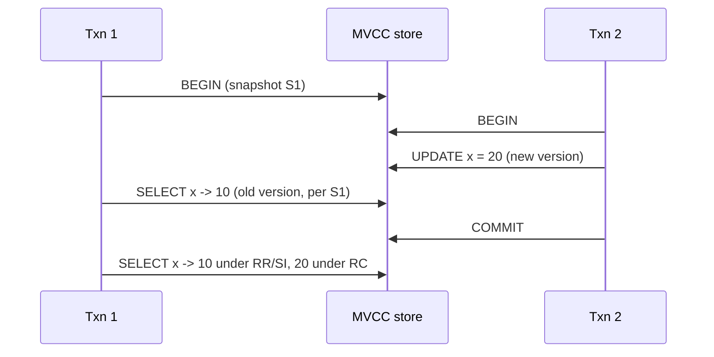

# Transactions and Isolation Levels

Hub: [[DBMS]] · [[CS-Core-Curriculum]]

## Core Idea

A **transaction** groups operations into one logical unit with **ACID** guarantees:

- **Atomicity**: all or nothing. Implemented with undo information and the write-ahead log (WAL).
- **Consistency**: the transaction moves the database from one valid state to another (constraints, triggers). This is largely the application's responsibility.
- **Isolation**: concurrent transactions don't interfere beyond what the isolation level permits.
- **Durability**: once committed, changes survive crashes (WAL flushed with `fsync`; see [[File-Systems]]).

Full isolation (**serializability**) means the result equals *some* serial order of the transactions. It costs throughput, so databases offer weaker levels that permit specific **anomalies**.

## Mechanism

### Concurrency control approaches

| Approach | Idea | Readers vs writers | Examples |
|---|---|---|---|
| **2PL** (two-phase locking) | Acquire locks (growing phase), then release (shrinking phase). *Strict* 2PL holds write locks until commit | Readers and writers block each other | SQL Server default (locking RC), InnoDB locking reads, classic serializable |
| **MVCC** | Keep multiple row versions. Each transaction reads a consistent **snapshot** | Readers don't block writers and vice versa | PostgreSQL, InnoDB consistent reads, Oracle, SQL Server snapshot modes |
| **SSI** (serializable snapshot isolation) | MVCC plus tracking of read/write dependencies. Aborts transactions that could form a non-serializable cycle | Non-blocking; conflicts cause aborts | PostgreSQL `SERIALIZABLE` |
| **OCC** (optimistic) | Run without locks, validate at commit | Aborts on conflict | Some in-memory and distributed DBs |



### Anomalies

- **Dirty read**: reading another transaction's uncommitted write.
- **Non-repeatable read**: re-reading a row returns a different committed value.
- **Phantom**: re-running a predicate query returns a different *set* of rows.
- **Lost update**: two read-modify-write transactions, where one overwrites the other's update.
- **Write skew**: two transactions read overlapping data, write *different* rows, and together violate an invariant that each one checked.

### Isolation levels vs anomalies

"Possible" means the level permits the anomaly. The first four rows follow the ANSI definitions and Berenson et al. (1995). Snapshot isolation is not an ANSI level.

| Level | Dirty read | Non-repeatable read | Phantom | Lost update | Write skew |
|---|---|---|---|---|---|
| Read Uncommitted | Possible | Possible | Possible | Possible | Possible |
| Read Committed | No | Possible | Possible | Possible | Possible |
| Repeatable Read (lock-based) | No | No | Possible | No | Possible |
| Snapshot Isolation | No | No | No (reads see a snapshot) | No (first-committer-wins) | **Possible** |
| Serializable | No | No | No | No | No |

### Per-engine notes

- **PostgreSQL**: default **Read Committed**. `READ UNCOMMITTED` behaves as Read Committed. **Repeatable Read is snapshot isolation**: no phantoms in reads, and concurrent updates of the same row fail with a serialization error, but write skew is allowed. **Serializable is SSI**, so applications must retry on `40001` errors.
- **MySQL InnoDB**: default **Repeatable Read**. Plain `SELECT`s use a consistent snapshot. Locking reads (`SELECT ... FOR UPDATE`) and writes use next-key/gap locks to block phantoms. Plain read-then-write can still **lose updates**, because InnoDB RR does not abort on write-write conflicts the way SI does. `SERIALIZABLE` turns plain SELECTs into shared-lock reads (when autocommit is off).
- **Oracle**: default Read Committed. Its `SERIALIZABLE` is actually snapshot isolation, so write skew is possible.
- **SQL Server**: default Read Committed with locking. `READ_COMMITTED_SNAPSHOT` and `SNAPSHOT` are MVCC options. `SERIALIZABLE` uses key-range locks.

> TODO: verify version-specific behavior against current engine docs before relying on edge cases.

## Worked Example

### Lost update and fixes

```sql
-- Both sessions run this at Read Committed:
BEGIN;
SELECT balance FROM accounts WHERE id = 1;        -- both read 100
UPDATE accounts SET balance = 100 - 30 WHERE id = 1;  -- app computed from stale read
COMMIT;                                           -- one withdrawal is lost
```

Fixes:

```sql
UPDATE accounts SET balance = balance - 30 WHERE id = 1;          -- atomic in-place update
SELECT balance FROM accounts WHERE id = 1 FOR UPDATE;             -- pessimistic row lock
UPDATE accounts SET balance = 70, version = version + 1
 WHERE id = 1 AND version = 7;                                   -- optimistic: check rows affected
```

### Write skew (on-call doctors)

Invariant: at least one doctor stays on call. Alice and Bob are both on call.

```sql
-- T1 (Alice) and T2 (Bob) concurrently, under snapshot isolation:
SELECT count(*) FROM doctors WHERE on_call;   -- both see 2
UPDATE doctors SET on_call = false WHERE name = 'Alice';  -- T1
UPDATE doctors SET on_call = false WHERE name = 'Bob';    -- T2
COMMIT; COMMIT;                               -- both succeed: 0 on call
```

The two transactions write different rows, so first-committer-wins sees no conflict. Fixes: run at `SERIALIZABLE` (PostgreSQL SSI aborts one), lock the rows read with `SELECT ... FOR UPDATE`, or materialize the conflict in a shared row both transactions must update.

## Pitfalls

- Assuming "Repeatable Read" means the same thing across engines. It doesn't.
- Using Serializable without retry logic. Serialization failures are expected, not bugs.
- Long-running transactions: they hold locks (2PL) or keep old versions alive (MVCC bloat; in PostgreSQL they block vacuum cleanup).
- Read-modify-write in application code without locks, atomic updates, or version checks.
- Treating isolation as a replacement for constraints: use `UNIQUE`/`CHECK`/foreign keys where possible.
- Deadlocks are normal under locking. Keep a consistent access order and retry. See [[Deadlocks]].

## Interview Questions

**Q: Explain ACID briefly.**
A: Atomicity (all or nothing), Consistency (constraints preserved), Isolation (concurrent transactions behave as allowed by the level), Durability (committed data survives crashes).

**Q: MVCC vs 2PL?**
A: 2PL serializes conflicting access with locks, so readers can block writers. MVCC keeps row versions so reads use a snapshot and never block writes, at the cost of version storage and garbage collection.

**Q: What anomaly does snapshot isolation still allow?**
A: Write skew: two transactions read the same data, update different rows based on it, and together break an invariant.

**Q: Non-repeatable read vs phantom?**
A: A non-repeatable read is a changed value in the *same* row. A phantom is a change in the *set* of rows matching a predicate (inserts or deletes).

**Q: What isolation does PostgreSQL's REPEATABLE READ provide?**
A: Snapshot isolation. It prevents dirty reads, non-repeatable reads, phantoms, and lost updates (by aborting), but allows write skew. SERIALIZABLE adds SSI to prevent that.

**Q: How do you prevent lost updates?**
A: Atomic `UPDATE ... SET x = x + ...`, `SELECT ... FOR UPDATE`, optimistic version checks, or a stricter isolation level with retries.

## Connections

- **System Design:** Distributed transactions (2PC, sagas), idempotency keys, and outbox patterns extend these guarantees across services. Replication lag creates read-your-writes problems. See [[Distributed-Systems]], [[Clocks-and-Ordering]], [[System-Design-Basics]].
- **Cybersecurity:** Race conditions in balance or coupon logic (double-spend, "limit overrun") are a real vulnerability class, fixed with the same locking and isolation tools. See [[OWASP-Top-10]].

## Related

[[Deadlocks]] · [[Synchronization-Primitives]] · [[Database-Indexing]] · [[SQL-Joins-and-Query-Plans]] · [[Normalization]] · [[Clocks-and-Ordering]] · [[DBMS]]
