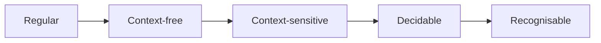

# Turing Machines and Decidability

Hub: [[Theory-of-Computation]] · [[CS-Core-Curriculum]]

## Core Idea

A **Turing machine (TM)** is a finite control plus an unbounded tape it can read, write, and move over. Despite its simplicity, the **Church–Turing thesis** holds that any effectively computable function can be computed by a TM. Every mainstream programming language (given unbounded memory) is Turing-complete.

Two separate questions:

- **Computability:** can *any* algorithm solve it? (decidable vs undecidable)
- **Complexity:** how efficiently? (P, NP, …)

Terminology:
- **Decidable (recursive):** some TM halts on every input with the correct yes/no.
- **Recognisable (recursively enumerable):** some TM halts and accepts every yes-instance, but may loop forever on no-instances.

## Mechanism

### The Chomsky hierarchy

| Type | Grammar | Machine | Example |
|---|---|---|---|
| 3 | Regular | Finite automaton | `(ab)*` |
| 2 | Context-free | Pushdown automaton | balanced parens, `aⁿbⁿ` |
| 1 | Context-sensitive | Linear-bounded automaton | `aⁿbⁿcⁿ` |
| 0 | Unrestricted | Turing machine | halting set (recognisable) |

Each level strictly contains the one above it.

### The halting problem (proof sketch)

`HALT = {⟨M, x⟩ : M halts on input x}` is undecidable.

1. Suppose a decider `H(M, x)` always halts and returns true iff M halts on x.
2. Build `D(M)`: if `H(M, M)` is true, loop forever; else halt.
3. Run `D(D)`. If it halts, then H(D, D) was true so D loops. If it loops, H said false so D halts. Contradiction.

So no such H exists. HALT is still *recognisable* (simulate and accept if it halts), so its complement is not recognisable.

### Reductions

`A ≤ B` means instances of A can be computably transformed (in polynomial time, for complexity) into instances of B with the same answer. If A ≤ B and A is undecidable (or NP-hard), B is too. **Direction matters:** reduce the known-hard problem *to* the new problem.

### Rice's theorem

Every **non-trivial semantic property** of the language a program recognises is undecidable. "Non-trivial" = some programs have it and some don't; "semantic" = depends on behaviour, not syntax. Examples: "does this program ever output 42?", "is its language empty?", "is this binary malicious?" in full generality.

Syntactic properties ("has more than 10 states") are outside Rice's theorem and often decidable.

### P, NP, NP-complete

- **P:** decidable in polynomial time on a deterministic TM.
- **NP:** a yes-answer has a certificate verifiable in polynomial time (equivalently, solvable in polynomial time by a nondeterministic TM).
- **NP-hard:** every NP problem polynomial-time reduces to it.
- **NP-complete:** NP-hard and in NP. SAT was the first (Cook–Levin). Others: 3-SAT, vertex cover, clique, Hamiltonian cycle, subset sum, decision-TSP.

P ⊆ NP. Whether P = NP is open.

## Worked Example

**Show 3-SAT ≤ₚ CLIQUE** (so CLIQUE is NP-hard).

Given a formula with k clauses, each of 3 literals:
1. Create one vertex per literal occurrence (3k vertices).
2. Connect two vertices if they are in *different* clauses and are *not* contradictory (x and ¬x).
3. Ask: is there a clique of size k?

A satisfying assignment picks one true literal per clause; those k vertices are pairwise consistent and in different clauses, so they form a k-clique. Conversely a k-clique has one vertex per clause with no contradictions, so setting those literals true satisfies the formula. The construction is polynomial. CLIQUE is also in NP (verify a given clique), so it is NP-complete.

## Pitfalls

- **Reducing in the wrong direction.** Showing your problem reduces *to* SAT only shows it is no harder than SAT, not that it is hard.
- **Confusing NP with "not polynomial".** NP stands for nondeterministic polynomial; P ⊆ NP.
- **Treating NP-hard as "unsolvable".** Small instances, special structure, approximations, heuristics, and SAT/ILP solvers handle many real cases. Pseudo-polynomial DP solves subset sum/knapsack when numbers are small (see [[Dynamic-Programming]]).
- **Overreading Rice's theorem.** It forbids a perfect *general* decider, not sound-but-incomplete analyses. Type checkers, static analysers, and antivirus heuristics work by accepting false positives or negatives.
- **Undecidable ≠ slow.** Undecidable problems have no algorithm at all, regardless of time.

## Interview Questions

**Q: Why is the halting problem undecidable?**
A: Assuming a halting decider H lets you build a program that does the opposite of what H predicts about itself; running it on itself yields a contradiction (diagonalisation).

**Q: What does Rice's theorem say, and why does it matter?**
A: Any non-trivial property of a program's behaviour is undecidable. Hence perfect bug finders or malware detectors are impossible; practical tools approximate.

**Q: Difference between NP-hard and NP-complete?**
A: NP-complete problems are NP-hard *and* in NP. NP-hard problems need not be in NP (the halting problem is NP-hard but undecidable).

**Q: How do you prove a new problem X is NP-complete?**
A: Show X ∈ NP (polynomial verifier), then reduce a known NP-complete problem to X in polynomial time.

**Q: Is the complement of HALT recognisable?**
A: No. HALT is recognisable; if its complement were too, running both recognisers in parallel would decide HALT.

## Connections

- **Cybersecurity:** Rice's theorem is why malware detection is heuristic and obfuscation works; see [[Malware-Analysis-Basics]] and [[Reverse-Engineering-Basics]]. Cryptography needs problems hard on *average*, a stronger assumption than NP-hardness (worst case); see [[Applied-Cryptography]].
- **System Design:** scheduling, bin packing, and placement problems are NP-hard, so schedulers use heuristics.
- **AI:** SAT/constraint solvers and classical planning sit on NP-complete (or harder) problems; heuristic search trades optimality for speed.

## Related

- [[Finite-Automata-and-Regular-Languages]]
- [[Theory-of-Computation]]
- [[Algorithms-Overview]]
- [[Big-O-Notation]]
- [[Dynamic-Programming]]
