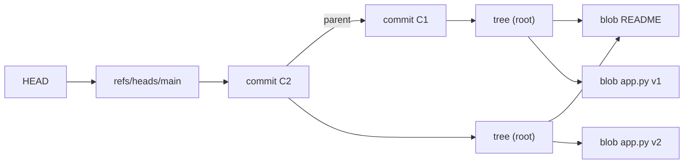

# Version Control Internals

Hub: [[Software-Engineering]] · [[CS-Core-Curriculum]]

## Core Idea

Git is a **content-addressed object store** plus a small set of **named pointers (refs)** into it. Every file version, directory listing, and commit is an immutable object whose name is the hash of its content. History is a **directed acyclic graph** of commits; branches are just movable labels on that graph.

Because a commit hash covers its tree and parents, which cover their contents recursively, the structure is a **Merkle DAG**: one commit ID fixes the entire history behind it.

## Mechanism

### Object types

| Object | Contains |
|---|---|
| **blob** | raw file bytes (no name, no permissions) |
| **tree** | entries of (mode, name, object ID) for blobs and subtrees |
| **commit** | root tree ID, zero or more parent IDs, author, committer, timestamps, message |
| **annotated tag** | target object ID, type, tagger, message, optional signature |

Object ID = hash of `"<type> <size>\0<content>"`. Default is **SHA-1** (40 hex chars); git also supports **SHA-256** repositories (`git init --object-format=sha256`). After the 2017 SHAttered collision, git uses a collision-detecting SHA-1 variant.



Unchanged files share blobs across commits, so identical content is stored once.

### Refs and HEAD

- **Branch:** a file `refs/heads/<name>` containing a commit ID. Committing advances it.
- **Tag:** `refs/tags/<name>`; lightweight tags point directly at a commit, annotated tags point at a tag object.
- **Remote-tracking:** `refs/remotes/origin/main`, updated by fetch.
- **HEAD:** usually a symbolic ref (`ref: refs/heads/main`); "detached HEAD" means it holds a commit ID directly.
- Many refs may be stored together in `packed-refs`.

### The index (staging area)

`.git/index` is a binary file listing path → blob ID plus stat metadata (for fast change detection). `git add` writes the blob and updates the index; `git commit` turns the index into tree objects and writes a commit. Three states: HEAD tree, index, working directory — `git diff` compares working tree vs index, `git diff --staged` compares index vs HEAD.

### Storage: loose objects and packfiles

New objects are stored zlib-compressed as `.git/objects/ab/cdef…`. `git gc` and network transfer build **packfiles**: many objects in one file, with similar objects stored as **deltas** against a base, plus a `.idx` for lookup. Deltas are a storage optimisation; conceptually every commit is still a full snapshot, not a diff.

### Merge vs rebase

- **Fast-forward:** target is an ancestor, so the branch pointer just moves.
- **Merge:** find the merge base (best common ancestor), do a three-way merge, create a commit with **two parents**. History is preserved as it happened.
- **Rebase:** replay each commit of your branch onto a new base, creating **new commits with new IDs** (same diffs, different parent, so different hash). History becomes linear.

Rule: don't rebase commits others have already based work on; their copies refer to the old IDs.

### Reflog

`.git/logs/` records every movement of HEAD and branch refs locally. After a bad reset or rebase, `git reflog` shows prior positions (`HEAD@{2}`) and you can restore them. Unreachable objects are only removed by gc after expiry (default reflog expiry is 90 days for reachable entries, 30 for unreachable ones; configurable).

## Worked Example

Inspect the object model with plumbing commands:

```bash
git init demo && cd demo
echo "hello" > a.txt
git hash-object a.txt          # ce013625030ba8dba906f756967f9e9ca394464a
git add a.txt && git commit -m "first"

git cat-file -p HEAD           # tree <id>, author ..., message
git cat-file -p 'HEAD^{tree}'  # 100644 blob ce0136... a.txt
git cat-file -t ce01362        # blob
cat .git/HEAD                  # ref: refs/heads/main (or master)
```

The blob hash for "hello\n" is the same in every SHA-1 repository in the world, because it depends only on content.

Recovering from a mistaken hard reset:

```bash
git reset --hard HEAD~2        # oops
git reflog                     # find e.g. "HEAD@{1}: commit: add feature"
git reset --hard HEAD@{1}      # back
```

## Pitfalls

- **Thinking branches are copies.** A branch is a 41-byte pointer; creating one is O(1).
- **Rebasing shared history** forces collaborators to reconcile duplicate commits; use `--force-with-lease` if you must push rewritten history.
- **Committing secrets.** Deleting the file in a later commit leaves it in history and in every clone. Rotate the secret; rewriting history (git filter-repo) is secondary.
- **Large binaries** bloat every clone, since deltas compress them poorly. Use Git LFS or external storage.
- **Assuming reflog is shared.** It is local-only and does not travel with push/clone.
- **`git reset --hard` with uncommitted changes** loses them permanently; they were never objects in the reflog (unless staged, in which case blobs may be recoverable via `git fsck --lost-found`).

## Interview Questions

**Q: What are git's object types?**
A: Blob (file content), tree (directory listing), commit (tree + parents + metadata), annotated tag. All immutable and named by the hash of their content.

**Q: Why does rebasing change commit hashes?**
A: A commit's hash covers its parent ID. Replaying it onto a new parent changes the content being hashed, producing a new object.

**Q: Merge or rebase?**
A: Merge preserves true history and is safe on shared branches; rebase gives linear history for local or private branches. Many teams rebase locally, then merge (or squash-merge) into main.

**Q: What does content addressing buy you?**
A: Deduplication, cheap integrity checking (corruption changes the hash), and a single ID that pins the entire history, which makes signed commits/tags meaningful.

**Q: How do you recover a commit after a bad reset?**
A: Find its ID in `git reflog` and reset or branch to it, before gc prunes it.

**Q: What is a packfile?**
A: A compressed file holding many objects, some stored as deltas against similar objects, with an index for lookup. Used for storage efficiency and transfer.

## Connections

- **Cybersecurity:** commit/tag signing and hash chaining underpin supply-chain integrity; weaker hashes are why SHA-1 collision resistance matters (see [[Hashing-vs-Encryption]], [[Applied-Cryptography]]). Leaked secrets in history are a common real-world exposure.
- **System Design:** the same Merkle-DAG idea appears in content-addressed storage, blockchains, and anti-entropy sync (comparing root hashes to find differing subtrees).

## Related

- [[Software-Engineering]]
- [[Testing-Strategies]]
- [[Hashing-vs-Encryption]]
- [[Hash-Tables]]
- [[File-Systems]]
