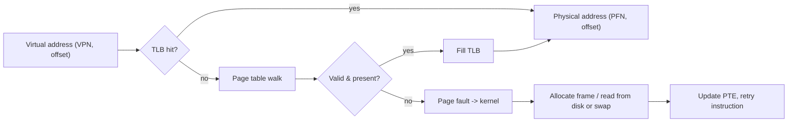

# Virtual Memory and Paging

Hub: [[Operating-Systems]] · [[CS-Core-Curriculum]]

## Core Idea

Each process sees a private, contiguous **virtual address space**. The hardware **MMU** translates virtual addresses to physical addresses using **page tables** maintained by the OS. Memory is split into fixed-size **pages** (virtual) and **frames** (physical), commonly 4 KiB, with larger "huge pages" (2 MiB/1 GiB on x86-64).

This gives:

- **Isolation** — a process can't address another's memory.
- **Overcommit and demand paging** — only touched pages need physical frames.
- **Sharing** — shared libraries and COW `fork()` map the same frame into several spaces.
- **Protection bits** — read/write/execute, user/kernel per page.

## Mechanism

### Translation

Virtual address = page number + offset. With 4 KiB pages, the low 12 bits are the offset.



- **Multi-level page tables**: x86-64 uses 4 levels (5 with LA57), each indexed by 9 bits of the 48-bit (or 57-bit) address, so unused regions need no table memory.
- **TLB** (Translation Lookaside Buffer): a small cache of recent translations. A miss costs a page walk (several memory accesses, often cached).
- **Page table entry (PTE)** bits: present, writable, user, accessed, dirty, NX (no-execute).

### Page faults

| Kind | Cause | Handling |
|---|---|---|
| Minor (soft) | Page in memory but not mapped (e.g., first touch of zero page, shared page) | Map it, no disk I/O |
| Major (hard) | Page must be read from disk/swap | Block thread, do I/O |
| Invalid | Bad address or permission violation | SIGSEGV to the process |

### Page replacement

When memory is full, evict a page:

- **FIFO** — simple; suffers **Belady's anomaly** (more frames can cause more faults).
- **Optimal (OPT/MIN)** — evict page used furthest in future; not implementable, used as benchmark.
- **LRU** — evict least recently used; good but costly to implement exactly.
- **Clock / second chance** — approximates LRU with the accessed bit. Linux uses active/inactive LRU lists (and multi-gen LRU in newer kernels).

Dirty pages must be written back before eviction.

**Thrashing**: the working sets of running processes exceed physical memory, so the system spends most time paging. Fix: reduce multiprogramming, add RAM, or fix locality.

## Worked Example

### Address split

32-bit address, 4 KiB pages → 12-bit offset, 20-bit VPN. Address `0x00403ABC` → VPN `0x00403`, offset `0xABC`. If the page table maps VPN `0x00403` → PFN `0x1F2`, physical address = `0x1F2ABC`.

### LRU vs FIFO with 3 frames

Reference string: `7 0 1 2 0 3 0 4`

- **FIFO:** 7,0,1 (3 faults) → 2 evicts 7 (4) → 0 hit → 3 evicts 0 (5) → 0 evicts 1 (6) → 4 evicts 2 (7). **7 faults.**
- **LRU:** 7,0,1 (3) → 2 evicts 7 (4) → 0 hit → 3 evicts 1 (5) → 0 hit → 4 evicts 2 (6). **6 faults.**

### Observing on Linux

```bash
getconf PAGESIZE                 # 4096 on most x86-64
/usr/bin/time -v ./app           # major/minor page faults
cat /proc/<pid>/maps             # virtual memory areas and permissions
vmstat 1                         # si/so columns show swap in/out
```

```c
// mmap a file: pages load lazily on first access (demand paging)
int fd = open("data.bin", O_RDONLY);
char *p = mmap(NULL, len, PROT_READ, MAP_PRIVATE, fd, 0);
char c = p[8192];   // triggers a fault that reads that page
```

## Pitfalls

- Confusing **paging** (fixed-size) with **segmentation** (variable-size, external fragmentation). Paging has internal fragmentation only (last page partially used).
- Thinking virtual memory = swap. Virtual memory exists even with swap disabled.
- Ignoring TLB reach: random access over huge datasets causes TLB misses; huge pages help.
- Linux overcommit: `malloc` can succeed and the OOM killer strikes later on first touch.
- Forgetting that a page fault restarts the faulting instruction.

## Interview Questions

**Q: Why use multi-level page tables?**
A: A flat table for a 48-bit space would be huge; multi-level tables allocate inner tables only for used regions.

**Q: What is the TLB and what happens on a context switch?**
A: A cache of virtual→physical translations. On a process switch entries become invalid unless tagged by ASID/PCID; otherwise the TLB is flushed.

**Q: What is a page fault and is it an error?**
A: A trap when a translation is missing or disallowed. Usually not an error (demand paging, COW); only invalid accesses become segfaults.

**Q: What is Belady's anomaly?**
A: With FIFO, increasing frames can increase faults. Stack algorithms like LRU and OPT don't suffer it.

**Q: What is thrashing?**
A: Excessive paging because active working sets don't fit in RAM, so CPU utilization collapses.

**Q: Internal vs external fragmentation?**
A: Internal is wasted space inside an allocated unit (partially used page); external is free memory split into unusable gaps (segmentation, heap allocators).

## Connections

- **System Design:** Databases and caches (buffer pools, `mmap`-based stores) depend on page cache behavior; container memory limits and OOM kills are common production incidents. See [[CPU-Caches-and-Memory-Hierarchy]].
- **Cybersecurity:** NX bit (DEP), ASLR, guard pages, and kernel/user separation are page-table features; Meltdown exploited speculative access across the user/kernel mapping, leading to KPTI. See [[Memory-Safety]], [[Reverse-Engineering-Basics]].
- **AI:** LLM serving systems apply paging ideas to the KV cache (e.g., vLLM's PagedAttention) to cut fragmentation. See [[Transformer-Architecture]].

## Related

[[Processes-and-Threads]] · [[CPU-Caches-and-Memory-Hierarchy]] · [[File-Systems]] · [[Memory-Safety]] · [[Operating-Systems]]
