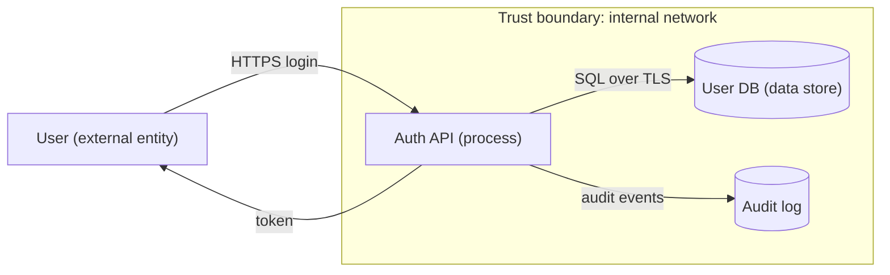

# Threat Modeling STRIDE

Hub: [[Cybersecurity-Index]] | Engineering OS: [[Security-Engineering-OS]]

## Core Idea

Threat modeling is structured, design-time reasoning about what can go wrong before you build it. STRIDE (from Microsoft) is a mnemonic that prompts six threat categories per component and data flow: Spoofing, Tampering, Repudiation, Information disclosure, Denial of service, Elevation of privilege. Each category is the violation of a desirable security property, which makes STRIDE a systematic way to not miss whole classes of threats.

## Details

**The STRIDE table — threat maps to property maps to mitigation**

| Threat | Violates property | Example | Mitigation |
|---|---|---|---|
| Spoofing | Authentication | Logging in as another user; forged sender | Strong authn, MFA, signed tokens |
| Tampering | Integrity | Altering a price in transit or in the DB | HMAC/signatures, input validation, TLS, access control |
| Repudiation | Non-repudiation | User denies making a transaction | Secure audit logs, signed actions, timestamps |
| Information disclosure | Confidentiality | Leaking PII, verbose error messages | Encryption, access control, least privilege |
| Denial of service | Availability | Flooding an endpoint, resource exhaustion | Rate limiting, quotas, autoscaling, timeouts |
| Elevation of privilege | Authorization | Normal user gains admin (IDOR, path bug) | Authz checks, least privilege, deny by default |

The "property violated" column is exactly the [[CIA-Triad]] extended with authn/authz/non-repudiation — that mapping is a common interview follow-up.

**The process (design-time, four questions)**
1. What are we building? Draw a Data Flow Diagram: external entities, processes, data stores, data flows, and trust boundaries (where privilege/trust level changes — the interesting bits).
2. What can go wrong? Apply STRIDE to each element, focusing on flows crossing trust boundaries.
3. What are we going to do about it? Choose per threat: mitigate, eliminate, transfer, or accept.
4. Did we do a good job? Review, and revisit when the design changes.

**Worked example — login API (user → API → user database)**
- Trust boundary: the internet-to-API edge, and the API-to-DB edge.
- Spoofing: attacker guesses/steals credentials → MFA, rate limiting, argon2 password hashing ([[Hashing-vs-Encryption]]).
- Tampering: MITM alters the request → TLS ([[TLS-Handshake]]).
- Repudiation: user denies a password change → append-only audit log with timestamp + source IP.
- Information disclosure: error reveals "user exists" → generic error messages; encrypt the DB.
- DoS: credential-stuffing floods login → per-IP and per-account rate limits, lockout with care (lockout itself is a DoS lever).
- Elevation: role field trusted from the client → server-side authz, deny by default ([[Authentication-vs-Authorization]]).

**Where it fits and common pitfalls**
- Proactive counterpart to reactive [[Incident-Response-Lifecycle]]: model at design time so you have fewer incidents.
- Element-level, not just diagram-level: apply STRIDE per element, not once for the whole system.
- Pitfall: modeling only the happy path; the value is in the trust boundaries and abuse cases.
- Pitfall: a threat model that's a one-time document — it must be revisited as the design evolves.
- Other frameworks to name-drop: DREAD (risk scoring, subjective), PASTA (attacker-centric), attack trees.

## Interview Angle

- Expect a live design threat model: "Here's a system, what could go wrong?" Draw the DFD, mark trust boundaries, then march through STRIDE per element. The structure impresses more than any single finding.
- Memorize the six letters and, for each, the property violated and one mitigation — the table above. "Tampering violates integrity, mitigate with HMAC/signatures" is the expected crispness.
- Expect: "How does STRIDE relate to CIA?" Tampering→I, Info disclosure→C, DoS→A, plus Spoofing→authn, Elevation→authz, Repudiation→non-repudiation.
- Say "trust boundary" out loud and focus analysis there — it signals you know where real threats concentrate.
- Tie-in: this vault's Threat-Model-Template in 06-Cybersecurity-Toolkit operationalizes exactly this process.

## DFD Example (Mermaid)

Every arrow crossing a trust boundary gets the full STRIDE pass; data stores get T, I, D (and R for logs); processes get all six.

## Choosing a Method

| Method | Focus | Use when |
|---|---|---|
| STRIDE | Per-element threat categories | Default for design reviews of software systems |
| Attack Trees | Goal decomposition of one attacker objective | Deep-diving a single high-value asset or abuse case |
| PASTA | Seven-stage, risk and business-impact centric | Heavier process, when business risk alignment is required |
| LINDDUN | Privacy threats (linkability, identifiability, ...) | Systems processing personal data |
| MITRE ATTACK | Observed adversary behaviour | Mapping threats to detections and validating coverage |

## Attacker View vs Defender View

- **Attacker:** looks for the weakest trust boundary, implicit trust (internal services without authn), and data flows nobody drew (debug endpoints, admin panels, CI credentials).
- **Defender:** makes trust explicit, puts controls at boundaries, and records each threat with an owner and a decision (mitigate / eliminate / transfer / accept) in the [[Threat-Model-Template]].

## Tradeoffs

- Lightweight models (one whiteboard session per feature) get done; exhaustive models get skipped. Prefer frequent, small, feature-level models.
- STRIDE generates many low-value findings if applied mechanically; prioritise by trust-boundary crossings and asset value.
- Risk scoring (DREAD) is subjective; many teams replace it with simple high/medium/low plus a justification.

## Interview Questions

1. **What is a trust boundary?** A point where data or control passes between components with different privilege or trust; most real threats concentrate there.
2. **Which STRIDE categories apply to a data store?** Tampering, Information disclosure, Denial of service; Repudiation if it is a log.
3. **When would you use attack trees instead of STRIDE?** When analysing one specific attacker goal in depth and comparing the cost of alternative paths.
4. **How do you keep a threat model alive?** Store it with the code, review it in design reviews and when a trust boundary changes, and link findings to tickets.
5. **How does threat modeling connect to detection?** Unmitigated or accepted threats become detection requirements; map them to ATT&CK techniques and write rules (Detection Engineering).

## Related

- [[Threat-Model-Template]]
- Attack Trees
- MITRE ATTACK
- Security Architecture
- [[CIA-Triad]]
- [[OWASP-Top-10]]
- [[Incident-Response-Lifecycle]]
- [[Authentication-vs-Authorization]]
- [[Cybersecurity-Index]]
