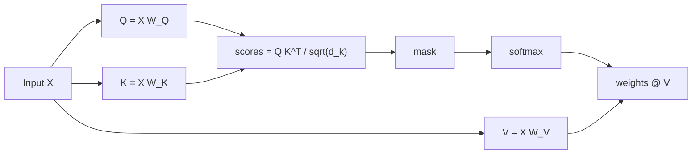

# Attention Mechanism

Hub: [[AI-Engineering-Index]]

## Core Idea

Each token computes a relevance score against every other token, turns those scores into a probability distribution with softmax, and takes a weighted average of the other tokens' value vectors. The output for each position is a context-aware blend of the whole sequence. This is content-based lookup, not position-based: what gets mixed in depends on what the tokens *mean*, and the weights are recomputed for every input.

Think of it as a soft, differentiable dictionary lookup: a query is compared with every key, and instead of returning the single best match it returns a similarity-weighted average of all values.

## How it works

Scaled dot-product attention:

$$\text{Attention}(Q, K, V) = \text{softmax}\left(\frac{QK^\top}{\sqrt{d_k}} + M\right)V$$

where $M$ is an optional mask (0 for allowed positions, $-\infty$ for blocked ones).

Shape walkthrough for a sequence of $n$ tokens with model dim $d_{model}$:

| Step | Operation | Shape |
|---|---|---|
| Input embeddings | $X$ | $(n, d_{model})$ |
| Project | $Q = XW_Q,\ K = XW_K,\ V = XW_V$ | $(n, d_k)$ each |
| Scores | $QK^\top$ | $(n, n)$ |
| Scale + mask + softmax | row-wise over $n$ | $(n, n)$, rows sum to 1 |
| Aggregate | weights $\cdot V$ | $(n, d_k)$ |

- **Why divide by $\sqrt{d_k}$**: if the components of $q$ and $k$ are roughly independent with unit variance, $q \cdot k$ has variance $d_k$. Large magnitudes push softmax into saturation (near one-hot), so gradients through it vanish. Scaling keeps score variance near 1.
- **Q/K/V intuition**: query = what this token is looking for; key = what this token advertises; value = what it contributes if selected. Three separate learned projections of the same input let a token match differently as searcher vs target.
- **Multi-head**: run $h$ attention ops in parallel with $d_k = d_{model}/h$ each, concatenate, project back with $W_O$. Heads can specialize (syntax, coreference, positional patterns); a single head would average distinct relations into one blur. Total compute is about the same as one full-width head.
- **Causal masking** (decoder-only LLMs): set scores for future positions to $-\infty$ before softmax so token $i$ only attends to tokens $\le i$. This lets training compute every position in parallel while matching left-to-right generation.
- **Self vs cross attention**: self - Q, K, V all from one sequence. Cross - Q from one sequence (decoder), K/V from another (encoder output, image features).



## Python code

Minimal, runnable NumPy implementation with causal mask and multi-head split:

```python
import numpy as np

def softmax(x, axis=-1):
    x = x - x.max(axis=axis, keepdims=True)      # numerical stability
    e = np.exp(x)
    return e / e.sum(axis=axis, keepdims=True)

def attention(Q, K, V, mask=None):
    d_k = Q.shape[-1]
    scores = Q @ np.swapaxes(K, -1, -2) / np.sqrt(d_k)   # (..., n, n)
    if mask is not None:
        scores = np.where(mask, scores, -1e9)             # False = blocked
    w = softmax(scores, axis=-1)
    return w @ V, w

def multi_head(X, Wq, Wk, Wv, Wo, h, causal=True):
    n, d = X.shape
    dk = d // h
    def split(T):                     # (n, d) -> (h, n, dk)
        return T.reshape(n, h, dk).transpose(1, 0, 2)
    Q, K, V = split(X @ Wq), split(X @ Wk), split(X @ Wv)
    mask = np.tril(np.ones((n, n), dtype=bool)) if causal else None
    out, _ = attention(Q, K, V, mask)            # (h, n, dk)
    out = out.transpose(1, 0, 2).reshape(n, d)   # concat heads
    return out @ Wo

rng = np.random.default_rng(0)
n, d, h = 5, 16, 4
X = rng.normal(size=(n, d))
W = [rng.normal(scale=d**-0.5, size=(d, d)) for _ in range(4)]
print(multi_head(X, *W, h=h).shape)   # (5, 16)
```

Worked micro-example: in "The cat sat because it was tired", the query for "it" can score high against the key for "cat", so the output vector at "it" is mostly cat's value - the model can resolve the pronoun in one matrix multiply.

## Tradeoffs

| Choice | Gain | Cost |
|---|---|---|
| Full attention | Any token reaches any other in one hop | $O(n^2)$ compute and memory in sequence length |
| Sliding-window / local attention | Linear in $n$ | Long-range info must propagate over layers |
| Multi-query / grouped-query attention (fewer K/V heads) | Much smaller KV cache, faster decoding | Slight quality loss vs full multi-head in some settings |
| FlashAttention (IO-aware tiling) | Exact result, far less memory traffic | Kernel-level complexity; still $O(n^2)$ FLOPs |
| More heads at fixed $d_{model}$ | More specialized relations | Each head has smaller $d_k$ |

## Failure modes

- **Softmax saturation** without scaling or with bad init: attention collapses to one-hot, gradients vanish.
- **Attention sink / diffuse attention**: over long contexts, weights spread thin or pile onto a few tokens (often the first); relevant tokens mid-context get low weight - one source of "lost in the middle" (see [[Context-Windows]]).
- **Mask bugs**: an off-by-one causal mask leaks future tokens during training - training loss looks great, generation is garbage.
- **Padding not masked** in batched inputs: pad tokens receive attention and corrupt outputs.
- **Numerical issues**: using `-inf` with fp16 and a fully-masked row gives NaN; use a large negative finite value or guard rows.
- **Over-interpreting weights**: high attention weight is not proof of causal importance; do not treat heatmaps as explanations.

## Production notes

- At inference the **KV cache** stores past keys/values so each new token costs $O(n)$ attention instead of recomputing the full $O(n^2)$; cache memory grows linearly with context length and batch size and often bounds throughput (see [[LLM-Inference-and-Serving]]).
- Long prompts cost quadratically in prefill; prefer retrieval of relevant chunks over stuffing ([[RAG-Playbook]]).
- Use fused attention kernels provided by your framework (e.g. `torch.nn.functional.scaled_dot_product_attention`) rather than hand-written matmuls.

## Interview questions

1. **Write the attention formula and explain each piece.** $\text{softmax}(QK^\top/\sqrt{d_k})V$: similarity scores, scaling to keep variance about 1, softmax to get a distribution per query, weighted sum of values.
2. **Why scale by $\sqrt{d_k}$?** Dot-product variance grows with $d_k$; large logits saturate softmax and kill gradients.
3. **Why three projections instead of using X directly?** Decouples what a token seeks from what it offers and what it passes on; the same token can match differently as searcher vs target.
4. **Why multi-head?** Several subspaces capture different relations in parallel at roughly the same total cost as one wide head.
5. **What does the causal mask do, and why does it enable parallel training?** Blocks attention to future positions, so all next-token predictions in a sequence can be computed in one pass (teacher forcing) while matching inference behavior.
6. **Complexity and how to reduce it?** $O(n^2 d)$ time, $O(n^2)$ memory for the score matrix; FlashAttention (memory), sliding windows / sparse attention (compute), grouped-query attention (KV cache).
7. **Self vs cross attention?** Self: Q, K, V from the same sequence. Cross: Q from the decoder, K/V from encoder output or another modality.
8. **Is attention alone enough?** No - it is a weighted linear mix of values; the feed-forward layers after it provide per-token nonlinear processing ([[Transformer-Architecture]]).

## Related

- [[Transformer-Architecture]]
- [[Embeddings]]
- [[RNNs-and-LSTMs]]
- [[Context-Windows]]
- [[LLM-Inference-and-Serving]]
- [[Linear-Algebra-for-ML]]
