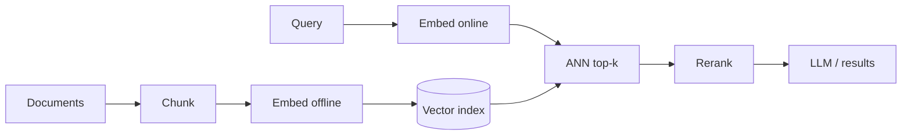

# Embeddings

Hub: [[AI-Engineering-Index]]

## Core Idea

An embedding maps a discrete object (token, sentence, image, user, product) to a dense float vector such that semantic similarity becomes geometric closeness. Embeddings are learned, not hand-designed: a model trained on co-occurrence, next-token, or contrastive objectives places related things near each other. Once everything is a vector, search, clustering, deduplication, and classification become geometry.

## How it works

- **Token embeddings**: a lookup table of shape (vocab_size, $d_{model}$), one row per token id ([[Tokenization]]); the first layer of every transformer, trained end-to-end.
- **Contextual embeddings**: hidden states after attention layers - the vector for "bank" depends on the sentence. Static embeddings (word2vec-style) give one vector per word regardless of context.
- **Sentence / document embeddings**: a dedicated encoder pools token states into one vector per text. This is what semantic search and RAG use - naively averaging a generative LLM's token states usually retrieves poorly.
- **Training signal (contrastive)**: pull (query, relevant doc) pairs together and push negatives apart. A common loss (InfoNCE) for a batch with in-batch negatives:

$$\mathcal{L} = -\log \frac{\exp(\text{sim}(q, d^+)/\tau)}{\sum_{j}\exp(\text{sim}(q, d_j)/\tau)}$$

Quality depends heavily on pair data - domain mismatch (legal, code, medical text on a web-trained model) degrades retrieval.

Similarity math:

$$\cos(a,b) = \frac{a\cdot b}{\lVert a\rVert\,\lVert b\rVert}, \qquad \lVert a-b\rVert^2 = 2 - 2\,a\cdot b \ \text{ when } \lVert a\rVert=\lVert b\rVert=1$$

So for L2-normalized vectors, ranking by cosine, dot product, and Euclidean distance is identical.



## Python code

Brute-force semantic search with normalized vectors (the `embed` function stands in for any embedding model):

```python
import numpy as np

def normalize(M):
    return M / np.linalg.norm(M, axis=-1, keepdims=True)

def top_k(query_vec, doc_matrix, k=3):
    q = normalize(query_vec[None, :])[0]
    D = normalize(doc_matrix)
    scores = D @ q                         # cosine similarity
    idx = np.argsort(-scores)[:k]
    return list(zip(idx.tolist(), scores[idx].round(3).tolist()))

# toy "embeddings" to show mechanics
docs = np.array([[0.9, 0.1, 0.0],    # overfitting note
                 [0.1, 0.9, 0.1],    # SQL note
                 [0.8, 0.2, 0.1]])   # regularization note
query = np.array([1.0, 0.1, 0.05])   # "stop my model memorizing data"
print(top_k(query, docs, k=2))       # -> docs 0 and 2
```

Worked example: embed every note chunk once; embed the query "how do I stop my model memorizing training data"; the overfitting note surfaces even though it never contains "memorizing" - keyword search would miss it, embedding search matches meaning.

## Tradeoffs

| Choice | Gain | Cost |
|---|---|---|
| Higher dimension | More capacity to separate meanings | Storage, memory, slower search |
| Bi-encoder (embed separately) | Precompute docs, fast ANN search | Less accurate than joint scoring |
| Cross-encoder (score pair jointly) | Much more accurate relevance | $O(N)$ model calls per query - only for reranking ([[Hybrid-Search-and-Reranking]]) |
| Exact search | Perfect recall | $O(N \cdot d)$ per query |
| ANN (HNSW, IVF) | Sub-linear queries at scale | Some recall loss, index build and memory ([[Vector-Databases]]) |
| Dense only | Paraphrase matching | Misses exact IDs, error codes, rare names - add BM25 |
| Vector quantization (int8, PQ) | Smaller index | Some similarity precision loss |

## Failure modes

- **Anisotropy**: vectors bunch into a narrow cone so everything has high cosine; compare relatively, never use an absolute threshold borrowed from another model.
- **Mixed spaces**: vectors from different models or versions are incompatible - never mix them in one index; re-embed on upgrade.
- **Truncation**: inputs longer than the encoder's limit are silently cut; pooling over long text dilutes meaning. Chunk first ([[Chunking-Strategies]]).
- **Query/document asymmetry**: short questions vs long passages; use models or prefixes designed for asymmetric retrieval.
- **Metric mismatch**: index configured for L2 while the model expects cosine on unnormalized vectors.
- **Privacy**: embeddings can leak information about the source text (inversion attacks are an active research area); protect the vector store like the documents ([[AI-Data-Leakage-and-Privacy]]).
- **Bias**: embeddings inherit training-data associations.

## Production notes

- Store raw text and metadata next to each vector; you need them for prompts, filters, and citations.
- Version the embedding model in index metadata; plan re-embedding as a batch job.
- Apply tenant / ACL filters inside the vector store, before similarity ranking ([[Least-Privilege]]).
- Cache query embeddings for repeated queries; batch document embedding for throughput.

## Interview questions

1. **Why cosine over Euclidean for text?** Magnitude often tracks length or frequency rather than meaning; and for normalized vectors the choice does not change ranking.
2. **How does semantic search work end to end?** Embed corpus offline, embed query online, ANN top-k, optionally rerank with a cross-encoder, return or feed to an LLM.
3. **Bi-encoder vs cross-encoder?** Bi-encoder: independent encodings, precomputable, fast, less accurate. Cross-encoder: joint encoding, accurate, too slow for full corpus - use for reranking.
4. **Static vs contextual embeddings?** Static: one vector per word ("bank" is one point). Contextual: depends on surrounding tokens.
5. **Retrieval quality is bad - what do you check?** Chunking, domain mismatch of the encoder, metric mismatch, missing hybrid/keyword search, missing reranker, stale or mixed-version index.
6. **How are sentence embedding models trained?** Contrastive learning on positive pairs with in-batch or hard negatives; hard negatives matter most.
7. **What does king - man + woman approx queen show?** Linear structure emerging from the training objective; useful intuition, not a guarantee.

## Related

- [[Attention-Mechanism]]
- [[Transformer-Architecture]]
- [[Vector-Databases]]
- [[Hybrid-Search-and-Reranking]]
- [[Chunking-Strategies]]
- [[RAG-Playbook]]
- [[Clustering]]
