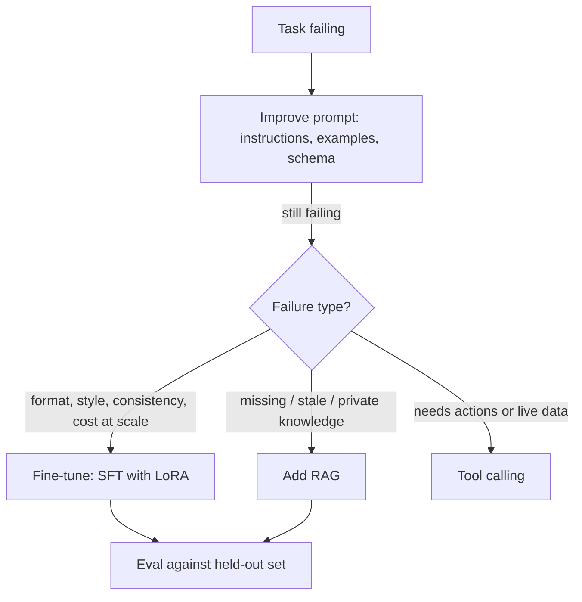

# Fine-Tuning vs Prompting

Hub: [[AI-Engineering-Index]]

## Core Idea

Three ways to adapt an LLM, in rough order of cost: **prompting** steers behavior at inference time with zero training; **RAG** injects fresh or private *knowledge* into the context; **fine-tuning** updates weights to bake in *behavior* - style, format, domain conventions, task skill. Rule of thumb: fine-tuning teaches form, RAG supplies facts, prompting does both weakly but instantly.

## How it works

| | Prompting | RAG | Fine-tuning |
|---|---|---|---|
| Changes | Context only | Context (retrieved) | Weights |
| Time to first result | Minutes | Days (pipeline) | Days to weeks (+ data) |
| New / private knowledge | Only what fits in the prompt | Yes, updatable instantly | Poor - lossy, stale on ingest |
| Style / format control | Moderate | None | Strong |
| Per-call tokens | High (long prompts, examples) | High (retrieved context) | Low (short prompts) |
| Attribution / citations | Manual | Natural (cite chunks) | None |
| Iteration speed | Instant | Re-index | Retrain + re-eval |
| Access control per user | Easy | At retrieval time | Hard (knowledge is in weights) |



**Decision order**

1. **Prompt first.** Clear instructions + few-shot examples + output schema solve most tasks ([[Prompt-Engineering-Guide]]).
2. **Add RAG** when the failure is missing, stale, or per-tenant knowledge ([[RAG-Playbook]]). Do not fine-tune to "teach facts".
3. **Use tools** when the answer lives in a live system (prices, inventory, user account) ([[Tool-Calling-and-Function-Calling]]).
4. **Fine-tune last**, when the failure is form: strict schema at scale, brand voice, domain dialect, or you need few-shot quality without paying for long prompts on every call. Also for distilling a large model's behavior into a smaller, cheaper one.

**Fine-tuning mechanics**

- **SFT** (supervised fine-tuning) on prompt -> response pairs with next-token loss on the response tokens.
- **LoRA**: freeze base weights $W$; learn a low-rank update $W' = W + \frac{\alpha}{r} BA$ with $A \in \mathbb{R}^{r\times d_{in}}$, $B \in \mathbb{R}^{d_{out}\times r}$, $r \ll d$. Trainable parameters are a small fraction of the model; adapters are swappable per task or tenant. **QLoRA** loads the frozen base in 4-bit to cut memory ([[Quantization]]).
- **Preference tuning** (RLHF, DPO): learns from chosen vs rejected responses to shape tone, helpfulness, and safety beyond what pair data expresses.
- **Data**: quality beats quantity; hundreds to low thousands of clean, representative examples is a common starting range for narrow tasks. Garbage pairs are learned faithfully.

## Python code

LoRA from scratch (runnable) to show the mechanics:

```python
import torch, torch.nn as nn

class LoRALinear(nn.Module):
    def __init__(self, base: nn.Linear, r=8, alpha=16):
        super().__init__()
        self.base = base
        for p in self.base.parameters():
            p.requires_grad = False                     # freeze W
        self.A = nn.Parameter(torch.randn(r, base.in_features) * 0.01)
        self.B = nn.Parameter(torch.zeros(base.out_features, r))  # zero init: starts as identity update
        self.scale = alpha / r

    def forward(self, x):
        return self.base(x) + (x @ self.A.T @ self.B.T) * self.scale

layer = LoRALinear(nn.Linear(1024, 1024), r=8)
trainable = sum(p.numel() for p in layer.parameters() if p.requires_grad)
total = sum(p.numel() for p in layer.parameters())
print(trainable, total, f"{trainable/total:.2%}")   # 16384 of 1065984, ~1.5% trainable
```

With Hugging Face PEFT the same idea is a config (module names depend on the model architecture):

```python
from peft import LoraConfig, get_peft_model
cfg = LoraConfig(r=16, lora_alpha=32, lora_dropout=0.05,
                 target_modules=["q_proj", "v_proj"], task_type="CAUSAL_LM")
# model = get_peft_model(base_model, cfg); model.print_trainable_parameters()
```

## Tradeoffs

- **Prompting**: fastest iteration, no infra; long prompts cost tokens on every call and hit context limits; brittle to model upgrades.
- **RAG**: fresh, citable, access-controlled knowledge; adds retrieval failure modes and latency.
- **Fine-tuning**: shorter prompts, consistent format, can enable a smaller model; needs data, eval, training infra, and re-tuning when the base model changes. Hosting custom weights may cost more than API calls at low volume ([[LLM-Cost-Optimization]]).
- **Full fine-tune vs LoRA**: full can reach higher quality on big shifts but needs far more memory and risks more forgetting; LoRA is cheap and modular.
- Production systems often combine all three: a tuned model, fed RAG context, driven by an engineered prompt.

## Failure modes

- **Fine-tuning for knowledge**: model learns the style of facts, hallucinates specifics, and is stale the next day.
- **Catastrophic forgetting**: narrow tuning degrades general ability; mix in general data, keep rank/learning rate modest, evaluate broad skills too.
- **Overfitting small datasets**: watch validation loss; stop early ([[Overfitting-and-Regularization]]).
- **Safety erosion**: fine-tuning can weaken refusal behavior; re-run safety evals ([[Guardrails]]).
- **No baseline**: without a held-out eval you cannot tell if tuning beat a better prompt ([[LLM-Evaluation-Framework]]).
- **Train/serve prompt mismatch**: different chat template or system prompt at inference than in training.
- **Data leakage**: PII or secrets in training data can be memorized and regurgitated ([[AI-Data-Leakage-and-Privacy]]).

## Production notes

- Version datasets, adapters, base model, and chat template together.
- Keep the prompt-only baseline as a fallback and comparison.
- Evaluate on task metrics, broad regression tests, and safety sets before rollout; shadow-test on live traffic.

## Interview questions

1. **"LLM should answer questions over internal docs - fine-tune?"** No: knowledge problem - docs change, citations and per-user ACL needed. Use RAG plus a good prompt.
2. **Give the decision order and justify it.** Prompt -> RAG/tools -> fine-tune; each step is slower to try and harder to undo.
3. **What is LoRA?** Low-rank trainable matrices added to frozen weights; tiny trainable footprint, swappable adapters, cheap training.
4. **When does prompting lose?** When examples eat the token budget at high volume, when behavior is too subtle to specify, or when a smaller model must match a larger one.
5. **SFT vs DPO/RLHF?** SFT imitates demonstrations; preference tuning optimizes toward preferred over rejected outputs.
6. **What is catastrophic forgetting and how do you mitigate it?** Loss of general ability after narrow tuning; mix data, lower LR/rank, evaluate broadly.
7. **What is distillation?** Train a small model on a larger model's outputs to cut cost/latency for a specific task.

## Related

- [[Prompt-Engineering-Guide]]
- [[RAG-Playbook]]
- [[Tool-Calling-and-Function-Calling]]
- [[Quantization]]
- [[Overfitting-and-Regularization]]
- [[LLM-Evaluation-Framework]]
- [[LLM-Cost-Optimization]]
