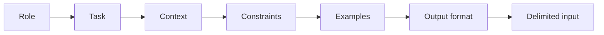

# LLM Prompt Engineering

Hub: [[AI-Engineering-Index]]

> Canonical deep note: [[Prompt-Engineering-Guide]]. This page is a concept pointer only.

## Core Idea

Prompt engineering is programming a model through its context window: you specify role, task, context, constraints, examples, and output format, and the model conditions its next-token predictions on all of it. Structure beats cleverness, and few-shot examples are usually the strongest single lever - models imitate demonstrated patterns more reliably than they follow described ones.

## Where to go next

- Full technique catalog, before/after examples, versioning, iteration loop: [[Prompt-Engineering-Guide]]
- Getting reliable JSON: [[Structured-Output]]
- Budgeting and positioning content in the window: [[Context-Windows]]
- Untrusted input and injection defenses: [[Prompt-Injection]]
- When prompting is not enough: [[Fine-Tuning-vs-Prompting]]

## One-line interview answer

"Prompts are code: structured instructions, few-shot examples for format and edge cases, schema-constrained output validated in code, delimited untrusted input, and a versioned eval set re-run on every prompt or model change."
