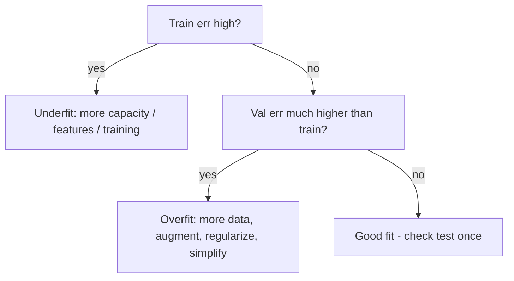

# Overfitting and Regularization

Hub: [[AI-Engineering-Index]]

## Core Idea

Overfitting is memorizing training noise instead of learning the underlying pattern: training loss keeps falling while validation loss rises. It is the high-variance end of the bias-variance tradeoff - a model too flexible for the amount of data it saw. Regularization is anything that constrains that flexibility (penalties, dropout, early stopping, more data, simpler models) to buy generalization at the price of a little training fit.

## How it works

**Bias-variance decomposition** (squared loss, noise variance $\sigma^2$):

$$\mathbb{E}[(y-\hat f(x))^2] = \text{Bias}[\hat f(x)]^2 + \text{Var}[\hat f(x)] + \sigma^2$$

- **High bias (underfit)**: train and validation error both high. Fix: more capacity, better features, train longer.
- **High variance (overfit)**: train error low, validation error high; predictions swing across resampled training sets. Fix: regularize, simplify, more data.
- **Learning curves**: plot train vs validation loss over epochs (or vs training-set size). Diverging curves = overfitting; the gap is the variance you pay.



**Regularization toolbox**

| Technique | Mechanism | Notes |
|---|---|---|
| L2 / weight decay | loss $+\ \lambda\sum w^2$; shrinks weights toward 0 | Default; smooth; keeps all features |
| L1 / lasso | loss $+\ \lambda\sum \lvert w\rvert$; drives some weights to exactly 0 | Built-in feature selection |
| Elastic net | mix of L1 and L2 | Handles correlated features better than pure L1 |
| Dropout | zero a fraction $p$ of activations each step | Implicit ensemble; disabled at inference |
| Early stopping | stop when validation loss stops improving | Nearly free; limits effective capacity |
| Data augmentation / more data | enlarge effective training set | Attacks variance at the source |
| Simpler model | fewer params, shallower trees, fewer features | Try before exotic tricks |
| Label smoothing, batch norm noise, ensembling | various | Common in deep learning |

**Why L1 gives zeros and L2 does not**: the L1 subgradient is a constant $\pm\lambda$ regardless of weight size, so it can push small weights all the way to 0; the L2 pull $2\lambda w$ fades as $w$ shrinks. Geometrically, the L1 constraint region is a diamond whose corners sit on the axes. Bayesian view: L2 = Gaussian prior on weights, L1 = Laplace prior.

**Weight decay vs L2 in Adam**: with adaptive optimizers they differ; AdamW applies decoupled weight decay, which is why it is the usual choice.

## Python code

Polynomial overfitting and ridge regularization (runnable):

```python
import numpy as np
from sklearn.pipeline import make_pipeline
from sklearn.preprocessing import PolynomialFeatures, StandardScaler
from sklearn.linear_model import LinearRegression, Ridge
from sklearn.metrics import mean_squared_error

rng = np.random.default_rng(0)
X = rng.uniform(-3, 3, size=(20, 1)); y = X[:, 0]**2 + rng.normal(0, 1, 20)
Xt = rng.uniform(-3, 3, size=(200, 1)); yt = Xt[:, 0]**2 + rng.normal(0, 1, 200)

for name, reg in [("plain", LinearRegression()), ("ridge", Ridge(alpha=1.0))]:
    m = make_pipeline(PolynomialFeatures(15), StandardScaler(), reg).fit(X, y)
    print(name, "train", round(mean_squared_error(y, m.predict(X)), 2),
          "test", round(mean_squared_error(yt, m.predict(Xt)), 2))
# plain: near-zero train error, much larger test error; ridge: closer train/test
```

PyTorch essentials:

```python
import torch, torch.nn as nn
model = nn.Sequential(nn.Linear(64, 128), nn.ReLU(), nn.Dropout(0.3), nn.Linear(128, 2))
opt = torch.optim.AdamW(model.parameters(), lr=3e-4, weight_decay=0.01)

best, bad, patience = float("inf"), 0, 5
def early_stop(val_loss, min_delta=1e-4):
    global best, bad
    if val_loss < best - min_delta:
        best, bad = val_loss, 0
        return False
    bad += 1
    return bad >= patience
# remember: model.train() during training, model.eval() for validation/inference
```

## Tradeoffs

- Stronger regularization lowers variance but raises bias; choose $\lambda$, dropout $p$, and patience by validation, not intuition ([[Cross-Validation-and-Model-Selection]]).
- More data is usually the best fix but the most expensive; augmentation is cheaper but must preserve labels.
- L1 gives interpretable sparse models but is unstable with correlated features.
- Early stopping is free but couples regularization with optimization settings.

## Failure modes

- **Data leakage masquerading as generalization**: test rows, near-duplicates, or future information in training; scalers fit on the full dataset. Split first, fit preprocessing on train only ([[Feature-Engineering]]).
- **Overfitting the validation set** by excessive hyperparameter search; keep a test set touched once.
- **Forgetting `model.eval()`**: dropout stays active at inference, giving noisy predictions.
- **Regularizing unscaled features**: L1/L2 penalties depend on feature scale; standardize first.
- **Benchmark contamination** in LLMs: test data in pretraining corpora is overfitting at corpus scale - one reason for private eval sets ([[LLM-Evaluation-Framework]]).
- **Fine-tuning small datasets**: LLM fine-tunes memorize quickly; watch validation loss per epoch ([[Fine-Tuning-vs-Prompting]]).

## Production notes

- Monitor train/serve skew and drift - a model that generalized offline can still fail on shifted production data.
- Keep the exact preprocessing pipeline versioned with the model.
- Prefer time-based splits for temporal data; random splits leak the future.

## Interview questions

1. **How do you detect and fix overfitting?** Detect via train/val divergence; fix roughly in order of cost-effectiveness: more/augmented data, early stopping, weight decay, dropout, smaller model. Naming an order shows judgment.
2. **L1 vs L2?** L1 yields sparse weights (feature selection); L2 shrinks smoothly. Why: constant vs proportional gradient, diamond vs circle constraint.
3. **Why does dropout work?** Prevents co-adaptation of units; approximates averaging many subnetworks; disabled at inference (inverted dropout scales during training).
4. **Explain the bias-variance tradeoff.** Error = bias squared + variance + noise; capacity trades one for the other; draw the U-shaped validation curve.
5. **What is data leakage? Give an example.** Information unavailable at prediction time used in training, e.g. fitting a scaler on the whole dataset or random-splitting time series.
6. **Why does regularization act like a prior?** MAP estimation with a Gaussian prior gives L2; Laplace prior gives L1.
7. **Training loss zero, test high, lots of data - what next?** Check leakage between train/test and label noise first, then capacity and regularization.

## Related

- [[Evaluation-Metrics-ML]]
- [[Cross-Validation-and-Model-Selection]]
- [[Feature-Engineering]]
- [[Linear-and-Logistic-Regression]]
- [[Neural-Networks-and-Backprop]]
- [[Fine-Tuning-vs-Prompting]]
