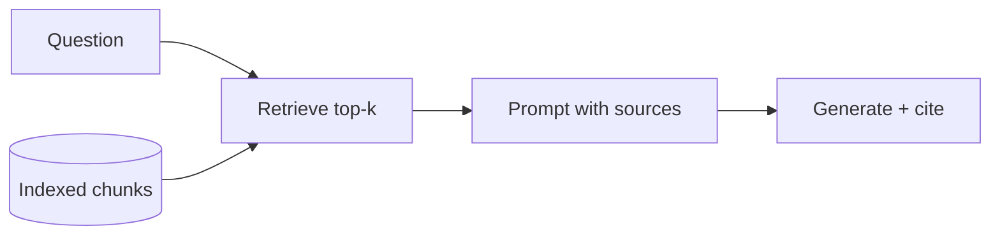

# RAG (Retrieval-Augmented Generation)

Hub: [[AI-Engineering-Index]]

> Canonical deep note: [[RAG-Playbook]]. This page is a concept pointer only.

## Core Idea

RAG bolts a search engine onto an LLM: at query time, retrieve the most relevant chunks from a knowledge store, inject them into the prompt, and instruct the model to answer *from that context*, with citations. It grounds answers in sources the model never trained on (private, fresh, per-tenant data) without touching weights. It solves a **knowledge** problem, not a behavior problem ([[Fine-Tuning-vs-Prompting]]).

## Where to go next

- End-to-end pipeline, failure modes, evaluation, defaults: [[RAG-Playbook]]
- Splitting documents: [[Chunking-Strategies]]
- Storage and ANN indexes: [[Vector-Databases]]
- BM25 + vectors + cross-encoder: [[Hybrid-Search-and-Reranking]]
- Grounding and refusals: [[Hallucination-Mitigation]]
- Pre-launch review: [[RAG-System-Checklist]]
- Reusable citation-enforcement pattern: [[Pattern-RAG-with-Citations]]

## When RAG is the wrong tool

- The answer needs aggregation over many records (counts, joins, "all invoices over X") - query the database or give the model a SQL tool.
- The whole corpus fits comfortably in context and changes rarely - long context plus prompt caching can be simpler (measure quality; see [[Context-Windows]]).
- The problem is output format or tone, not missing knowledge - see [[Fine-Tuning-vs-Prompting]].

## One-line interview answer

"Embed and index chunks offline; at query time retrieve (hybrid + rerank), filter by the user's permissions, generate with an answer-only-from-sources prompt and citations, and evaluate retrieval and generation separately."
