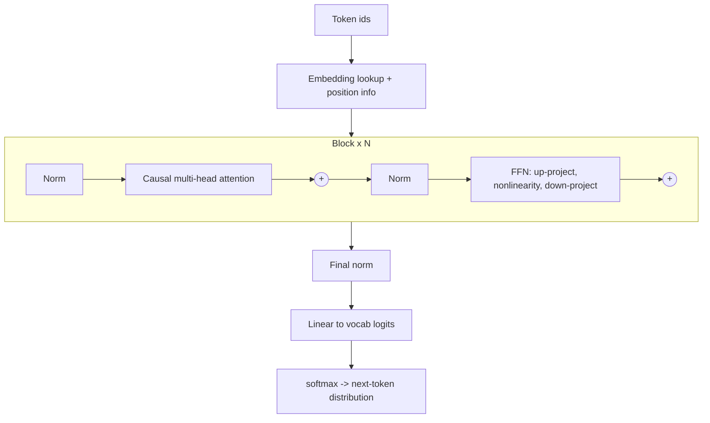

# Transformer Architecture

Hub: [[AI-Engineering-Index]]

## Core Idea

A transformer is a stack of identical blocks - multi-head self-attention followed by a position-wise feed-forward network (FFN), each wrapped in a residual connection and layer normalization. Attention mixes information *across* positions; the FFN transforms each position independently. No step processes tokens one at a time during training, so the whole sequence is computed in parallel - which is why transformers displaced RNNs and scaled into LLMs.

## How it works

Data flow for one decoder-only block (the dominant design for modern LLMs), pre-norm variant:

$$h = x + \text{MHA}(\text{Norm}(x)), \qquad y = h + \text{FFN}(\text{Norm}(h))$$



Role of each part:

- **Embeddings + positions**: attention is permutation-invariant, so position must be injected. Original: sinusoidal or learned absolute positions. Many modern LLMs use **RoPE** (rotary embeddings), which rotates Q/K so dot products depend on relative position.
- **Multi-head causal attention**: the only place tokens exchange information ([[Attention-Mechanism]]).
- **FFN**: two (or three, for gated variants like SwiGLU) linear layers with a nonlinearity; hidden width typically about 4x $d_{model}$. Holds roughly two-thirds of block parameters and much of the model's stored associations.
- **Residual connections**: gradient highway - each block learns a refinement of its input, making deep stacks trainable.
- **Normalization (pre-norm)**: normalizing before each sublayer (instead of after, as in the 2017 paper) keeps training stable at depth. RMSNorm is a common cheaper variant.
- **Output head**: projects to vocab logits; often weight-tied with the input embedding.

Parameter sanity check (ignoring biases and norms): per block, attention has $4d^2$ ($W_Q, W_K, W_V, W_O$) and a 4x FFN has $8d^2$, so about $12d^2$ per layer. With $d=768$, 12 layers: $12 \cdot 12 \cdot 768^2 \approx 85M$, plus embeddings $50257 \cdot 768 \approx 39M$ - consistent with GPT-2 small at about 124M.

**Training vs inference**

- **Training**: teacher forcing - predict token $t+1$ at every position simultaneously with cross-entropy $\mathcal{L} = -\sum_t \log p(x_{t+1}\mid x_{\le t})$. One forward pass yields $n$ predictions.
- **Inference**: autoregressive, one token at a time. Prefill processes the prompt in parallel; decode generates token by token using the **KV cache**. Decoding is typically memory-bandwidth bound ([[LLM-Inference-and-Serving]]).

**Variants**

| Family | Attention | Typical use |
|---|---|---|
| Encoder-only (BERT-style) | Bidirectional | Classification, embeddings, rerankers |
| Encoder-decoder (T5-style) | Bidirectional + cross | Translation, seq-to-seq |
| Decoder-only (GPT-style) | Causal | Generation; one next-token objective scales over all text |

## Python code

A compact, runnable pre-norm decoder block in PyTorch:

```python
import torch
import torch.nn as nn
import torch.nn.functional as F

class Block(nn.Module):
    def __init__(self, d=256, h=4, ff_mult=4, p=0.1):
        super().__init__()
        self.n1, self.n2 = nn.LayerNorm(d), nn.LayerNorm(d)
        self.h = h
        self.qkv = nn.Linear(d, 3 * d)
        self.proj = nn.Linear(d, d)
        self.ff = nn.Sequential(nn.Linear(d, ff_mult * d), nn.GELU(),
                                nn.Linear(ff_mult * d, d))
        self.drop = nn.Dropout(p)

    def forward(self, x):                      # x: (B, T, d)
        B, T, d = x.shape
        q, k, v = self.qkv(self.n1(x)).chunk(3, dim=-1)
        q, k, v = (t.view(B, T, self.h, d // self.h).transpose(1, 2) for t in (q, k, v))
        a = F.scaled_dot_product_attention(q, k, v, is_causal=True)
        a = a.transpose(1, 2).reshape(B, T, d)
        x = x + self.drop(self.proj(a))
        x = x + self.drop(self.ff(self.n2(x)))
        return x

x = torch.randn(2, 10, 256)
print(Block()(x).shape)   # torch.Size([2, 10, 256])
```

## Tradeoffs

| Design point | Gain | Cost |
|---|---|---|
| Transformer vs RNN | Parallel training; $O(1)$ path length between tokens | $O(n^2 d)$ attention vs RNN's $O(n d^2)$; KV cache memory |
| Deeper vs wider | Depth adds composition | Harder optimization, more sequential latency |
| Pre-norm vs post-norm | Stable deep training | Can slightly reduce final quality without tuning |
| RoPE / relative positions | Better length generalization | Still degrades far beyond trained length without scaling tricks |
| Mixture-of-experts FFN | More parameters at similar per-token compute | Routing complexity, memory for all experts, load balancing |

## Failure modes

- **Training instability**: loss spikes from large learning rates, missing warmup, or fp16 overflow; mitigations include warmup, gradient clipping, bf16, and pre-norm.
- **Length extrapolation**: quality drops on sequences longer than seen in training ([[Context-Windows]]).
- **Exposure bias**: trained on ground-truth prefixes, generates from its own - errors compound in long generations.
- **Repetition / degeneration** under greedy decoding; use sampling controls.
- **Memory blowup at inference**: KV cache grows with batch x length x layers x heads; mitigate with GQA, paging, [[Quantization]].

## Production notes

- Latency = prefill (compute bound, grows with prompt) + decode (per-token, memory bound). Optimize both separately ([[LLM-Latency-Optimization]]).
- Architecture details decide serving cost: number of KV heads, context length, and parameter count drive GPU memory.
- For classification/embedding tasks, a small encoder is often cheaper and better than prompting a large decoder.

## Interview questions

1. **Walk me through a transformer block.** Norm, causal MHA, residual add, norm, FFN, residual add - and give the purpose of each part; listing parts without their why is the common fail.
2. **Why did transformers replace RNNs?** Parallelism across the sequence during training, and $O(1)$ path length for long-range dependencies (vs $O(n)$ through a recurrent state).
3. **Why positional encodings?** Attention is permutation-invariant; without position info "dog bites man" equals "man bites dog".
4. **Why residuals and normalization?** Gradient flow and stable activations at depth; each block refines rather than replaces.
5. **Where do most parameters live?** In FFN layers (about $8d^2$ of about $12d^2$ per block) and embeddings.
6. **Training vs inference difference?** Training computes all positions in parallel via teacher forcing; inference is sequential per generated token with a KV cache.
7. **Why decoder-only for LLMs?** One simple next-token objective applies to all raw text, scales well, and handles both understanding and generation via prompting.
8. **What bounds long-context serving?** KV cache memory and quadratic prefill attention.

## Related

- [[Attention-Mechanism]]
- [[Embeddings]]
- [[RNNs-and-LSTMs]]
- [[Tokenization]]
- [[Context-Windows]]
- [[LLM-Inference-and-Serving]]
- [[Fine-Tuning-vs-Prompting]]
