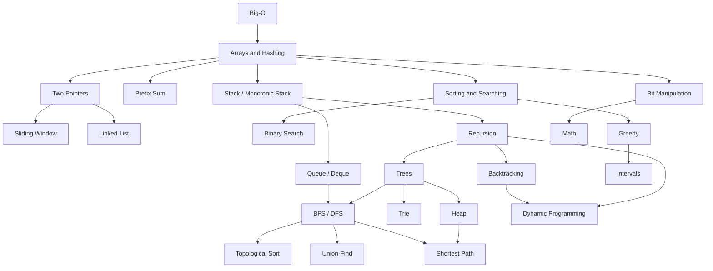

# DSA Index

Hub: [[Interview-Prep-Index]]

The entry point for data structures and algorithms prep. Learn the patterns in the order below, drill each pattern's template until you can write it from memory, then solve the linked problems (every problem has Python, Java and C++ solutions).

## Topic Roadmap (recommended order)

1. [[Big-O-Notation]] - complexity vocabulary
2. [[Arrays-and-Hashing-Pattern]]
3. [[Two-Pointer-Pattern]]
4. [[Sliding-Window-Pattern]]
5. [[Prefix-Sum-Pattern]]
6. [[Stack-and-Monotonic-Stack-Pattern]]
7. [[Queue-and-Deque-Pattern]]
8. [[Linked-List-Pattern]]
9. [[Sorting-and-Searching-Pattern]]
10. [[Binary-Search-Pattern]]
11. [[Recursion-Pattern]]
12. [[Trees-Pattern]]
13. [[Heap-Pattern]]
14. [[Trie-Pattern]]
15. [[Backtracking-Pattern]]
16. [[BFS-DFS-Pattern]]
17. [[Topological-Sort-Pattern]]
18. [[Union-Find-Pattern]]
19. [[Shortest-Path-Pattern]]
20. [[Greedy-Pattern]]
21. [[Intervals-Pattern]]
22. [[DP-Pattern]]
23. [[Bit-Manipulation-Pattern]]
24. [[Math-Pattern]]

## Pattern Recognition Cheat Sheet

| If you see... | Think... |
|---|---|
| Unsorted array, find pair / complement / duplicate | Hash map ([[Arrays-and-Hashing-Pattern]]) |
| Group equivalent items (anagrams) | Canonical key -> hash map |
| Sorted array, pair/triplet with target sum | Converging two pointers ([[Two-Pointer-Pattern]]) |
| Longest/shortest contiguous subarray or substring with a constraint | Sliding window ([[Sliding-Window-Pattern]]) |
| Subarray sum equals k, negatives allowed | Prefix sum + hash map ([[Prefix-Sum-Pattern]]) |
| Many range-sum queries, static array | Prefix sums |
| Matching brackets, nested structure, undo | Stack ([[Stack-and-Monotonic-Stack-Pattern]]) |
| Next greater / previous smaller element | Monotonic stack |
| Max/min of every window of size k | Monotonic deque ([[Queue-and-Deque-Pattern]]) |
| Linked list: middle, cycle, kth from end | Fast/slow pointers ([[Linked-List-Pattern]]) |
| Sorted (or rotated sorted) search in O(log n) | Binary search ([[Binary-Search-Pattern]]) |
| "Minimum X such that condition holds" with monotonic feasibility | Binary search on the answer |
| Top k / kth largest / merge k sorted / running median | Heap ([[Heap-Pattern]]) |
| Values in a small bounded range | Counting / bucket sort ([[Sorting-and-Searching-Pattern]]) |
| Tree height, diameter, path sums, LCA | Post-order DFS returning values ([[Trees-Pattern]]) |
| Anything "per level" in a tree | BFS by levels |
| Prefix queries, autocomplete, many words in a grid | Trie ([[Trie-Pattern]]) |
| "Generate all" subsets / permutations / combinations | Backtracking ([[Backtracking-Pattern]]) |
| Grid islands, connected regions, flood fill | DFS/BFS ([[BFS-DFS-Pattern]]) |
| Minimum steps in an unweighted graph or grid | BFS (multi-source if many starts) |
| Dependencies, prerequisites, build order | Topological sort ([[Topological-Sort-Pattern]]) |
| Dynamic connectivity, redundant edge, components | Union-Find ([[Union-Find-Pattern]]) |
| Weighted shortest path, non-negative weights | Dijkstra ([[Shortest-Path-Pattern]]) |
| Shortest path with negative edges or at most k edges | Bellman-Ford |
| Edge weights only 0 or 1 | 0-1 BFS |
| Local choice provably optimal (exchange argument) | Greedy ([[Greedy-Pattern]]) |
| Overlapping intervals, meetings, scheduling | Sort + sweep ([[Intervals-Pattern]]) |
| Count ways / min cost / max value with overlapping subproblems | DP ([[DP-Pattern]]) |
| Pick items under a capacity, each once | 0/1 knapsack DP |
| Two strings, compare prefixes | 2D DP (LCS / edit distance) |
| Pairs cancel, single odd one out, subsets as masks | Bit manipulation ([[Bit-Manipulation-Pattern]]) |
| Answer mod 10^9+7, primes, gcd, large powers | Math ([[Math-Pattern]]) |
| Problem defined in terms of smaller copies of itself | Recursion ([[Recursion-Pattern]]) |

## Code Libraries

Tested, reusable implementations of the core algorithms:

- [[coding-library]] - overview, test counts and run commands for all three languages
- [[python-library]] - Python library (drill language)
- [[java-library]] - Java library (JDK only)
- [[cpp-library]] - header-only C++17 library
- Language refreshers: [[Java-Interview-Essentials]], [[Cpp-Interview-Essentials]]

## Problem List

Every problem note contains: problem, intuition, brute force, optimized approach, complexity, Python/Java/C++ code, edge cases, common mistakes and follow-ups.

| # | Problem | Pattern | Difficulty | Source |
|---|---|---|---|---|
| 1 | [[Two-Sum]] | Arrays and hashing | Beginner | LeetCode 1 |
| 2 | [[Group-Anagrams]] | Arrays and hashing | Intermediate | LeetCode 49 |
| 3 | [[Product-of-Array-Except-Self]] | Arrays and hashing | Intermediate | LeetCode 238 |
| 4 | [[Valid-Anagram]] | Strings | Beginner | LeetCode 242 |
| 5 | [[Longest-Palindromic-Substring]] | Strings | Intermediate | LeetCode 5 |
| 6 | [[Three-Sum]] | Two pointers | Intermediate | LeetCode 15 |
| 7 | [[Container-With-Most-Water]] | Two pointers | Intermediate | LeetCode 11 |
| 8 | [[Trapping-Rain-Water]] | Two pointers | Advanced | LeetCode 42 |
| 9 | [[Longest-Substring-Without-Repeating-Characters]] | Sliding window | Intermediate | LeetCode 3 |
| 10 | [[Minimum-Window-Substring]] | Sliding window | Advanced | LeetCode 76 |
| 11 | [[Subarray-Sum-Equals-K]] | Prefix sum | Intermediate | LeetCode 560 |
| 12 | [[Valid-Parentheses]] | Stack | Beginner | LeetCode 20 |
| 13 | [[Daily-Temperatures]] | Monotonic stack | Intermediate | LeetCode 739 |
| 14 | [[Largest-Rectangle-in-Histogram]] | Monotonic stack | Advanced | LeetCode 84 |
| 15 | [[Sliding-Window-Maximum]] | Deque | Advanced | LeetCode 239 |
| 16 | [[Implement-Queue-using-Stacks]] | Queue | Beginner | LeetCode 232 |
| 17 | [[Reverse-Linked-List]] | Linked list | Beginner | LeetCode 206 |
| 18 | [[Linked-List-Cycle]] | Linked list | Beginner | LeetCode 141 |
| 19 | [[Maximum-Depth-of-Binary-Tree]] | Trees | Beginner | LeetCode 104 |
| 20 | [[Binary-Tree-Level-Order-Traversal]] | Trees | Intermediate | LeetCode 102 |
| 21 | [[Validate-Binary-Search-Tree]] | BST | Intermediate | LeetCode 98 |
| 22 | [[Kth-Smallest-Element-in-a-BST]] | BST | Intermediate | LeetCode 230 |
| 23 | [[Kth-Largest-Element-in-an-Array]] | Heap | Intermediate | LeetCode 215 |
| 24 | [[Merge-K-Sorted-Lists]] | Heap | Advanced | LeetCode 23 |
| 25 | [[Implement-Trie-Prefix-Tree]] | Trie | Intermediate | LeetCode 208 |
| 26 | [[Word-Search-II]] | Trie | Advanced | LeetCode 212 |
| 27 | [[Number-of-Islands]] | BFS / DFS | Intermediate | LeetCode 200 |
| 28 | [[Rotting-Oranges]] | BFS | Intermediate | LeetCode 994 |
| 29 | [[Course-Schedule]] | Topological sort | Intermediate | LeetCode 207 |
| 30 | [[Course-Schedule-II]] | Topological sort | Intermediate | LeetCode 210 |
| 31 | [[Number-of-Provinces]] | Union-Find | Intermediate | LeetCode 547 |
| 32 | [[Redundant-Connection]] | Union-Find | Intermediate | LeetCode 684 |
| 33 | [[Network-Delay-Time]] | Shortest path (Dijkstra) | Intermediate | LeetCode 743 |
| 34 | [[Cheapest-Flights-Within-K-Stops]] | Shortest path (Bellman-Ford) | Advanced | LeetCode 787 |
| 35 | [[Jump-Game]] | Greedy | Intermediate | LeetCode 55 |
| 36 | [[Gas-Station]] | Greedy | Intermediate | LeetCode 134 |
| 37 | [[Merge-Intervals]] | Intervals | Intermediate | LeetCode 56 |
| 38 | [[Subsets]] | Backtracking | Intermediate | LeetCode 78 |
| 39 | [[Permutations]] | Backtracking | Intermediate | LeetCode 46 |
| 40 | [[Generate-Parentheses]] | Recursion | Intermediate | LeetCode 22 |
| 41 | [[Construct-Binary-Tree-from-Preorder-and-Inorder-Traversal]] | Recursion | Intermediate | LeetCode 105 |
| 42 | [[Climbing-Stairs]] | DP (1D) | Beginner | LeetCode 70 |
| 43 | [[Coin-Change]] | DP (1D, unbounded knapsack) | Intermediate | LeetCode 322 |
| 44 | [[Longest-Common-Subsequence]] | DP (2D) | Intermediate | LeetCode 1143 |
| 45 | [[Partition-Equal-Subset-Sum]] | DP (0/1 knapsack) | Intermediate | LeetCode 416 |
| 46 | [[Longest-Increasing-Subsequence]] | DP (LIS) | Intermediate | LeetCode 300 |
| 47 | [[Single-Number]] | Bit manipulation | Beginner | LeetCode 136 |
| 48 | [[Counting-Bits]] | Bit manipulation | Beginner | LeetCode 338 |
| 49 | [[Pow-x-n]] | Math | Intermediate | LeetCode 50 |
| 50 | [[Count-Primes]] | Math | Intermediate | LeetCode 204 |
| 51 | [[Sort-Colors]] | Sorting | Intermediate | LeetCode 75 |
| 52 | [[Top-K-Frequent-Elements]] | Sorting (bucket) | Intermediate | LeetCode 347 |
| 53 | [[Search-in-Rotated-Sorted-Array]] | Binary search | Intermediate | LeetCode 33 |
| 54 | [[Koko-Eating-Bananas]] | Binary search on answer | Intermediate | LeetCode 875 |

## Progress

- [ ] Finish the arrays / two pointers / sliding window block (problems 1-11)
- [ ] Finish stacks, queues and linked lists (12-18)
- [ ] Finish trees, heaps and tries (19-26)
- [ ] Finish graphs (27-34)
- [ ] Finish greedy, intervals, backtracking and recursion (35-41)
- [ ] Finish DP (42-46)
- [ ] Finish bits, math, sorting and searching (47-54)
- [ ] Re-solve every Advanced problem from scratch without notes

## Related

- [[Interview-Prep-Index]]
- [[Technical-Interview-Roadmap]]
- [[Big-O-Notation]]
