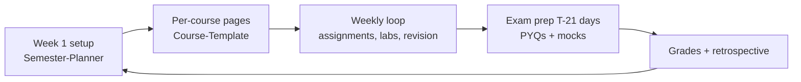

# Academic OS

A system for getting good grades with bounded time, so the rest of your hours go to skills, projects and career. The main levers: start exams early with past papers, space your revision, decompose assignments on the day they're assigned, and know which marks actually move your grade.

## Semester Flow

## Templates and Guides

| When | Use |
|---|---|
| Week 1 | [[Semester-Planner]], [[Semester-Dashboard-Template]], one [[Course-Template]] per course |
| Every week | [[Study-Planner-Template]], [[Assignment-Tracker-Template]], [[Lab-Tracker]] |
| Per assignment | [[Assignment-Template]] |
| Per lab | [[Lab-Record-Template]] |
| After each lecture | [[Revision-System]] (1-3-7-14-30 schedule) |
| Exam prep | [[Exam-Tracker-Template]], [[PYQ-Analysis-Template]], [[Question-Bank-Template]], [[Revision-Checklist]] |
| Grades | [[Grade-Calculation-Guide]], `CGPA-Tracker.csv`, or the calculator in the web app at `/academic` |
| Projects | [[Research-Project-Template]] |

## Weekly Academic Check (10 min, inside [[Weekly-Review]])

- [ ] Every assignment due in the next 14 days is at least decomposed
- [ ] Revision reviews due this week were done (see [[Revision-System]])
- [ ] Lab records up to date
- [ ] Any course below target for 2 weeks gets Block 1 next week
- [ ] Exams within 21 days have a PYQ analysis started
