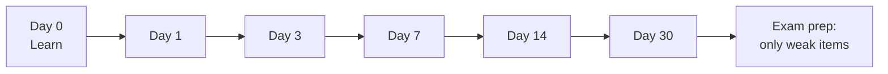

# Revision System

Two well-supported learning techniques, used together:

- **Spaced repetition**: review material at increasing intervals instead of cramming. Each review happens just as you're starting to forget.
- **Active recall** (retrieval practice): test yourself from memory instead of re-reading. Re-reading feels productive but mostly builds familiarity, not recall.

## The Schedule: 1-3-7-14-30

After you first learn a topic (day 0, usually the lecture), review it on:

| Review | Day after learning | Time | What to do |
|---|---|---|---|
| R1 | Day 1 | 10-15 min | Close notes, write everything you remember, then check and fill gaps |
| R2 | Day 3 | 10 min | Answer the cue questions from your notes |
| R3 | Day 7 | 10 min | Solve 2-3 problems on the topic without looking |
| R4 | Day 14 | 10 min | Mixed practice: this topic plus older ones |
| R5 | Day 30 | 15 min | Past-paper style questions under time |

If a review goes badly (under about 70% recalled), restart that topic from R2 instead of moving forward.

## Active Recall Methods

| Method | How | Best for |
|---|---|---|
| Blank page | Write everything you know about a topic, then compare with notes | Theory, definitions, processes |
| Cue questions | Turn each note heading into a question; answer before reading | Lecture notes |
| Flashcards | One fact or question per card; use an app with spacing (e.g. Anki) | Formulas, definitions, facts |
| Practice problems | Solve without looking at worked examples | Numerical and problem-solving courses |
| Teach it | Explain aloud to a friend or rubber duck without notes | Concepts you think you understand |
| Derive it | Re-derive a formula or proof from first principles | Maths, physics, algorithms |

## Daily Routine (20-30 min)

1. Open the tracker below and filter for reviews due today.
2. Do the reviews using active recall only. Notes stay closed until you check.
3. Mark each review with how well you recalled it (good / partial / failed).
4. Add today's new topics with day 0 = today.

## Tracker

| Course | Topic | Learned (D0) | D1 | D3 | D7 | D14 | D30 | Last recall (good / partial / failed) |
|---|---|---|---|---|---|---|---|---|
| | | | | | | | | |

Tip: fill the due dates when you add the row, so due items are easy to find.

## Setup Checklist

- [ ] Tracker created, one row per lecture topic
- [ ] Notes rewritten as questions (cue column or flashcards)
- [ ] 20-30 min daily slot scheduled in [[Study-Planner-Template]]
- [ ] Before exams: switch to [[Revision-Checklist]] and past papers
