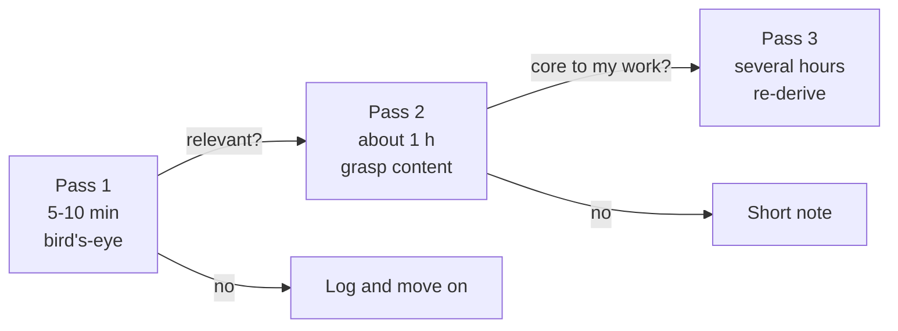

# How to Read a Paper

Use the three-pass method (S. Keshav, "How to Read a Paper", ACM SIGCOMM CCR, 2007). Most papers you meet should stop at pass 1. Only a few deserve pass 3.

## Pass 1: Bird's-Eye View (5-10 min)

Read: title, abstract, introduction, section headings, conclusion, and skim the reference list.

Answer the **five Cs**:

- **Category**: what type of paper (new method, analysis, system, survey, benchmark)?
- **Context**: which prior work does it build on?
- **Correctness**: do the assumptions look reasonable?
- **Contributions**: what do the authors claim is new?
- **Clarity**: is it well written?

Decision: drop, skim later, or go to pass 2. Log the decision in your screening table in [[Literature-Review-Template]].

## Pass 2: Grasp the Content (about 1 hour)

- Read the whole paper, but skip proofs and dense derivations.
- Study figures, tables and graphs carefully. Check axes, error bars, and whether results are statistically meaningful.
- Mark references you haven't read that look important (for snowballing).
- Fill the [[Paper-Note-Template]] sections: Problem through Results.

You should be able to summarize the main idea and its evidence to someone else. If you can't, either the paper is outside your background (read prerequisites first) or it's badly written.

## Pass 3: Re-Implement Mentally (several hours)

Only for papers central to your work, or when you're reviewing.

- Re-create the work: given the same assumptions, how would you have done it? Compare with what they did.
- Challenge every assumption. Look for missing baselines, unfair comparisons, and hidden limitations.
- Identify what you could reproduce, and what's underspecified.
- Fill Limitations, Novelty and Future Work in the note with your own analysis.

After pass 3 you should be able to reconstruct the paper's structure from memory and list its strong and weak points.

## Practical Tips

- Read with a question in mind ("does this handle adaptive attackers?"). It keeps reading targeted.
- Check the paper's code repo early. Missing code or unanswered issues say something about reproducibility.
- Check whether a later version, erratum, or follow-up already addresses the limitations you found.
- Batch pass-1 reads (10-20 at once); schedule pass-2 and pass-3 reads as focus blocks.

## Checklist per Paper

- [ ] Pass 1 decision logged
- [ ] Pass 2: note created with Problem to Results filled
- [ ] Pass 3 (if needed): limitations and novelty in my own words
- [ ] Important references added to the snowball list
