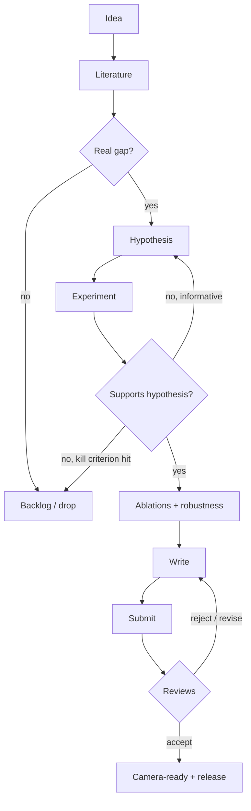

# Research Workflow

Research is a loop with frequent exits. Most ideas should die early, cheaply, at the literature or hypothesis stage. Late failures (after months of experiments) usually mean a stage was skipped.

## Stages

| Stage | Goal | Exit condition | Template | Typical time (student project) |
|---|---|---|---|---|
| Idea | Capture candidates without committing | Idea scored on impact / feasibility / fit | [[Research-Ideas-Backlog-Template]] | ongoing |
| Literature | Learn what's known and contested | 8-12 papers noted; synthesis matrix filled | [[How-to-Read-a-Paper]], [[Paper-Note-Template]], [[Literature-Review-Template]] | 1-3 weeks |
| Gap | Find what's missing that matters | Gap sentence passes Check 1 of [[Novelty-Checklist]] | [[Novelty-Checklist]] | days |
| Hypothesis | Make a falsifiable prediction | Hypothesis + kill criterion written before running anything | [[Hypothesis-Template]] | 1 day |
| Experiment | Test it fairly | Baseline reproduced; main runs over 3+ seeds logged | [[Datasets-and-Baselines-Guide]], [[Experiment-Tracking-Guide]], [[Experiment-Tracker]] | most of the time |
| Analysis | Show why it works | Ablation per component; failure cases documented | [[Ablation-Study-Guide]] | 1-2 weeks |
| Write | Argue the claim with evidence | Every abstract claim maps to a table or figure | [[Publication-Checklist]] | 2-4 weeks |
| Submit | Get through the desk check | Reproducibility and desk-reject checks pass | [[Reproducibility-Checklist]], [[Publication-Checklist]] | days |
| Review | Raise reviewers' scores | Point-by-point response with actions | [[Reviewer-Response-Template]] | 1-2 weeks |

## Rules

1. **Write before you run.** The hypothesis, kill criterion and main metric are fixed before the first real experiment.
2. **Baseline first.** Reproduce the strongest relevant baseline before building your method. If you can't reproduce it, that's your first finding.
3. **Smallest experiment that could kill the idea** comes before anything elaborate.
4. **Log everything, delete nothing.** Failed runs are data. See [[Experiment-Tracker]].
5. **Write continuously.** Draft the method section while building, the related work while reading.
6. **Talk to your advisor at stage exits**, not only when stuck.

## Weekly Research Check (add to your weekly review)

- [ ] Which stage am I in, and what's its exit condition?
- [ ] Did anything this week move me toward that exit?
- [ ] Any result that contradicts the hypothesis? Logged and discussed?
- [ ] Is the kill criterion close to being hit?
- [ ] Draft text written this week (any section)?
