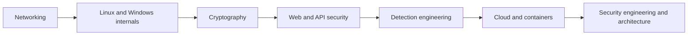

# Security Engineering OS

The hub for everything security in this repo. Vault-side concept hub: [[Cybersecurity-Index]]. All offensive material is framed for **authorized testing, your own lab, and CTFs only**; every attacker-view section is paired with detections and defenses.

## Learning Path

1. **Networking** - [[Networking-for-Security]], [[Network-Security]], [[Common-Ports-and-Protocols-Cheat-Sheet]], [[Network-Traffic-Analysis-Cheat-Sheet]]
2. **Operating systems** - [[Linux-Internals-for-Security]], [[Windows-Internals-for-Security]], [[Process-and-Memory-Fundamentals]], [[Filesystems-and-Permissions]]
3. **Cryptography** - [[Hashing-vs-Encryption]], [[Applied-Cryptography]], [[TLS-Handshake]]
4. **Web security** - [[OWASP-Top-10]], [[XSS]], [[SQL-Injection]], [[CSRF]], [[SSRF]], [[Authentication-Security]]
5. **Detection engineering** - [[Log-Analysis]], [[SIEM-Fundamentals]], [[Detection-Engineering]], [[Threat-Hunting]]

Track hands-on progress in [[Security-Labs-Tracker]]; lab build in [[Home-Lab-Setup-Guide]].

## Fundamentals (vault concepts)

[[CIA-Triad]] | [[Authentication-vs-Authorization]] | [[Least-Privilege]] | [[Memory-Safety]] | [[Hashing-vs-Encryption]]

## Foundations

- [[Networking-for-Security]]
- [[Linux-Internals-for-Security]]
- [[Windows-Internals-for-Security]]
- [[Process-and-Memory-Fundamentals]]
- [[Filesystems-and-Permissions]]

## Offensive (authorized testing only)

- [[Reconnaissance-and-OSINT]]
- [[Enumeration]]
- [[Vulnerability-Assessment]]
- [[Web-App-Pentest-Methodology]]

## Defensive

- [[Security-Logging-and-Detection]] (overview)
- [[SIEM-Fundamentals]]
- [[Log-Analysis]]
- [[Detection-Engineering]]
- [[Threat-Hunting]]
- [[Security-Monitoring]]
- [[Malware-Analysis-Basics]] then [[Malware-Analysis-Workflow]]
- [[Reverse-Engineering-Basics]]
- [[Digital-Forensics]]
- [[Incident-Response-Lifecycle]]

## Application Security

- [[OWASP-Top-10]] (concept) and [[Web-Security-Checklist-OWASP]] (checklist)
- [[Secure-Coding]]
- [[SAST-DAST-SCA]]
- [[Secrets-Management]]
- [[Authentication-Security]]
- [[XSS]], [[SQL-Injection]], [[CSRF]], [[SSRF]]

## Cloud

- [[Cloud-Security]] (provider-agnostic)
- [[AWS-Security-Fundamentals]]
- [[IAM-Deep-Dive]]
- [[AWS-KMS-and-Encryption]]
- [[WAF]]
- [[Cloud-Logging]]
- [[Container-Security]]
- [[Kubernetes-Security]]

## Security Engineering

- [[Threat-Modeling-STRIDE]] and [[Threat-Model-Template]]
- [[Attack-Trees]]
- [[MITRE-ATTACK]]
- [[Security-Architecture]]
- [[Zero-Trust]]
- [[Identity-Security]]
- [[Supply-Chain-Security]]

## Playbooks

| Playbook | Use when |
|---|---|
| [[Incident-Response-Playbook]] | Any incident (generic master runbook) |
| [[SOC-Analyst-Playbook]] | Daily alert triage |
| [[Phishing-Response-Playbook]] | Reported or detected phishing |
| [[Ransomware-Response-Playbook]] | Encryption or extortion activity |
| [[Compromised-Credentials-Playbook]] | Account takeover, leaked passwords or tokens |
| [[Cloud-Account-Compromise-Playbook]] | Suspicious AWS API activity or leaked keys |
| [[Web-App-Pentest-Methodology]] | Authorized web application assessment |

## Checklists

- [[Security-Review-Checklist]]
- [[Incident-Response-Checklist]]
- [[Cloud-Security-Checklist]]
- [[Web-Security-Checklist-OWASP]]

## Reference and Career

- [[Linux-Security-Cheat-Sheet]], [[Windows-Security-Cheat-Sheet]]
- [[CTF-Getting-Started-Guide]], [[Home-Lab-Setup-Guide]]
- [[Cybersecurity-Career-Roadmap]], [[Security-Interview-Questions]]

## Planned (not yet written)

These notes are on the roadmap but do not exist yet; they are listed in plain text so no link points at a missing page.

- Active Directory Security
- Privilege Escalation Concepts
- Exploitation Fundamentals
- Post Exploitation and Detection
- API Security Testing

## Deduplication Map

| Concept (why) | Operational (how) |
|---|---|
| [[Incident-Response-Lifecycle]] | [[Incident-Response-Playbook]], [[Incident-Response-Checklist]] |
| [[OWASP-Top-10]] | [[Web-Security-Checklist-OWASP]] |
| [[Threat-Modeling-STRIDE]] | [[Threat-Model-Template]] |
| [[Malware-Analysis-Basics]] | [[Malware-Analysis-Workflow]] |
| [[Security-Logging-and-Detection]] | [[Log-Analysis]], [[Detection-Engineering]] |
| [[Cloud-Security]] | [[AWS-Security-Fundamentals]], [[Cloud-Security-Checklist]] |
