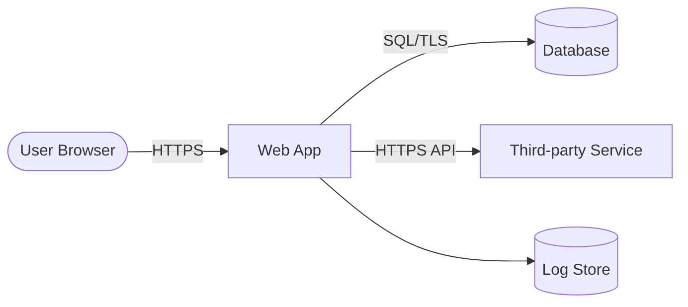
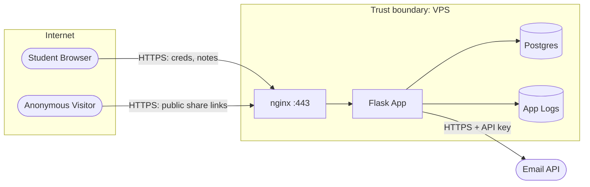

# Threat Model Template

Hub: [[Security-Engineering-OS]]

> **Template vs concept:** the method (four questions, DFDs, trust boundaries, STRIDE) is explained in [[Threat-Modeling-STRIDE]]; complementary techniques: Attack Trees, MITRE ATTACK.

> Defensive design exercise: find the threats to **your own system** before an attacker does, and track mitigations to done. Work through the sections in order — you can't enumerate threats against a system you haven't drawn. A filled mini-example for a simple web app is at the bottom; copy this file per project and replace the example with your system.

---

## 1) System Overview

- **Name:**
- **Version / date of this model:**
- **Author(s):**
- **Business goal (what must keep working):**
- **Data classification (highest sensitivity handled):** Public / Internal / Confidential / Regulated (PII, payment, health)
- **In scope:**
- **Out of scope (and why):**
- **Assumptions (things you're trusting without verifying here):**

## 2) Assets — what an attacker would want

| Asset | Where It Lives | Why It's Valuable | C / I / A Priority |
|---|---|---|---|
| User credentials | | | |
| Session tokens / API keys | | | |
| User personal data | | | |
| Business data | | | |
| Service availability | | | |
| Reputation / trust | | | |

## 3) Data Flow Diagram (DFD)

Draw the system before analyzing it. Elements to use:

- **External entity** (rectangle) — users, third-party services, anything you don't control
- **Process** (circle) — your code: web server, API, workers
- **Data store** (parallel lines / cylinder) — databases, caches, file storage, queues, logs
- **Data flow** (arrow) — every request, response, write, read
- **Trust boundary** (dashed line) — every place the level of trust changes

### DFD Checklist

- [ ] Every external entity that touches the system is drawn (users, admins, third-party APIs, monitoring)
- [ ] Every process the data passes through is drawn
- [ ] Every data store is drawn — **including logs, caches, backups, and queues** (commonly forgotten, commonly leaky)
- [ ] Every data flow is labeled with **what data** moves and **what protocol** carries it
- [ ] Trust boundaries drawn at minimum: internet ↔ your infrastructure; app ↔ database; your code ↔ third-party services; user ↔ admin planes
- [ ] Every flow that crosses a trust boundary is identified (these get analyzed first)
- [ ] Authentication points marked on the diagram
- [ ] No "magic" arrows — if you can't say how data gets from A to B, the diagram is incomplete
- [ ] Deployment/CI pipeline considered (it can modify the system — it's part of the attack surface)

Paste or link the diagram here (Mermaid works in Obsidian):

## 4) STRIDE-per-Element Worksheet

Apply each STRIDE category to each DFD element. Not every category applies to every element type — the ✓ map:

| Element Type | S (Spoofing) | T (Tampering) | R (Repudiation) | I (Info Disclosure) | D (DoS) | E (Elevation) |
|---|---|---|---|---|---|---|
| External entity | ✓ | | ✓ | | | |
| Process | ✓ | ✓ | ✓ | ✓ | ✓ | ✓ |
| Data store | | ✓ | ✓ | ✓ | ✓ | |
| Data flow | | ✓ | | ✓ | ✓ | |

Prompt questions per category:

- **Spoofing** — can someone pretend to be this entity/process? How is identity proven?
- **Tampering** — can the data/flow/store be modified without detection?
- **Repudiation** — can an actor deny having done an action? Is there a tamper-resistant log?
- **Information Disclosure** — can data leak in transit, at rest, in logs, in errors, in caches?
- **Denial of Service** — can this element be exhausted, crashed, or locked out?
- **Elevation of Privilege** — can a lower-privilege actor gain higher privilege through this element?

### Worksheet

One row per (element, applicable STRIDE category, threat). Give each threat an ID.

| ID | Element | STRIDE | Threat (attacker does X, causing Y) | Existing Controls | Risk Score (see §5) |
|---|---|---|---|---|---|
| T-01 | | | | | |
| T-02 | | | | | |
| T-03 | | | | | |

## 5) Risk Scoring — Likelihood × Impact

Score each threat: **Risk = Likelihood × Impact** (each 1–3).

| | **Impact 1 — Minor** (nuisance, no data loss) | **Impact 2 — Moderate** (limited data/one user, recoverable outage) | **Impact 3 — Severe** (bulk data breach, full compromise, extended outage) |
|---|---|---|---|
| **Likelihood 3 — High** (easy, automated, internet-exposed) | 3 — Medium | 6 — High | 9 — Critical |
| **Likelihood 2 — Medium** (needs some skill or a foothold) | 2 — Low | 4 — Medium | 6 — High |
| **Likelihood 1 — Low** (needs insider access or chained exploits) | 1 — Low | 2 — Low | 3 — Medium |

**Action policy:**

| Score | Rating | Policy |
|---|---|---|
| 8–9 | Critical | Fix before release / immediately |
| 6 | High | Fix this iteration; interim compensating control now |
| 3–4 | Medium | Schedule; accept only with sign-off |
| 1–2 | Low | Accept and document, revisit next review |

## 6) Mitigation Tracking Table

Every threat from §4 gets a row — including the accepted ones (an accepted risk with no name attached is an unowned risk).

| Threat ID | Risk | Decision (Mitigate / Accept / Transfer / Avoid) | Mitigation / Control | Owner | Due | Status | Verified How |
|---|---|---|---|---|---|---|---|
| T-01 | | | | | | Open / In progress / Done / Accepted | |
| T-02 | | | | | | | |

## 7) Security Test Plan

Tie tests to threats — every High/Critical threat needs at least one test proving the mitigation works.

- **Unit security tests:** (e.g., authz checks return 403 for wrong-user IDs; input validators reject known-bad payloads)
- **Integration tests:** (e.g., session invalidated on logout; rate limits actually trigger)
- **Dynamic testing:** (e.g., ZAP/Burp baseline scan of your own staging environment)
- **Manual abuse-case testing:** (walk each abuse case below against staging)
- **Config checks:** (headers present, TLS config, cloud storage not public)

## 8) Abuse Cases

Write them as user stories from the attacker's perspective — then confirm the model covers them.

1. As an attacker, I ...
2. As a malicious registered user, I ...
3. As someone who stole a user's laptop, I ...

## 9) Review Cadence

- [ ] Re-review on every architecture change (new data store, new third-party, new trust boundary)
- [ ] Scheduled review every ______ months
- **Next review date:**

---
---

# Filled Mini-Example: "CampusNotes" — simple note-sharing web app

*A small Flask app: students register, log in, write notes, optionally share a note via public link. Postgres database, deployed on one VPS behind nginx, sends email via a third-party API.*

## 1) System Overview (example)

- **Name:** CampusNotes v0.3
- **Business goal:** students can store and selectively share notes
- **Data classification:** Confidential (emails, password hashes, private note content)
- **In scope:** web app, DB, nginx, email API integration
- **Out of scope:** VPS provider's hypervisor, email provider internals (transferred trust — covered by their terms)
- **Assumptions:** OS is patched (covered by Linux-Security-Cheat-Sheet checklist); TLS certs via Let's Encrypt auto-renew

## 2) Assets (example)

| Asset | Where It Lives | Why Valuable | C/I/A |
|---|---|---|---|
| Password hashes | Postgres `users` table | Credential stuffing against other sites | C |
| Session cookies | Browser + server session store | Full account takeover | C |
| Private notes | Postgres `notes` table | Personal/academic data | C, I |
| Email API key | Server env var | Spam sending, provider account abuse | C |
| Availability | Whole stack | Students lose notes access at exam time | A |

## 3) DFD (example)

Trust boundaries: Internet ↔ nginx; Flask ↔ Postgres (localhost); Flask ↔ Email API (third party).

## 4) STRIDE Worksheet (example, abridged)

| ID | Element | STRIDE | Threat | Existing Controls | Risk |
|---|---|---|---|---|---|
| T-01 | Student Browser (ext. entity) | S | Attacker brute-forces login to impersonate a student | Password hashing only — no rate limit | 3×3 = **9 Critical** |
| T-02 | Flask App (process) | E | Logged-in user edits another user's note by changing `note_id` in URL (IDOR) | None — query doesn't check owner | 3×2 = **6 High** |
| T-03 | HTTPS flow user↔nginx | I | Token/note interception if TLS misconfigured or HTTP allowed | TLS enabled; HTTP not redirected | 1×3 = **3 Medium** |
| T-04 | Postgres (data store) | I | SQL injection in note search leaks all notes | Some queries use string formatting | 2×3 = **6 High** |
| T-05 | App Logs (data store) | I | Passwords/tokens written to logs on failed requests | Unreviewed logging calls | 2×2 = **4 Medium** |
| T-06 | Flask App (process) | D | No pagination + public share links let a scraper exhaust DB connections | None | 2×2 = **4 Medium** |
| T-07 | Email API flow | S/I | API key leaked via repo commit lets attacker send phishing as CampusNotes | Key in env var, but also in `.env` in repo history | 2×3 = **6 High** |
| T-08 | Flask App (process) | R | User claims "I never shared that note" — no audit trail of share events | None | 1×2 = **2 Low** |

## 6) Mitigation Tracking (example)

| Threat ID | Risk | Decision | Mitigation | Owner | Due | Status | Verified How |
|---|---|---|---|---|---|---|---|
| T-01 | 9 | Mitigate | Rate-limit login (5/min/IP + per-account lockout backoff); add Argon2id if not already | Rakshit | This week | In progress | Integration test: 6th attempt returns 429 |
| T-02 | 6 | Mitigate | Add `WHERE owner_id = :current_user` to every note query; central `require_owner()` helper | Rakshit | This week | Open | Unit test: fetching another user's note → 403 |
| T-04 | 6 | Mitigate | Parameterized queries everywhere; grep CI check for f-string SQL | Rakshit | This week | Open | Code review + sqlmap scan of own staging |
| T-07 | 6 | Mitigate | Rotate key; purge from git history; add pre-commit secret scan (gitleaks) | Rakshit | Today | Done | Old key revoked at provider; gitleaks in CI |
| T-03 | 3 | Mitigate | nginx 301 HTTP→HTTPS + HSTS header | Rakshit | Next sprint | Open | curl -I http:// returns 301; header present |
| T-05 | 4 | Mitigate | Logging filter strips `password`, `token` fields; review logging calls | Rakshit | Next sprint | Open | Unit test on log formatter |
| T-06 | 4 | Accept (interim) | nginx `limit_req` on share-link routes; revisit if traffic grows | Rakshit | — | Accepted | Documented here; review next semester |
| T-08 | 2 | Accept | Log share events at INFO as cheap partial control | Rakshit | — | Accepted | — |

## 8) Abuse Cases (example)

1. As an attacker with a leaked password list, I try credential stuffing against `/login`. *(→ T-01)*
2. As a malicious registered user, I iterate `note_id` values to read/edit others' private notes. *(→ T-02, T-04)*
3. As a scraper, I hammer public share links to take the site down before exams. *(→ T-06)*

## 9) Review (example)

- Next review: start of next semester, or immediately if file-upload feature is added (new tampering + malware surface).
