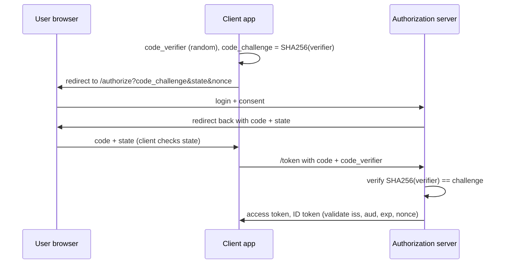

# Authentication Security

Hub: [[Security-Engineering-OS]]

## Password storage

Use a slow, salted, memory-hard KDF: **Argon2id** (preferred) or **bcrypt**. Never plain SHA-256/MD5, never reversible encryption.

```python
from argon2 import PasswordHasher
ph = PasswordHasher()               # argon2id, random salt per hash
stored = ph.hash(password)
ph.verify(stored, attempt)          # raises on mismatch
if ph.check_needs_rehash(stored):   # upgrade parameters over time
    stored = ph.hash(attempt)
```

```java
// Spring Security
PasswordEncoder enc = new Argon2PasswordEncoder(16, 32, 1, 1 << 16, 3);
// or: new BCryptPasswordEncoder(12)
```

Notes: bcrypt truncates input at 72 bytes; check new passwords against breached-password lists; rate-limit and lock out progressively.

## Session management

- Generate session IDs with a CSPRNG; **regenerate on login** and privilege change (prevents session fixation).
- Cookie flags: `Secure`, `HttpOnly`, `SameSite=Lax` or `Strict`, narrow `Path`, `__Host-` prefix.
- Idle and absolute timeouts; server-side invalidation on logout and password change.
- Server-side sessions are easy to revoke; stateless tokens are not.

## JWT validation pitfalls

| Pitfall | Fix |
|---|---|
| `alg: none` accepted | Pin allowed algorithms explicitly |
| **Algorithm confusion** (RS256 -> HS256, public key used as HMAC secret) | Pin algorithm per key; never let the token header choose |
| Missing `exp` / `nbf` check | Require and validate with small clock skew |
| Missing `aud` / `iss` check | Token for service A replayed at service B; validate both |
| `kid` / `jku` header trusted to fetch keys | Only resolve keys from a configured JWKS URL |
| Long-lived tokens, no revocation | Short access tokens + refresh rotation |
| Tokens in `localStorage` | Exposed to XSS; prefer HttpOnly cookies or BFF pattern |

```python
import jwt  # PyJWT
claims = jwt.decode(
    token, public_key,
    algorithms=["RS256"],               # pinned
    audience="orders-api",
    issuer="https://idp.example.com",
    options={"require": ["exp", "iat", "aud", "iss"]},
)
```

## OAuth 2.0 / OIDC with PKCE

OAuth delegates **authorization**; OIDC adds an ID token for **authentication**. Use the Authorization Code flow with **PKCE** for all clients (implicit flow is deprecated).



Checklist: exact-match redirect URIs, validate `state` (CSRF) and `nonce` (replay), minimal scopes, rotate refresh tokens, do not use access tokens as proof of identity (use the ID token).

## MFA

- Phishing-resistant first: **WebAuthn / passkeys / FIDO2** (origin-bound).
- TOTP is good; SMS is weakest (SIM swap) but better than nothing.
- Defend against MFA fatigue (push bombing): number matching, rate limits.
- Recovery flows are the weak link: protect them as strongly as login.

## Detection

- Credential stuffing: many usernames from few IPs, high failure ratio.
- Impossible travel, new device + sensitive action.
- Token replay: same JWT `jti` from different clients; refresh token reuse (revoke the family).
- Repeated MFA push denials.

## Tradeoffs

- Argon2 cost vs. login latency and DoS risk: tune to hardware, rate-limit.
- Stateless JWT scales but revocation is hard; sessions are revocable but need shared storage.
- Strict SameSite breaks some cross-site flows (SSO returns); `Lax` is the usual default.

## Interview Q&A

**Q: Explain JWT algorithm confusion.**
A: If a verifier accepts the algorithm from the token header, an attacker can sign an HS256 token using the server's RSA *public* key as the HMAC secret. Fix: pin algorithms per key.

**Q: Why PKCE even for confidential clients?**
A: It binds the code to the client instance that started the flow, defeating authorization-code interception and injection.

**Q: Why regenerate the session ID at login?**
A: Prevents session fixation, where an attacker plants a known ID before the victim authenticates.

**Q: bcrypt vs Argon2id?**
A: Both are slow salted KDFs; Argon2id is also memory-hard, raising cost for GPU/ASIC cracking. bcrypt has a 72-byte limit.
