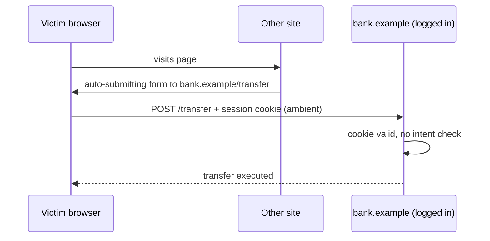

# CSRF

Hub: [[Security-Engineering-OS]]

## Mechanism

Browsers attach cookies automatically. If a state-changing endpoint trusts the cookie alone, a page on another site can make the victim's browser send an authenticated request the victim never intended.



CSRF needs: cookie/ambient auth, a state-changing action, and predictable parameters. Pure bearer-token APIs (Authorization header set by JS) are not vulnerable in the classic sense.

## Prevention

1. **SameSite cookies:** `Lax` (browser default in modern Chromium when unset) blocks cookies on cross-site POSTs; `Strict` blocks all cross-site sends. Set it explicitly; do not rely on browser defaults.
2. **Synchronizer token:** per-session random token in a hidden field/header, verified server-side.
3. **Double-submit cookie** (signed, bound to session) for stateless apps.
4. **Check `Origin` / `Sec-Fetch-Site`** headers on state-changing requests.
5. Never change state on `GET`.
6. Re-authenticate for high-risk actions (password change, payouts).

Framework defaults: Django (`CsrfViewMiddleware`), Spring Security (CSRF on by default for session apps), Rails (`protect_from_forgery`), ASP.NET Core antiforgery. The common bug is **disabling it** globally to fix an API issue.

```java
// Spring: keep CSRF on for browser session endpoints; disable only for stateless token APIs
http.csrf(csrf -> csrf.ignoringRequestMatchers("/api/token-auth/**"));
```

- [ ] Session cookies set `SameSite=Lax` or `Strict` explicitly
- [ ] CSRF middleware enabled for all cookie-authenticated routes
- [ ] No state change on GET
- [ ] CORS does not reflect arbitrary origins with credentials

## Detection

- Review for `csrf_exempt`, `csrf().disable()`, state-changing GET routes.
- Logs: state-changing requests with foreign `Origin`/`Referer` or `Sec-Fetch-Site: cross-site`.
- DAST checks for missing tokens.

## Tradeoffs

- `Strict` breaks inbound links landing logged-in; `Lax` is the usual balance.
- Tokens add complexity for SPAs/caching; `Origin` checks are simpler but must handle missing headers.
- SameSite does not protect against same-site attackers (e.g. a compromised sibling subdomain).

## Interview Q&A

**Q: Does CORS prevent CSRF?**
A: No. CORS controls whether a script can *read* the response; a simple cross-site form POST is still sent.

**Q: Is SameSite=Lax enough?**
A: It removes most cross-site POST CSRF, but not GET-based state changes, same-site attackers, or old browsers. Keep tokens for defense in depth.

**Q: Why are JWT-in-header APIs not CSRF-prone?**
A: The browser does not attach the header automatically; an attacker site cannot read the token to set it.
