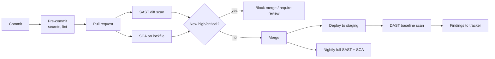

# SAST, DAST and SCA

Hub: [[Security-Engineering-OS]]

## Mechanism

| Tool class | Looks at | Finds well | Misses |
|---|---|---|---|
| **SAST** (static) | Source / bytecode, taint flow source -> sink | Injection sinks, hardcoded secrets, weak crypto APIs, unsafe deserialization | Config/runtime issues, business-logic flaws; false positives on sanitized paths |
| **DAST** (dynamic) | Running app over HTTP | Reflected XSS, missing headers, auth/session misconfig, exposed endpoints | Code it cannot reach; needs auth setup; slow |
| **SCA** (composition) | Manifests, lockfiles, SBOM | Known CVEs in dependencies, license issues, outdated packages | Whether the vulnerable function is actually reachable (unless reachability analysis) |

Related: **IaC scanning** (Terraform/K8s misconfig), **container image scanning**, **secret scanning** ([[Secrets-Management]]).

## CI integration

Principles:
- **Scan the diff on PRs** (fast, relevant to the author); full scans nightly.
- **Gate only on new, high-confidence, high-severity** findings. Gating on the whole backlog stalls delivery and teaches people to bypass.
- Output a standard format (SARIF) so results land in one dashboard / code-review UI.
- Generate an **SBOM** per build so you can answer "are we affected?" when a new CVE drops.
- Pin dependencies with lockfiles; automate update PRs.

## Triage

1. **Is it real?** Trace source -> sink; check for sanitization the tool missed.
2. **Is it reachable?** Exposed endpoint? Vulnerable dependency function actually called?
3. **Impact and exploitability** -> priority (see [[Vulnerability-Assessment]]).
4. **Decide:** fix, mitigate, or accept with an expiry date and owner. Never silent-suppress.
5. **Tune:** suppressions live in code with a justification comment; recurring false positives become rule changes.

- [ ] Every suppression has a reason and owner
- [ ] Accepted risks have an expiry
- [ ] Metrics tracked: open criticals, mean time to remediate, false-positive rate

## Detection value vs. prevention value

SAST/SCA are shift-left **prevention**; DAST and runtime monitoring are closer to **detection**. None replace manual review of authorization and business logic (IDOR, workflow bypass).

## Tradeoffs

- SAST: early and cheap per finding, but noisy; developer trust erodes quickly with false positives.
- DAST: low false positives, but late in the cycle and coverage depends on crawling and auth.
- SCA: high signal for known CVEs, but many findings are unreachable; reachability tooling helps but is language-dependent.
- Blocking gates improve hygiene but add friction; start in report-only mode, then gate.

## Interview Q&A

**Q: SAST vs DAST in one line?**
A: SAST reads the code without running it (white-box); DAST attacks the running app from outside (black-box).

**Q: Your SCA tool reports 400 CVEs. What do you do?**
A: Deduplicate by package, filter to reachable/runtime deps, prioritize by exploitation evidence (KEV/EPSS) and exposure, fix by upgrading shared base packages first.

**Q: How do you stop scanners being ignored?**
A: Scan diffs, gate only on new high-confidence issues, put results in the PR, and tune rules aggressively.

**Q: What does an SBOM buy you?**
A: A per-build inventory so a new CVE can be matched to affected services in minutes.
