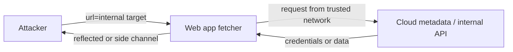

# SSRF

Hub: [[Security-Engineering-OS]]

## Mechanism

Any feature where the server fetches a URL supplied or influenced by a user (webhooks, URL previews, PDF renderers, image imports, XML external entities) can be steered to **internal** targets the attacker cannot reach directly: admin panels, internal APIs, databases, and the cloud **instance metadata service** (IMDS at `169.254.169.254`), which can return temporary IAM credentials.



Why it matters in cloud: the server's network position and IAM role become the attacker's. A single SSRF can pivot to storage buckets or control-plane APIs.

## Prevention

1. **Avoid user-supplied URLs** where possible (pick from known integrations, upload files instead).
2. **Allowlist** destination hosts/schemes (`https` only); do not denylist (bypassable via redirects, IPv6, decimal IPs, DNS tricks).
3. **Resolve then validate:** resolve DNS, reject private, loopback, link-local, and metadata ranges, and **connect to the validated IP** (prevents DNS rebinding TOCTOU). Re-validate on each redirect or disable redirects.
4. **Egress controls:** fetchers run in an isolated subnet/proxy with outbound allowlist; block `169.254.169.254` and internal CIDRs at the network layer.
5. **IMDSv2** (AWS): session-token-based, requires a `PUT` with a custom header, and hop limit 1 blocks containers/forwarders. Enforce `HttpTokens=required`. Other clouds require a metadata header (e.g. `Metadata-Flavor: Google`).
6. **Least-privilege** instance roles, so stolen credentials are low value.
7. Disable XML external entities in parsers.

```python
import ipaddress, socket
from urllib.parse import urlparse

ALLOWED_HOSTS = {"api.partner.example"}

def validate(url: str) -> str:
    u = urlparse(url)
    if u.scheme != "https" or u.hostname not in ALLOWED_HOSTS:
        raise ValueError("destination not allowed")
    for info in socket.getaddrinfo(u.hostname, 443):
        ip = ipaddress.ip_address(info[4][0])
        if ip.is_private or ip.is_loopback or ip.is_link_local or ip.is_reserved:
            raise ValueError("internal address")
    return url   # then fetch with redirects disabled, pinned to the checked IP
```

- [ ] URL fetch features inventoried
- [ ] Host allowlist + scheme restriction
- [ ] Redirects disabled or re-validated
- [ ] Egress proxy / firewall blocks metadata and internal ranges
- [ ] IMDSv2 enforced, hop limit 1
- [ ] Instance roles least-privilege

## Detection

- Outbound requests from app servers to metadata IP or internal ranges (VPC flow logs, proxy logs).
- Cloud audit logs: instance-role credentials used from outside the instance/VPC (e.g. AWS GuardDuty has findings for this).
- Unusual schemes (`file://`, `gopher://`) or internal hostnames in URL parameters.

## Tradeoffs

- Strict allowlists limit product features like arbitrary webhooks; use an egress proxy for those.
- IP validation is subtle (IPv6, IPv4-mapped IPv6, redirects); network-layer controls are the reliable backstop.

## Interview Q&A

**Q: Why is SSRF rated so highly in cloud environments?**
A: The metadata service can hand out the instance's IAM credentials, turning a web bug into cloud account access.

**Q: How does IMDSv2 mitigate SSRF?**
A: It requires a PUT to obtain a session token and a header on each request; most SSRF primitives only control a GET URL. Hop limit 1 stops forwarding through containers/proxies.

**Q: Why is a denylist of 127.0.0.1 insufficient?**
A: Alternate encodings, IPv6, DNS names resolving to internal IPs, rebinding, and redirects bypass it.
