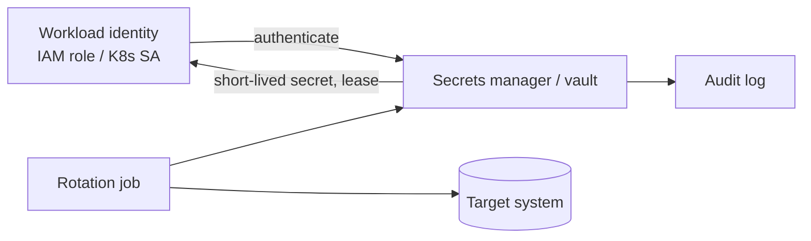

# Secrets Management

Hub: [[Security-Engineering-OS]]

## Mechanism

A secret (API key, DB password, signing key, token) grants whatever its identity is allowed to do. Risk = **exposure paths x lifetime x privilege**. Good secrets management shrinks all three.

## Storage

- Use a secrets manager (e.g. HashiCorp Vault, AWS Secrets Manager, GCP Secret Manager, Azure Key Vault) rather than env files in repos or config baked into images.
- Authenticate workloads with **platform identity** (IAM roles, workload identity, K8s service accounts) instead of a bootstrap secret.
- Prefer **dynamic, short-lived credentials** (vault-issued DB creds, STS tokens, OIDC federation from CI to cloud) over long-lived static keys.
- Encrypt at rest with a KMS; separate who can read secrets from who can administer the vault.
- Keep secrets out of logs, error messages, crash dumps, and client bundles.

## Rotation

- Automate rotation; manual rotation does not happen on schedule.
- Support **two valid versions** during rollover (dual-key) to avoid downtime.
- Rotate immediately on: suspected leak, staff departure with access, vendor breach.
- Track secret age; alert on keys older than policy.

## Detection of leaked secrets

- **Pre-commit hooks** (e.g. gitleaks, detect-secrets, trufflehog) block secrets before they enter history.
- **CI / server-side scanning** as a backstop, since hooks can be skipped locally.
- **Platform push protection** (e.g. GitHub secret scanning) where available.
- **History scans** on onboarding a repo: secrets in old commits are still exposed.
- Canary / honeytokens: fake credentials whose use triggers an alert.
- Cloud audit logs: use of a key from unexpected IPs/regions.

## Response to a leaked secret

1. **Revoke/rotate first.** Deleting the commit does not help; forks, clones and caches keep it.
2. Review audit logs for use of the credential during the exposure window.
3. Then clean history if needed and document in the incident ([[Incident-Response-Playbook]]).

- [ ] Pre-commit secret scanner configured
- [ ] CI secret scan blocks merges
- [ ] No long-lived cloud keys in CI (use OIDC federation)
- [ ] Rotation automated with age alerts
- [ ] Leak runbook: revoke, investigate, clean

## Tradeoffs

- Vaults add a runtime dependency; cache leases and plan for vault outage.
- Short TTLs improve safety but increase renewal load and failure modes.
- Secret scanners produce false positives on test fixtures; allowlist with care.

## Interview Q&A

**Q: A developer pushed an AWS key to a public repo. First step?**
A: Deactivate/rotate the key immediately, then check CloudTrail for its use, then clean up history.

**Q: Why are env vars not a full answer?**
A: They leak via process listings, crash dumps, debug endpoints and child processes, and still need a secure source and rotation.

**Q: How does CI access cloud without stored keys?**
A: OIDC federation: the CI job presents a signed identity token and exchanges it for short-lived cloud credentials scoped to that repo/branch.
